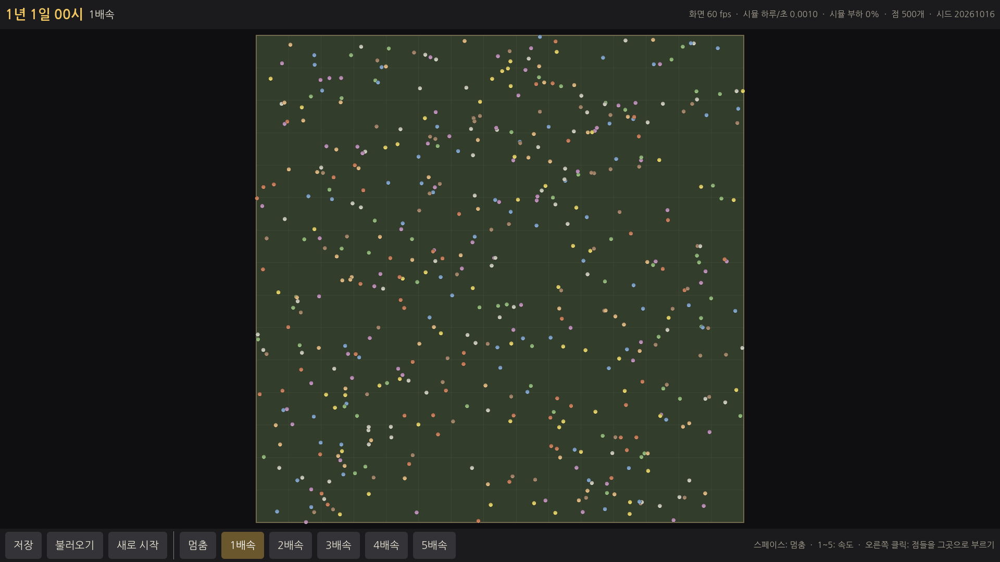
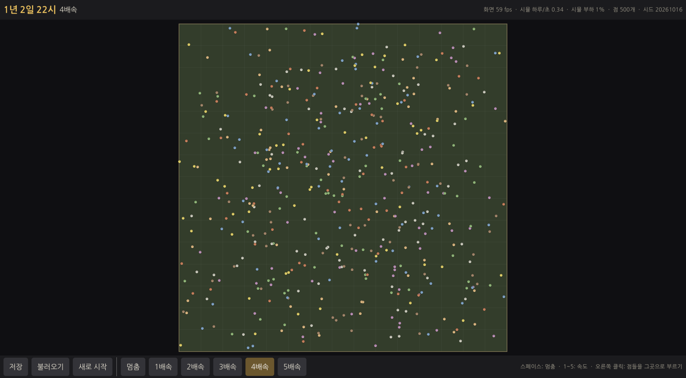

# E0 바탕 — 보고서

## 쉬운 말 다섯 줄
1. 앞으로 모든 단계가 기대어 설 **게임의 뼈대**를 만들었습니다. 아직 행성이나 사람은 없고, 시험용 **점 500개**가 지도 위를 걸어 다닙니다.
2. 점들은 "언제 출발해서 언제 도착한다"는 일정을 가지고 있고, 화면은 그 일정을 보고 **매 순간 부드럽게** 그립니다. 그래서 계산이 바빠도 화면은 끊기지 않습니다.
3. 속도는 **멈춤 · 1배속 ~ 5배속**. 가장 빠른 5배속에서도 계산은 컴퓨터 힘의 7% 정도만 씁니다.
4. **저장 → 더 돌림 → 불러오기** 를 하면 점들이 저장한 그 자리, 그 시각으로 정확히 돌아옵니다(시험으로 확인). 같은 시드면 몇 번을 다시 해도 똑같은 결과가 나옵니다.
5. 윈도우에서 바로 실행되는 **zip 파일**을 만들었습니다. 따로 설치할 것은 없고, 한글도 깨지지 않습니다.

## 해 볼 것
1. zip 을 풀고 `WTW` 폴더 안의 **`WTW.exe`** 를 실행합니다. 윈도우가 "PC 보호" 경고를 띄우면 **"추가 정보 → 실행"** 을 누르세요(서명하지 않은 파일이라 처음 한 번 나옵니다).
2. 점들이 **부드럽게** 움직이는지 봅니다. 1배속에서 특히 뚝뚝 끊기지 않는지 봐 주세요.
3. 키보드 **1 ~ 5** 로 1배속 ~ 5배속을 바꿔 보고, **스페이스** 로 멈췄다 풀어 봅니다. (아래 막대의 단추로도 됩니다.)
4. 아래 **[저장]** → 조금 더 돌림 → **[불러오기]** → 점들과 위쪽 날짜가 저장한 때로 돌아오는지 봅니다.
5. 위쪽 날짜가 **"1년 1일 00시"** 처럼 나오고, 시간이 흐르면 시·일이 넘어가는지 봅니다. (4배속이면 하루가 3초)
6. (덤) 지도 위에서 **오른쪽 클릭** → 점들이 하던 일을 멈추고 그곳으로 모입니다. **[새로 시작]** 은 새 시드로 처음부터.
7. 창 크기를 바꾸거나 최대화해도 화면이 깨지지 않는지 봅니다. 위쪽 오른편의 "화면 ○○ fps" 가 60 근처인지도 알려 주세요.

---

## 한 일

### 저장소 구성
```
sim/            Wtw.Sim        .NET 8 클래스 라이브러리 (Godot 참조 없음)
sim.tests/      Wtw.Sim.Tests  xUnit — Trait("Category","Fast"/"Slow")
tools/bench/    Wtw.Bench      측정 도구 + baseline.json
tools/*.sh      setup · env · build · test · screenshot · export-windows · test-windows-exe
game/           Godot 4.5.1 .NET 프로젝트 (sim 을 프로젝트 참조)
data/           properties.json · materials.json (견본)
Wtw.sln         sim + 테스트 + 측정 도구
.github/workflows/ci.yml   PR 마다 빌드 + 빠른 테스트 + 윈도우 zip(결과물)
.claude/settings.json      SessionStart 훅 → tools/setup.sh (클라우드 세션에서만)
```

### 시뮬 코어 (`sim/`)
| 부분 | 파일 | 내용 |
|---|---|---|
| 안정 해시 | `Core/StableHash.cs` | 문자열 = UTF-8 FNV-1a 64 + SplitMix64 마무리. 값을 테스트에 박아 둠(파이썬으로 따로 계산해 같음을 확인) |
| 난수 | `Core/Pcg32.cs`, `Core/RngStreams.cs` | PCG32(공식 예제 출력과 같음). 스트림 = (이름 × 지방) → (세계 시드, 이름, 지방) 해시로 시드. 상태 저장/복원 |
| 시계 | `Time/GameTime.cs` | 1시간 2,500틱 · 하루 60,000틱 · 1년 40일. 0틱 = 1년 1일 0시 0분. 틱 ↔ 년·일·시·분, "1년 3일 07시" 표시 |
| 예약 계산기 | `Scheduling/Scheduler.cs` | (시각, 예약 순번) 최소 힙. 같은 시각은 예약한 순서. 취소 · 당김(Reschedule) · 정렬된 내보내기 |
| 세계 | `World/GameWorld.cs` | 시드 · 시계 · 지방 목록(빈 것) · 엔티티 아이디(1부터 차례) · 스트림 · 예약 · 개입 기록. 하루 경계 훅(그 시각 예약보다 먼저) |
| 개입 기록 | `World/Intervention.cs` | (시각, 종류, 값). 시작 기록 = 시드 + 설정 + 개입 기록 → `GameWorld.Replay` 로 똑같이 다시 만듦 |
| 저장 | `Persistence/SaveGame.cs` | "WTWS" + 버전 1. 순서가 정해진 것만 써서 같은 상태 = 같은 바이트 |
| 데이터 | `Data/ContentData.cs` | `data/*.json` 읽기 + 검사(겹치는 아이디 · 없는 아이디 참조 · 필수 칸 · 값 범위 · JSON 문법). 예: "materials.json 의 3번째 항목(a): 아이디 'a' 가 1번째 항목과 겹칩니다." |
| 점 | `Movers/Leg.cs`, `Dot.cs`, `DotField.cs` | 구간 = 출발 시각 · 도착 시각 · 꺾인 선(점 2~4개). 시뮬 안은 정수만, 화면은 같은 일정으로 실수 보간. 도착 시각에 다음 출발을 예약. E3 사람 걷기가 이 구조를 쓴다 |
| 스냅샷 | `Runtime/WorldSnapshot.cs` | 화면용 읽기 전용 사본. 세 칸 버퍼(잠금 없음) — 시뮬도 화면도 서로를 기다리지 않는다 |
| 시뮬 스레드 | `Runtime/SimHost.cs` | 별도 스레드. 화면 시계가 dt×속도로 가고 시뮬에게 "0.05초 앞까지 계산해 둬" 라고 목표를 준다. 시뮬이 늦으면 화면이 기다릴 뿐 뛰어넘지 않음. 저장·불러오기·새로 시작은 시뮬 스레드가 처리 |
| 속도 | `Runtime/Speed.cs` | 초당 틱: 1배속 60 · 2배속 180 · 3배속 360 · 4배속 20,000(하루 3초) · 5배속 150,000(하루 0.4초) |

### 화면 (`game/`)
- `Main.cs` 시작점 · 입력(스페이스, 1~5, F5 저장, F9 불러오기, 오른쪽 클릭) / `MapView.cs` 지도 + 점(MultiMesh 로 한 번에 그림, 매 프레임 보간) / `Hud.cs` 위 막대(날짜 · 속도 · fps · 시뮬 하루/초 · 시뮬 부하) + 아래 메뉴 막대(저장 · 불러오기 · 새로 시작 · 속도 단추) / `UiTheme.cs` 글꼴 · 글자 크기 · 색 · 창 모양 한 곳 / `Art.cs` 그림 공급 한 곳(지금은 코드로 그린 원) / `AutoPilot.cs` 클라우드 자동 확인용(스크린샷 · 게임 안 저장/불러오기 자체 시험 · 프레임 통계).
- 한글 글꼴: 나눔고딕(OFL, `game/fonts/OFL.txt`, zip 에도 라이선스 파일 포함).
- 1920×1080 기준, `canvas_items` + `expand` 로 창 크기를 바꿔도 지도는 정사각형 그대로 가운데에.
- 저장 위치: `%APPDATA%\WTW\saves\quicksave.wtw` (한 칸).

### 빌드와 전달
- `tools/setup.sh`: .NET 8 SDK(apt, 안 되면 dotnet-install) · Godot 4.5.1 mono(리눅스) · 윈도우 내보내기 템플릿(윈도우 것만 남김). 있으면 건너뜀. 처음 약 1분 30초.
- `tools/export-windows.sh E0` → `dist/WTW-E0-windows.zip` (68MB). 안에 `WTW/WTW.exe` + `.NET` 실행 파일 일체(self-contained) + 읽어보기 + 글꼴 라이선스.
- `tools/test-windows-exe.sh`: **내보낸 윈도우 exe 를 Wine 으로 실제로 띄워** 게임 안 저장/불러오기 시험 + 스크린샷. (진짜 윈도우는 아니지만 "exe 가 .NET 과 함께 뜨고 돌아간다" 는 확인)
- CI(`.github/workflows/ci.yml`): PR 마다 빌드 + 빠른 테스트, 그다음 윈도우 zip 을 만들어 Actions 결과물(WTW-windows)로 올림.

## 측정 결과 (목표 대비)

| 항목 | 목표 | 결과 |
|---|---|---|
| 빠른 테스트 | 전부 통과, 수 초 | **44개 통과, 약 1초** |
| 느린 테스트 | 단계 끝 한 번 | **1개 통과, 약 6초** (점 500개 120일, 10일마다 저장→불러오기, 30일마다 개입 → 끊김 없이 돌린 것과 바이트까지 같음, 시작 기록 재생도 같음) |
| 헤드리스 점 500개 하루/초 | 기록해서 기준으로 (목표 수치 없음) | **125.4 하루/초** (시드 20개 중앙값, 100일, 4개 동시) → `tools/bench/baseline.json`. 같은 조건 반복 측정이 **95 ~ 146** 사이로 흔들림. 한 코어에 시드 하나만 돌리면 약 100 하루/초 |
| 예약 한 번 평균 | — | 0.36µs (하루당 예약 약 22,000개 = 점 하나당 44개) |
| 메모리 | — | 측정 도구 프로세스 최대 176MB (세계 4개 동시), 하나면 104MB |
| 5배속에 필요한 계산 | 하루 0.4초 = 2.5 하루/초 | 게임 화면에서 **2.54 하루/초, 시뮬 부하 7%** (계산 여유 약 40배) |
| 화면 fps (점 500개) | 60 근처 | 클라우드 가상 화면(그래픽 카드 없이 CPU 로 그림): 1배속 평균 54, 5배속 평균 57, 99% 프레임이 29ms 이하. 윈도우 exe(Wine): 52~58. **진짜 윈도우 PC 에서는 아직 못 잼** — 해 볼 것 7번으로 부탁 |
| 끊김 | 1배속에서 뚝뚝 끊기지 않음 | "시뮬이 늦어 화면이 기다린 프레임" = 시작 첫 프레임 1개뿐(8초 동안 약 400프레임 중) |
| 저장→불러오기→계속 | 같은 결과 | 테스트(바이트 단위 같음) + **게임 화면 안 자체 시험**: 저장 시각과 불러온 뒤 시각이 같고 점 500개 위치 차이 0 (리눅스 빌드와 윈도우 exe 둘 다) |
| 한글 | 깨지지 않음 | 스크린샷 확인 |

### 스크린샷
- 1배속: `docs/reports/E0/screen-1x.png`
- 5배속: `docs/reports/E0/screen-5x.png`
- 윈도우 exe 를 Wine 으로 실행: `docs/reports/E0/windows-exe-wine.png`




## 기획과 다르게 한 것 / 이유
1. **그리기 방식을 "호환(Compatibility, OpenGL)" 으로 정함.** 기획서에는 없던 기술 선택. 2D 에 충분하고, 오래된 그래픽 카드에서도 잘 뜨고, 클라우드 가상 화면에서 스크린샷을 찍을 수 있어서. 3D 지구본(E1)에서 부족하면 그때 바꿀 수 있다(설정 한 줄).
2. **시험 지도는 네모 150×150.** 육각 지방은 E2 의 일. 점의 움직임 시험에는 모양이 상관없어서.
3. **오른쪽 클릭 "점들을 그곳으로 부르기" 를 덧붙임.** 프롬프트에는 없다. 개입 기록과 "예약 끊기(급한 일)" 를 게임 화면에서 직접 해 볼 수 있게 하려고. 저장 파일과 시작 기록에 남는다.
4. **F5 = 저장, F9 = 불러오기** 단축키를 덧붙임.
5. **데이터 견본에 "becomes"(무엇을 하면 무엇이 된다) 칸을 만듦.** "없는 아이디 참조" 검사를 시험하려고. E4 에서 진짜 형식을 정할 때 바꿔도 된다.
6. **측정 도구의 "빨라짐/느려짐" 기준을 ±20%** 로 둠. 이 클라우드 컴퓨터는 같은 측정을 반복해도 ±20% 가까이 흔들려서, ±10% 로 두면 매번 틀린 경보가 난다.
7. 점의 걷는 빠르기는 1배속에서 초당 2.5~5타일(림월드 사람과 비슷하게)로 정함.

## 알려진 문제 · 다음 단계에 넘길 것
- **진짜 윈도우 PC 에서의 fps 와 부드러움은 아직 확인 못 함.** 클라우드에는 윈도우가 없어 Wine 으로만 띄워 봄. 사용자의 결과(해 볼 것 2·7번)를 받아야 확정.
- 클라우드의 fps 50 대는 그래픽 카드 없이 CPU 로 그려서다(시뮬 부하는 7%). 진짜 PC 에선 화면 주사율(보통 60)에 맞을 것으로 본다.
- **5배속에서 점이 거의 순간이동처럼 보인다.** 걷기 한 번이 실제 1초도 안 걸리는 속도라서 당연하다. 기획대로 4~5배속은 지구본(E1)에서 보는 속도.
- zip 이 68MB(풀면 약 170MB): Godot 엔진 + .NET 실행 파일 일체가 들어 있어서. 줄이려면 나중에 엔진 기능을 덜어낸 템플릿을 쓸 수 있다(급하지 않음).
- 저장은 한 칸(quicksave)뿐. 여러 칸 · 저장 창은 필요할 때(아마 E3 이후).
- 화면은 시뮬보다 최대 0.05초(실제 시간) 뒤를 보여 준다. 달리는 중에 저장하면 그 0.05초 앞의 상태가 저장된다(5배속에서 게임 시간 몇 시간). 멈춘 뒤 저장하면 정확히 보이는 그대로 저장된다.
- 클라우드 세션 시작 때 `tools/setup.sh` 가 자동으로 돈다(처음 약 1분 30초). Wine 은 무거워서 자동 설치에 넣지 않았고, `tools/test-windows-exe.sh` 가 필요할 때 깐다.
- E1 에 넘길 것: 지구본은 3D 라 지금의 2D 화면 구조(MapView) 옆에 새 보기를 만들고, 스냅샷에 행성 정보를 더하면 된다. 하루 경계 훅(`GameWorld.DayBoundary`)과 지방별 스트림(`RngStreams.Get(이름, 지방)`)은 이미 있다.
