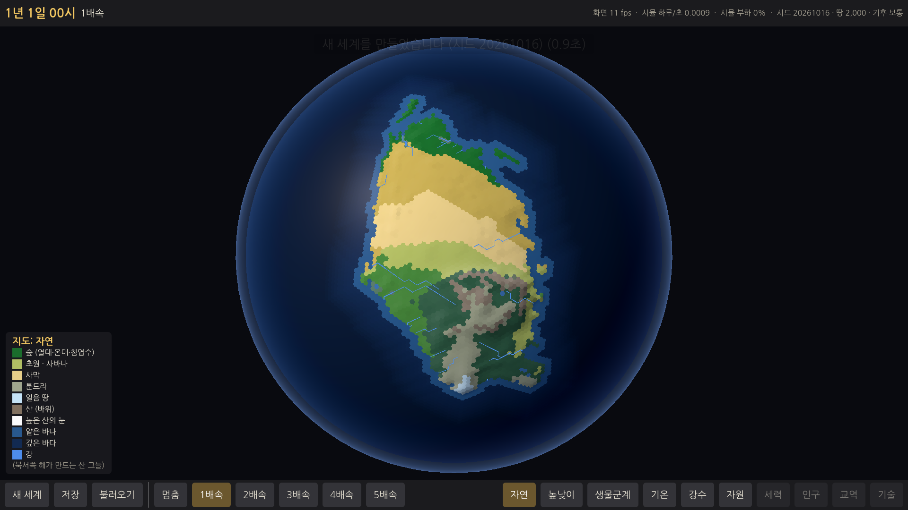
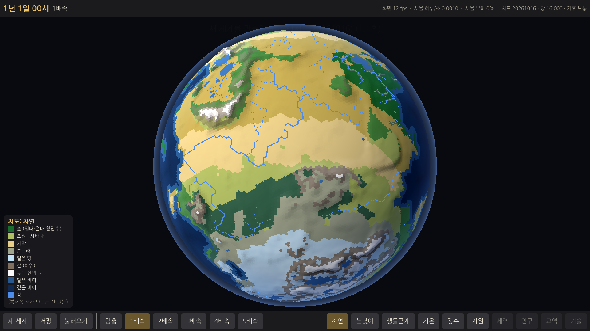
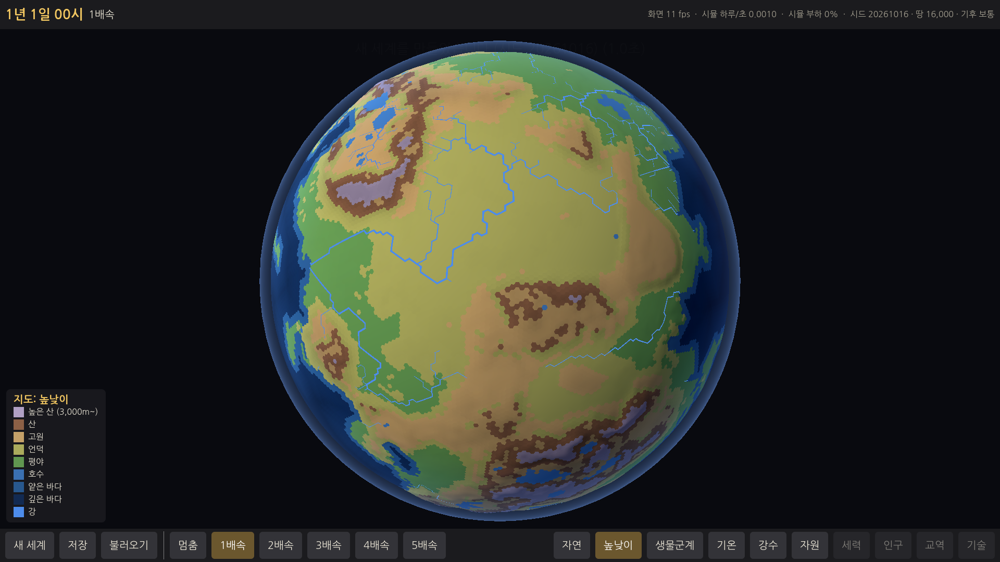
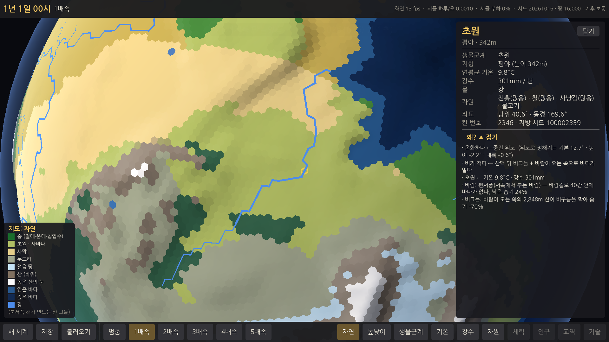

# E1 행성 — 보고서

## 쉬운 말 다섯 줄
1. 게임을 켜면 **새 세계 화면**이 나오고, [만들기]를 누르면 약 1초 만에 **둥근 지구본 행성**이 만들어집니다. 같은 시드(행성 번호)면 언제나 똑같은 행성입니다.
2. (검토 뒤 고침) 땅은 이제 **행성의 한쪽 면에 모입니다.** 땅이 적으면 한 면만 봐도 땅 전체가 보이고 나머지는 모두 바다, 땅을 늘리면 같은 땅이 그 둘레로 넓어집니다. 땅의 양은 **1,000~30,000칸**에서 고르거나 직접 넣을 수 있습니다.
3. 땅은 남북으로 길어서, 작은 땅에서도 **더운 곳(사막·열대)부터 추운 곳(툰드라·얼음)까지** 걸칩니다.
4. 기본 지도는 **자연스러운 색(생물군계 + 산 그늘)**, 칸 사이 선은 없앴고, 칸을 누르면 정보 창이 나오고 **"왜?"는 눌러야 펼쳐집니다.** 지도는 자연 · 높낮이 · 생물군계 · 기온 · 강수 · 자원 여섯 가지입니다.
5. 아쉬운 점: 땅을 한쪽에 모으면서 **섬이 작아져 큰 대륙이 땅의 약 97%** 입니다(기획은 70~85%). 섬 수(3~8개)는 대체로 맞습니다. 또 클라우드에는 그래픽 카드가 없어 **화면 부드러움(fps)은 윈도우 PC에서 확인**이 필요합니다.

## 해 볼 것
1. zip 을 풀고 `WTW` 폴더의 **`WTW.exe`** 를 실행합니다. 윈도우가 "PC 보호" 경고를 띄우면 **"추가 정보 → 실행"** 을 누르세요(서명하지 않은 파일이라 처음 한 번 나옵니다).
2. 새 세계 화면에서 땅의 양 **2,000** 을 누르고 [만들기] → 지구본을 돌리지 않아도 **땅 전체가 한 화면에** 보이는지, 북쪽(또는 남쪽) 끝이 툰드라·얼음인지 봅니다.
3. [새 세계] → **시드는 그대로** 두고 땅의 양을 16,000, 24,000 으로 바꿔 만들어 봅니다. 같은 땅이 둘레로 넓어져야 합니다. "직접 입력" 칸에 3000 처럼 숫자를 넣어도 됩니다.
4. **마우스 왼쪽으로 끌어** 돌려 봅니다. 끌다가 **마우스를 멈춘 뒤 놓으면 그 자리에 서고**, 움직이면서 놓으면 조금 더 미끄러져야 합니다. 휠로 가까이·멀리.
5. **땅 칸을 눌러** 정보 창을 봅니다. 칸 사이 선이 없고, 고른 칸에만 금색 테두리가 있는지. **"왜? ▼ 펼치기"** 를 누르면 같은 창 안에서 이유가 펼쳐집니다.
6. 아래 막대의 **자연 · 높낮이 · 생물군계 · 기온 · 강수 · 자원** 을 눌러 봅니다(키보드 Q W E R T Y). 자연 지도에서 사막이 모래색으로 보이는지, 높낮이 지도에서 "높은 산"(보랏빛 회색)과 자연 지도의 "얼음 땅"(옅은 하늘색)이 구분되는지.
7. **[저장]**(달리는 중이어도 먼저 멈춘 뒤 저장합니다) → 조금 돌림 → **[불러오기]** → 같은 행성, 같은 날짜로 돌아오는지.
8. 위쪽 오른편의 **"화면 ○○ fps"** 가 지구본을 돌릴 때 60 근처인지 알려 주세요(클라우드에서는 잴 수 없었습니다).

---

## 한 일

### 1. 측지 육각 격자 (`sim/Planet/GeoGrid.cs`)
- 정이십면체의 면을 72등분 → **51,842 칸 = 육각형 51,830 + 오각형 12**, 칸의 꼭짓점(삼각형) 103,680개.
- 칸 번호 · 이웃 · 꼭짓점 순서는 **정수 규칙으로만** 정함: 0~11 = 정이십면체 꼭짓점(오각형), 다음은 모서리 30개(정렬 순) 위의 점, 다음은 면 20개 안쪽의 점. 이웃은 바깥에서 볼 때 **시계 방향**, 가장 작은 번호의 이웃부터. `Corner[k]` = 이웃 k 와 k+1 사이 꼭짓점.
- 좌표는 사칙연산 + 제곱근만(기계마다 같은 값). 시드와 무관하므로 한 번 만들어 공유.
- **만드는 시간: 0.03초** (클라우드, 한 번만).

### 2. 행성 만들기 (`sim/Planet/PlanetGenerator.cs`)
순서: 모양 → 방향 → 땅/바다 → 높이 → 물길·호수 → 기후 → 강 → 생물군계 → 자원.
- **설정**: 시드 · 땅의 양(단추 2,000 / 4,000 / 8,000 / 16,000(기본) / 24,000, 또는 **1,000~30,000 직접 입력**) · 기후 경향(추움 −4°C / 보통 / 따뜻함 +4°C, 강수 ±10%). 땅의 양을 바꿔도 **같은 행성의 같은 땅 값**에서 경계만 낮춘다(테스트: 2,000 → 16,000 → 24,000 으로 늘릴 때 작은 땅의 99% 이상이 큰 땅 안, 행성 방향도 같음).
- **모양 (검토 뒤 새로 짬)**: 땅 값 = −ln(땅의 중심 L 에서의 거리 × (1 + 해안 잡음)) + 섬 혹.
  - **땅의 중심 L** 은 위도 33~46°(북·남반구 중 하나). 거리는 **남북으로 길쭉하게**(동서 거리를 1.8~2.4배로 셈, 축은 남북에서 ±20° 안팎 기울임) → 가장 작은 땅에서도 더운 쪽(적도 쪽 끝)부터 추운 쪽(극 쪽 끝)까지 걸친다.
  - 땅이 적으면 L 둘레만, 많으면 같은 모양이 둘레로 넓어진다. 굴곡(만·반도)과 해안 잡음은 **중심에서의 거리에 비례**해서 크기와 무관하게 비슷한 들쭉날쭉함.
  - **섬**: "방향 × 거리의 로그" 위에 놓인 드문 혹. 거리의 로그를 쓰므로 무늬가 크기와 무관하게 되풀이돼, 땅이 적든 많든 해안 앞(대륙 크기의 약 1~1.9배 거리)에 섬이 몇 개 있다. 대륙이 커지면 그 섬은 대륙에 붙고 더 바깥의 섬이 떠오른다.
  - 로그는 사칙연산만으로 직접 계산(`DetLog`, `Math.Log` 와 소수 12자리까지 같음을 테스트) — 기계마다 같은 값.
- **땅 칸 수**: 값이 높은 칸부터 정한 수만큼. 너무 작은 땅 조각(땅 칸 수 ÷ 300, 3~40칸 미만)은 바다로, 대양과 떨어진 작은 물(80칸 이하)은 호수로. 호수만큼 모자란 땅은 한 번 다시 나눠 채움 → **마른 땅(호수 제외)이 설정의 ±0.6% 안**.
- **높이**(정수 m): 내륙일수록 높게 + 산맥(능선 잡음 → 가는 줄기) + 고원(넓고 평평) + 언덕 + 드문 분지. 지형 단계: 깊은 바다 · 얕은 바다 · 호수 · 평야 · 언덕 · 고원 · 산 · 높은 산(3,000m~). 바다 깊이는 해안에서 멀수록.
- **물길·호수**: 낮은 곳부터 채워 가는 "우선순위 채우기". 150m 이상 깊은 웅덩이는 호수(한 웅덩이에서 가장 깊은 45칸까지), 얕은 웅덩이는 메움. 평지에서 물길이 자로 그은 직선이 되지 않게 같은 높이일 때는 고정된 난수 순서로 넓힌다.
- **기후**(지역별 고정, 계절 없음):
  - 기온 = 위도(표) + 높이(−6.5°C/1000m) + 내륙(높은 위도는 더 춥게, 열대는 조금 덥게) + 기후 경향. 기후 띠 경계는 크기가 다른 잡음 세 겹으로 위도를 밀어 구불구불하게(작은 대륙 안에서도), 위도대 강수도 ±35% 안팎으로 출렁이게(검토 뒤 고침).
  - 강수 = 위도대 기본(적도 비구름 띠 · 아열대 건조 띠 · 편서풍 띠 · 극지) × 바람이 싣고 온 습기 × 산비탈. **탁월풍**: 위도 0~30° 무역풍(동→서), 30~60° 편서풍(서→동), 60° 이상 극동풍. 칸마다 바람을 거슬러 올라가며 바다까지의 거리와 넘어온 산을 본다 → 땅을 지날수록 마르고, 1,200m 넘는 산을 넘으면 **비그늘**(최대 −70%), 바람을 받는 오르막은 비가 더(최대 +60%).
- **생물군계** 10개: 얼음 · 툰드라 · 침엽수림 · 온대림 · 초원 · 사막 · 사바나 · 열대우림 · 습지 · 고산 (기온 × 강수, 고산은 높은 산, 습지는 평평한 낮은 땅 + 강/호수).
- **강**: 강수 − 증발(기온에 따라)을 물길을 따라 모아, 많이 모인 칸이 개울 · 강 · 큰 강. 칸 사이 선(`Downstream`)으로 바다·호수까지.
- **자원**(칸마다 없음/있음/많음): 돌 · 부싯돌 · 진흙 · 구리 · 주석 · 철 · 소금 · 숲(나무) · 사냥감 · 물고기. 지형과 맞게(진흙 = 강가·호숫가·습지, 구리 = 언덕·고원·산의 광맥, 주석 = 드묾, 소금 = 덥고 마른 해안·사막, 물고기 = 얕은 바다·호수 …). 아이디와 규칙은 **`data/resources.json`** (E4 재료 데이터가 이 아이디를 그대로 씀, 테스트가 시뮬과 같은지 확인).
- **지방 시드**: `Planet.ProvinceSeed(칸)` = (세계 시드, "province", 칸 번호) 스트림의 첫 값. 저장하지 않고 필요할 때 계산.
- **결정론**: 실수 계산은 사칙연산 + 제곱근 + Floor 만(삼각함수 · `Math.Pow` 없음), 결과는 정수(높이 m · 기온 ×10 · 강수 mm · 단계)로 저장하고 시뮬은 정수만 쓴다. 난수는 (세계 시드, "planet.…") 스트림에서만. 행성 지문(칸별 정수 값 전부의 해시)을 **테스트에 박아 둠** → CI(다른 컴퓨터)에서도 같은 값이어야 통과.
- **저장**: 저장 파일 버전 2 — 시드 · 설정(땅 칸 수 · 기후 경향) + "바뀐 칸 수"(지금은 늘 0, 운석 등이 생기면 여기에). 칸 하나하나는 저장하지 않는다. 불러오기 = 다시 만들기(같은 행성이 기억에 있으면 그것). 버전 1(E0) 파일도 읽는다.
- **"왜"** (`sim/Planet/CellReport.cs`): 행성에 저장된 정수(기온의 위도·높이·내륙 몫, 남은 습기 %, 비그늘 % 와 막은 산, 산비탈 %, 바람 종류, 바람길로 바다까지 칸 수)만 읽어 문장을 만든다. 예: "온화하다 ← 중간 위도 (위도로 정해지는 기본 14.5° · 높이 −2.3° · 내륙 −0.8°)", "비가 적다 ← 산맥 뒤 비그늘 + 바람이 오는 쪽으로 바다가 멀다", "비그늘: 바람이 오는 쪽의 2,917m 산이 비구름을 막아 습기 −70%".

### 3. 지구본 화면 (`game/`)
- `GlobeView.cs`: 행성 전체 = **메시 하나**(정점 약 36만, 삼각형 31만). 칸 색은 256×203 텍스처(칸 하나 = 화소 하나)에 담고, 지도 모드를 바꾸면 그 텍스처만 다시 칠한다. **칸 사이 선은 그리지 않고**, 마우스가 올라간 칸(흰 테두리)과 고른 칸(금색 테두리)만 셰이더에서 테두리. 새 세계를 만들면 **땅의 한가운데가 화면 가운데** 오게 돌린다. 산은 살짝 솟게(6,500m = 반지름의 2.8%), 바다는 매끈하게, 꼭짓점 높이는 세 칸의 평균이라 이음매가 없다. 해는 카메라 왼쪽 위에서 따라오고, 가장자리에 옅은 대기 빛.
- 조작: 왼쪽 끌기 = 돌리기(**놓기 직전 0.08초 안에 움직이고 있었을 때만 관성**, 멈춘 채로 놓으면 그 자리에 섬), 휠 = 확대/축소(부드럽게, 가까이 갈수록 천천히 돈다), 누르기 = 고르기(다시 누르면 해제), 화살표 키 = 돌리기, Esc = 창 닫기. 칸 고르기는 광선과 구의 교점에서 이웃을 따라 가장 가까운 칸으로 걸어간다.
- `CellPanel.cs` 칸 정보 창(오른쪽). **"왜?" 는 처음엔 접혀 있고**, "왜? ▼ 펼치기" 를 누르면 같은 창 안에서 펼쳐진다(한 번 펼치면 다른 칸을 눌러도 펼친 채로, 게임을 다시 켜면 접힌 채로 시작). `Legend.cs` 범례(왼쪽 아래, 자원 모드에서는 자원 고르기 단추) — 서로·막대와 겹치지 않는 자리.
- `MapModes.cs`: 지도 모드 6개의 색과 범례를 한 곳에. **자연**(기본) = 생물군계 색 + 산은 바위색 + 높은 산 꼭대기는 눈 + 북서쪽 해가 만드는 산 그늘(이웃과의 높이 차로 비탈 방향을 어림). **높낮이** = 높이 단계만(평야 초록 → 언덕 노랑 → 고원 황토 → 산 갈색 → 높은 산 보랏빛 회색). 얼음 땅은 옅은 하늘색, 높은 산의 눈은 흰색으로 구분. 세력 · 인구 · 교역 · 기술은 단추 자리만(누르면 "아직 없음 — E○부터" 알림).
- `NewWorldScreen.cs`: 시드(직접 입력/무작위) · 땅의 양(단추 5개 + 직접 입력, 범위 밖이면 이유를 알려 줌) · 기후 경향 → [만들기], 만드는 동안 진행 막대(행성은 다른 스레드에서 만든다). 저장 파일이 있으면 여기서 [불러오기]도.
- E0 의 점 시험 화면은 **개발용 F12** 로만 남김(새 세계에는 점이 없음, `--dots=N` 으로만 생김).
- 그리기 방식은 E0 의 **호환(OpenGL) 그대로**. 지구본에 필요한 것(정점 색 대신 텍스처, 셰이더 테두리, 빛)이 모두 된다.

### 4. E0 검토에서 넘어온 일
- **저장 = 멈춘 다음 저장**: [저장]/F5 를 누르면 먼저 멈추고, 시뮬이 이미 계산해 둔 곳까지 마저 간 뒤 그 상태를 저장한다. 화면도 그 시각에 와서 서므로 "보이는 것 = 저장된 것". 게임 안 자체 시험으로 확인: 달리는 중(4배속)에 저장 → 멈춘 화면 시각 32,341 = 저장된 시각 32,341 → 더 돌림 → 불러오기 → 같은 시각, 점 500개 위치 차이 0.
- **CI zip 이름**: 단계 이름을 `game/project.godot` 의 `config/version`(지금 "E1")에서 읽는다(`tools/export-windows.sh`, `tools/test-windows-exe.sh`, CI).
- **측정 기준 비교**: 기준 파일에 **코어 수 + CPU 이름**을 적고, 다른 컴퓨터면 "다른 컴퓨터 — 비교 안 함" 이라고만 한다. 옛 기준(CPU 이름 없음)은 실제로 "다른 컴퓨터" 로 나옴을 확인. 기준 파일 하나에 점 측정과 행성 측정을 같이 둔다(`--planet`).

### 5. 테스트 (`sim.tests/PlanetTests.cs`, `PlanetSlowTests.cs`)
- 격자: 칸 51,842 · 오각형 12 · 육각형 51,830 · 이웃이 서로 맞음 · 이웃 수 5/6 · 이웃이 시계 방향 · 꼭짓점이 세 칸을 잇는 삼각형 · 정이십면체 면이 바깥을 봄 · **칸 번호·이웃 순서 지문 고정값** · 작은 격자(n=4)도 됨.
- 행성: 같은 시드+설정 = 같은 지문, 다른 시드 = 다름, 기후 경향은 땅 모양을 안 바꿈 · **행성 지문 고정값** · 땅 칸 수 ±3% · 땅을 늘리면 같은 행성에서 넓어짐(2,000 → 16,000 → 24,000) · **땅 1,000·2,000 이 무게중심에서 70° 안(한쪽 면)** · **땅 2,000 에 툰드라·얼음과 20°C 넘는 더운 땅이 모두 있음** · 직접 만든 로그 = `Math.Log` · 강은 이웃 칸으로만, 내려가기만(오르막 없음), 내려갈수록 작아지지 않음, 바다·호수에서 끝남 · 지형 7종 모두 · 생물군계 8종 이상 · 자원 10종이 모두 땅에 있음 · 자원 아이디 = `data/resources.json` · "왜" 문장 · 지방 시드 · 저장 → 불러오기 → 같은 행성.
- 느린 테스트: 시드 20개 × 땅 6가지(1,000 · 2,000 · 4,000 · 8,000 · 16,000 · 24,000) = 120개 (아래 측정 결과).
- 빠른 테스트 **64개 통과(약 8초)**, 느린 테스트 2개 통과.

## 측정 결과 (목표 대비)

| 항목 | 목표 | 결과 |
|---|---|---|
| 격자 만들기 | 보고 | **0.03초** (한 번만) |
| 행성 만들기 | 10초 이내(클라우드) | **중앙값 0.42초, 최대 0.58초** (시드 20 × 땅 5가지, Release). 게임 안(개발용 빌드, 지구본 메시 포함)은 약 1초 |
| 땅 칸 수 | 설정의 ±3% | **120/120** (땅 1,000~24,000), 가장 큰 오차 1.7% (호수 제외한 마른 땅 기준) |
| (새) 땅이 한쪽 면에 | 가장 적은 땅이 한 면에 다 보임 | **땅 1,000·2,000: 40/40** 이 땅 한가운데서 70° 안 (2,000 에서 가장 먼 땅 68°). 기본 카메라는 한가운데서 약 74° 까지 보인다 |
| (새) 추운 땅 | 툰드라·얼음이 꼭 있게 | 툰드라·얼음이 있는 행성 **118/120** (없는 2개는 둘 다 땅 1,000). 땅 2,000 중앙값: 얼음 3% · 툰드라 11% · 침엽수림 16% · 온대림 14% · 초원 18% · 사막 9% · 사바나 11% · 열대우림 7% · 고산 5% |
| 큰 대륙 비율 | 땅의 70~85% | **못 맞춤: 중앙값 97%**(땅마다 96~98%), 범위 안 0/120 — 아래 "기획과 다르게 한 것" 1번 |
| 섬 | 3~8개 | 중앙값 **5개**, 범위 안 **99/120** (땅 1,000: 20/20 · 2,000: 17/20 · 4,000: 12/20 · 8,000: 14/20 · 16,000: 18/20 · 24,000: 18/20). 벗어난 것은 대부분 0~2개 |
| 오각형이 바다에 | 모두 바다(못 하면 보고) | 땅 1,000·2,000: **0/20 · 0/20** (모두 바다) · 4,000: 5/20 · 8,000: 6/20 행성에서 1개씩 · 16,000: 20/20(중앙값 4개) · 24,000: 20/20(중앙값 5.5개) |
| 호수 · 강 | — | 호수 칸 중앙값 2(2,000) · 252(16,000) · 409(24,000), 강 칸 중앙값 115(2,000) · 893(16,000) · 1,316(24,000) |
| 화면 fps | 60 근처 | **클라우드에서는 못 잼**: 그래픽 카드가 없어 CPU 가 3D 를 그린다(가상 화면 9~13 fps, 해상도를 절반으로 줄여도 15 fps → 그래픽 카드 몫이 병목). 새 세계 화면(2D)은 36 fps. 진짜 윈도우 PC 에서 확인 부탁(해 볼 것 9번) |
| 점 500개 하루/초 (E0 측정, 이 컴퓨터 기준) | 기록 | 115.8 하루/초 → 새 기준 파일. 같은 컴퓨터에서 연달아 76 / 116 이 나올 만큼 흔들림 |
| 게임 안 저장 → 불러오기 | 같은 상태 | 통과(위 4번) — 리눅스 빌드와 **윈도우 exe(Wine)** 둘 다. 윈도우 exe 를 Wine 으로 띄운 화면: `docs/reports/E1/windows-exe-wine.png` |

### 스크린샷 (검토 뒤 다시 찍음)
- 새 세계 화면: `docs/reports/E1/new-world.png`
- 땅 2,000 (한 면에 다 보임, 자연 지도): `land-2000.png` · 땅 1,000 (높낮이 지도): `land-1000-elevation.png`
- 땅 16,000: 자연(기본) `natural.png` · 높낮이 `elevation.png` · 생물군계 `biome.png` · 기온 `temperature.png` · 강수 `rain.png` · 자원(구리) `resource-copper.png`
- 칸 정보 창: "왜?" 접힘 `cell-info.png` · 펼침 `cell-info-why.png`
- 윈도우 exe 를 Wine 으로 띄운 화면: `windows-exe-wine.png`

## 기획과 다르게 한 것 / 이유
1. **큰 대륙이 땅의 약 97%**(기획 70~85%). 검토에서 "땅을 한쪽 면에 모으고, 땅이 적으면 한 면에 다 보이게, 늘려도 같은 행성" 을 요청받아 모양을 새로 짰다. 이 세 조건 아래서 섬을 키우려고 여러 방법을 시험했는데, 섬을 멀리 띄우면 작은 땅에서 땅이 행성 반대쪽까지 흩어지고(한 면에 안 보임), 가까이 두고 키우면 땅이 늘 때 섬이 대륙에 곧바로 붙어 버렸다. "한쪽에 모이기" 를 앞세워 섬은 작게(수십~수백 칸) 두었다. 섬 수(3~8개)는 대체로 맞는다. 느린 테스트도 대륙 비율은 판단하지 않고 보고만 한다.
2. **오각형**: 땅이 적으면(1,000·2,000) 모두 바다지만, 땅 16,000 이상이면 행성마다 4~7개가 땅에 걸린다(전에는 1~2개). 땅이 한쪽에 모여 반구 가까이 덮으므로 63° 간격의 오각형을 피할 수 없다. 대륙을 일부러 깎는 것은 "억지로 맞추기" 라 하지 않았다. → E2 에서 "한 변을 막은 육각 지도" 대비책이 필요.
3. **땅의 양 범위 1,000~30,000칸.** 가장 적은 값은 1,000: 시험해 보니 800칸에서는 대륙이 조각나 큰 대륙이 땅의 68%(20개 중 중앙값), 600칸에서 46%, 400칸에서 33% 로 "대륙 하나 + 섬" 모양이 깨졌다. 1,000칸은 큰 대륙 97% · 섬 3~8개 20/20. 가장 많은 값 30,000(행성의 58%)은 그 위로는 시험하지 않아서 막아 두었다.
4. **"땅 칸 수" = 바다도 호수도 아닌 마른 땅**으로 셌다. 호수는 땅 속의 물이라 지방(사람이 사는 곳)이 되기 어렵다고 봤다. 호수만큼 모자라면 한 번 다시 나눠 채운다.
5. **작은 땅 조각은 바다로 돌린다**(땅 칸 수 ÷ 300 칸 미만, 3~40칸). 해안 잡음이 1~2칸짜리 점 섬을 많이 만들어 "섬 3~8개" 를 크게 넘었기 때문. 땅이 적으면 섬도 작으므로 기준도 땅에 맞춰 줄였다.
6. **고원**을 높이 단계 하나로 둠(높이 850m 이상인데 이웃과 높이 차가 작은 땅). 프롬프트의 "해안" 은 높이 단계 대신 칸 표시(해안 · 호숫가)로 둠.
7. **산맥 둘레가 막힌 큰 분지는 통째로 호수가 되지 않게** 한 웅덩이의 호수를 가장 깊은 45칸까지로 제한(실제로는 물이 넘쳐 출구를 깎는다).
8. 지도 모드 키는 **Q W E R T Y**(1~5 는 속도라서). 프롬프트의 "지형" 지도는 검토 뒤 **자연**(기본, 생물군계 색 + 산 그늘)과 **높낮이**(높이 단계만) 둘로 나눴다. E0 의 오른쪽 클릭(점 부르기)은 지구본에서 뺐다(점 시험은 F12 개발용 화면).
9. 지구본에서 강은 자연 · 높낮이 · 생물군계 · 강수 모드에서만 보인다(기온 · 자원 모드에서는 색을 읽기 어려워서).
10. 칸 사이 선을 없앴으므로 "가까이 가면 칸 경계선이 보임"(프롬프트)은 이제 없다 — 검토 요청대로 고른 칸 · 마우스가 올라간 칸에만 테두리. 가까이 가면 산 그늘이 칸마다 조금씩 달라 칸 모양은 보인다.

## 검토 뒤 고친 것 (사용자 요청 8가지)
| # | 요청 | 한 것 |
|---|---|---|
| 1 | 칸 사이 검은 선 없애기 | 셰이더에서 경계선을 지우고, 마우스를 올린 칸(흰 테두리)과 고른 칸(금색 테두리)만 남김 |
| 2 | "왜?" 접어 두기 | 처음엔 접힘. "왜? ▼ 펼치기" 를 누르면 같은 창 안에서 펼침/접기 |
| 3 | 땅을 한쪽 면에, 늘리면 둘레로, 추운 땅까지 | 모양을 새로 짬(위 2절). 땅 1,000·2,000 은 40/40 이 한 면에, 툰드라·얼음은 118/120 행성에. 새 세계를 만들면 카메라가 땅 한가운데를 봄 |
| 4 | 땅을 훨씬 적게 · 직접 입력 | 단추 2,000~24,000 다섯 개 + 직접 입력 1,000~30,000. 최솟값 1,000 (이유는 위 3번) |
| 5 | 멈춘 뒤 놓으면 관성 없이 | 놓기 직전 0.08초 안의 움직임만 관성으로 씀 → 멈춘 채로 놓으면 0 |
| 6 | 기본 지도를 자연스러운 색으로 | "자연" 지도(생물군계 색 + 바위 · 눈 · 산 그늘)를 기본으로, 높이만 보는 "높낮이" 지도를 따로 둠 |
| 7 | 높은 산 / 얼음 땅 색 구분 | 높낮이 지도의 높은 산 = 보랏빛 회색, 얼음 땅 = 옅은 하늘색, 자연 지도의 높은 산 눈 = 흰색 |
| 8 | 생물군계 경계를 자연스럽게 | 위도 밀기를 세 겹(큰·중간·작은 물결)으로, 위도대 강수도 출렁이게. 넓은 평원에서는 위도를 따라 가는 띠가 아직 조금 보인다 |

## 알려진 문제 · 다음 단계에 넘길 것
- **E2**: 땅에 걸린 오각형 칸(땅 16,000 이상이면 행성마다 4~7개)의 지방 지도는 "한 변을 막은 육각 지도" 로 만들어야 한다. 오각형 칸은 0~11번이라 `Grid.IsPentagon(칸)` 으로 바로 안다.
- **E2**: 지방 지도를 만들 때 쓸 값 — `Planet.ProvinceSeed(칸)`, 칸의 지형 · 높이 · 생물군계 · 강(`RiverSize`, `Downstream` = 강이 나가는 이웃) · 해안/호숫가 · 자원 단계. 이웃 칸 순서는 시계 방향이라 육각 지방 지도의 여섯 변과 맞출 수 있다.
- **윈도우 PC 에서의 fps 와 부드러움은 아직 확인 못 함**(E0 에 이어 두 번째). 클라우드는 CPU 로 3D 를 그려서 7~13 fps 다. 혹시 진짜 PC 에서도 느리면 칸 하나를 삼각형 4개(지금 6개)로 줄이거나, 멀리 볼 때 쓰는 가벼운 메시를 따로 둘 수 있다.
- 땅이 많으면(8,000 이상) 땅이 극을 넘어가 **얼음 땅이 땅의 17~18%** 가 된다(극 쪽 끝이 넓게 얼음). 추운 땅이 필요하다는 요청에는 맞지만, 많다고 느끼면 땅의 중심 위도를 조금 낮출 수 있다.
- 작은 땅은 모양이 **둥글둥글한 타원**에 가깝다(굴곡을 키우면 작은 땅이 조각난다).
- 생물군계 경계는 전보다 구불구불하지만, 넓은 평원에서는 위도를 따라 가는 띠가 아직 보인다.
- 기획서 5-2 의 "보이지 않는 작은 계절(수확량이 조금 오르내림)" 은 수확이 생기는 단계(E3~E4)의 일이라 하지 않았다.
- 행성 지문을 테스트에 박아 두었으므로, **생성 규칙을 바꾸면** `PlanetTests.PlanetPin` 을 일부러 고쳐야 한다(실수로 바뀐 것을 잡기 위함).
- 개발용: `tools/bench --dump 경로 --seed N --land L` + `python3 tools/planet_map.py 경로 그림.png` 로 행성 전체를 펼친 지도(지형·생물군계·기온·강수)와 땅 쪽에서 본 지구본(`그림-globe.png`)을 볼 수 있다.
