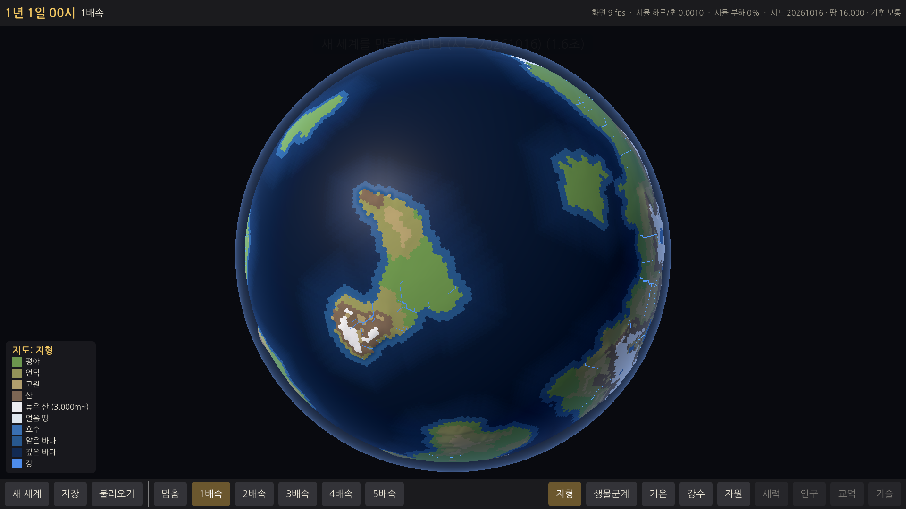
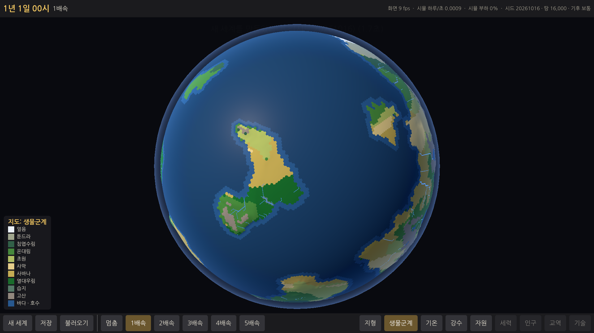
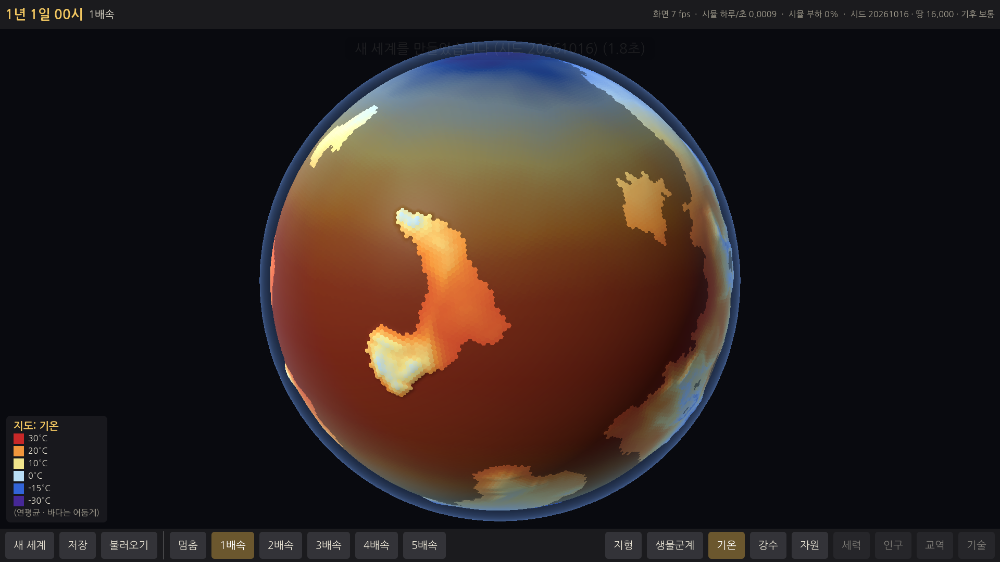
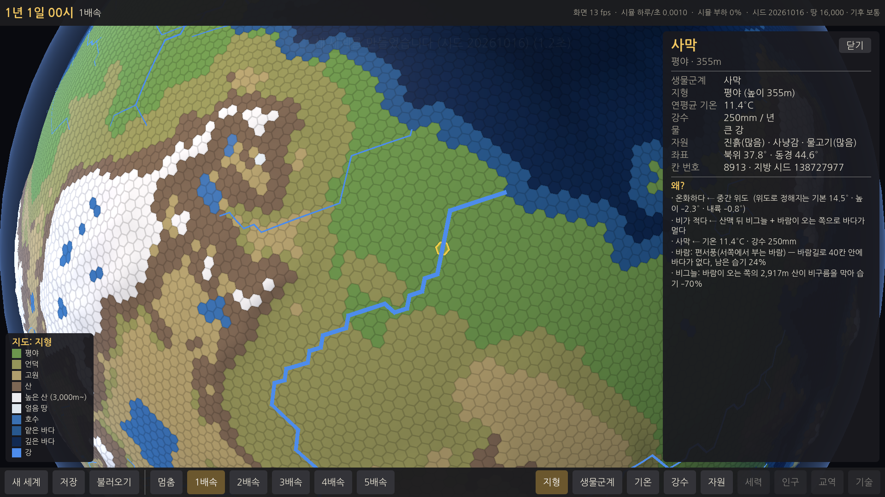

# E1 행성 — 보고서

## 쉬운 말 다섯 줄
1. 게임을 켜면 **새 세계 화면**이 나오고, [만들기]를 누르면 약 1~2초 만에 **둥근 지구본 행성**이 만들어집니다.
2. 행성에는 **큰 대륙 하나와 작은 섬 몇 개**, 산맥·고원·평야·호수·강이 있고, 같은 시드를 넣으면 **언제나 똑같은 행성**이 나옵니다.
3. 마우스로 지구본을 **돌리고 확대**할 수 있고, 가까이 가면 육각형 칸이 보입니다. 칸을 누르면 **어떤 땅인지와 "왜" 그런지**(예: "비가 적다 ← 산맥 뒤 비그늘")를 알려 줍니다.
4. 지도는 **지형 · 생물군계 · 기온 · 강수 · 자원** 다섯 가지로 바꿔 볼 수 있습니다. 세력·인구·교역·기술은 자리만 있습니다(나중 단계에서 채움).
5. 아쉬운 점: 육각 칸 사이에 섞인 **오각형 12개를 모두 바다로 보내지는 못했습니다**(행성마다 1~6개가 땅에 걸림). 그리고 클라우드에는 그래픽 카드가 없어 **화면 부드러움(fps)은 윈도우 PC에서 확인**이 필요합니다.

## 해 볼 것
1. zip 을 풀고 `WTW` 폴더의 **`WTW.exe`** 를 실행합니다. 윈도우가 "PC 보호" 경고를 띄우면 **"추가 정보 → 실행"** 을 누르세요(서명하지 않은 파일이라 처음 한 번 나옵니다).
2. 새 세계 화면에서 그대로 **[만들기]** → 지구본이 나옵니다.
3. **마우스 왼쪽으로 끌어** 지구본을 돌리고(놓으면 조금 더 미끄러집니다), **휠로 가까이·멀리** 해 봅니다. 아주 가까이 가면 육각형 칸 테두리가 보입니다. 화살표 키로도 돌아갑니다.
4. **땅 칸을 눌러** 오른쪽 정보 창을 봅니다. 맨 아래 **"왜?"** 의 설명(춥다/덥다, 비가 많다/적다의 이유)이 그럴듯한지 봐 주세요. 산맥 바로 뒤의 마른 땅을 눌러 보면 "산맥 뒤 비그늘" 이 나옵니다.
5. 아래 막대 오른쪽의 **지형 · 생물군계 · 기온 · 강수 · 자원** 을 눌러 지도를 바꿔 봅니다(키보드 Q W E R T). 자원 모드에서는 왼쪽 아래 범례에서 구리·주석·철 등 **볼 자원을 고릅니다**.
6. **[새 세계]** → 시드는 그대로 두고 땅의 양을 **24,000** 으로 바꿔 만들어 비교해 봅니다(같은 행성에서 땅만 넓어져야 합니다).
7. 시드 칸에 **같은 숫자**를 넣어 다시 만들면 **똑같은 행성**이 나오는지 봅니다.
8. **[저장]**(달리는 중이어도 먼저 멈춘 뒤 저장합니다) → 조금 돌림 → **[불러오기]** → 같은 행성, 같은 날짜로 돌아오는지.
9. 위쪽 오른편의 **"화면 ○○ fps"** 가 지구본을 돌릴 때 60 근처인지 알려 주세요(클라우드에서는 잴 수 없었습니다).

---

## 한 일

### 1. 측지 육각 격자 (`sim/Planet/GeoGrid.cs`)
- 정이십면체의 면을 72등분 → **51,842 칸 = 육각형 51,830 + 오각형 12**, 칸의 꼭짓점(삼각형) 103,680개.
- 칸 번호 · 이웃 · 꼭짓점 순서는 **정수 규칙으로만** 정함: 0~11 = 정이십면체 꼭짓점(오각형), 다음은 모서리 30개(정렬 순) 위의 점, 다음은 면 20개 안쪽의 점. 이웃은 바깥에서 볼 때 **시계 방향**, 가장 작은 번호의 이웃부터. `Corner[k]` = 이웃 k 와 k+1 사이 꼭짓점.
- 좌표는 사칙연산 + 제곱근만(기계마다 같은 값). 시드와 무관하므로 한 번 만들어 공유.
- **만드는 시간: 0.03초** (클라우드, 한 번만).

### 2. 행성 만들기 (`sim/Planet/PlanetGenerator.cs`)
순서: 모양 → 방향 → 땅/바다 → 높이 → 물길·호수 → 기후 → 강 → 생물군계 → 자원.
- **설정**: 시드 · 땅의 양(16,000 / 20,000 / 24,000) · 기후 경향(추움 −4°C / 보통 / 따뜻함 +4°C, 강수 ±10%). 땅의 양을 바꿔도 **같은 행성의 같은 땅 값**에서 경계만 낮춘다(테스트: 24,000 의 땅이 16,000 의 땅을 99% 이상 품음, 행성 방향도 같음).
- **모양**: 대륙 = 둥근 덩어리 4~6개를 한 방향으로 이은 사슬(길쭉하게), 섬 = 3~6개를 대륙·서로와 떨어뜨려 놓음(땅 24,000 에서도 붙지 않게). 그 위에 큰 굴곡(만·반도) + 해안 톱니 잡음.
- **땅 칸 수**: 값이 높은 칸부터 정한 수만큼. 너무 작은 땅 조각(30칸 미만)은 바다로, 대양과 떨어진 작은 물(80칸 이하)은 호수로. 호수만큼 모자란 땅은 한 번 다시 나눠 채움 → **마른 땅(호수 제외)이 설정의 ±0.6% 안**.
- **높이**(정수 m): 내륙일수록 높게 + 산맥(능선 잡음 → 가는 줄기) + 고원(넓고 평평) + 언덕 + 드문 분지. 지형 단계: 깊은 바다 · 얕은 바다 · 호수 · 평야 · 언덕 · 고원 · 산 · 높은 산(3,000m~). 바다 깊이는 해안에서 멀수록.
- **물길·호수**: 낮은 곳부터 채워 가는 "우선순위 채우기". 150m 이상 깊은 웅덩이는 호수(한 웅덩이에서 가장 깊은 45칸까지), 얕은 웅덩이는 메움. 평지에서 물길이 자로 그은 직선이 되지 않게 같은 높이일 때는 고정된 난수 순서로 넓힌다.
- **기후**(지역별 고정, 계절 없음):
  - 기온 = 위도(표) + 높이(−6.5°C/1000m) + 내륙(높은 위도는 더 춥게, 열대는 조금 덥게) + 기후 경향. 기후 띠 경계는 잡음으로 구불구불하게.
  - 강수 = 위도대 기본(적도 비구름 띠 · 아열대 건조 띠 · 편서풍 띠 · 극지) × 바람이 싣고 온 습기 × 산비탈. **탁월풍**: 위도 0~30° 무역풍(동→서), 30~60° 편서풍(서→동), 60° 이상 극동풍. 칸마다 바람을 거슬러 올라가며 바다까지의 거리와 넘어온 산을 본다 → 땅을 지날수록 마르고, 1,200m 넘는 산을 넘으면 **비그늘**(최대 −70%), 바람을 받는 오르막은 비가 더(최대 +60%).
- **생물군계** 10개: 얼음 · 툰드라 · 침엽수림 · 온대림 · 초원 · 사막 · 사바나 · 열대우림 · 습지 · 고산 (기온 × 강수, 고산은 높은 산, 습지는 평평한 낮은 땅 + 강/호수).
- **강**: 강수 − 증발(기온에 따라)을 물길을 따라 모아, 많이 모인 칸이 개울 · 강 · 큰 강. 칸 사이 선(`Downstream`)으로 바다·호수까지.
- **자원**(칸마다 없음/있음/많음): 돌 · 부싯돌 · 진흙 · 구리 · 주석 · 철 · 소금 · 숲(나무) · 사냥감 · 물고기. 지형과 맞게(진흙 = 강가·호숫가·습지, 구리 = 언덕·고원·산의 광맥, 주석 = 드묾, 소금 = 덥고 마른 해안·사막, 물고기 = 얕은 바다·호수 …). 아이디와 규칙은 **`data/resources.json`** (E4 재료 데이터가 이 아이디를 그대로 씀, 테스트가 시뮬과 같은지 확인).
- **지방 시드**: `Planet.ProvinceSeed(칸)` = (세계 시드, "province", 칸 번호) 스트림의 첫 값. 저장하지 않고 필요할 때 계산.
- **결정론**: 실수 계산은 사칙연산 + 제곱근 + Floor 만(삼각함수 · `Math.Pow` 없음), 결과는 정수(높이 m · 기온 ×10 · 강수 mm · 단계)로 저장하고 시뮬은 정수만 쓴다. 난수는 (세계 시드, "planet.…") 스트림에서만. 행성 지문(칸별 정수 값 전부의 해시)을 **테스트에 박아 둠** → CI(다른 컴퓨터)에서도 같은 값이어야 통과.
- **저장**: 저장 파일 버전 2 — 시드 · 설정(땅 칸 수 · 기후 경향) + "바뀐 칸 수"(지금은 늘 0, 운석 등이 생기면 여기에). 칸 하나하나는 저장하지 않는다. 불러오기 = 다시 만들기(같은 행성이 기억에 있으면 그것). 버전 1(E0) 파일도 읽는다.
- **"왜"** (`sim/Planet/CellReport.cs`): 행성에 저장된 정수(기온의 위도·높이·내륙 몫, 남은 습기 %, 비그늘 % 와 막은 산, 산비탈 %, 바람 종류, 바람길로 바다까지 칸 수)만 읽어 문장을 만든다. 예: "온화하다 ← 중간 위도 (위도로 정해지는 기본 14.5° · 높이 −2.3° · 내륙 −0.8°)", "비가 적다 ← 산맥 뒤 비그늘 + 바람이 오는 쪽으로 바다가 멀다", "비그늘: 바람이 오는 쪽의 2,917m 산이 비구름을 막아 습기 −70%".

### 3. 지구본 화면 (`game/`)
- `GlobeView.cs`: 행성 전체 = **메시 하나**(정점 약 36만, 삼각형 31만). 칸 색은 256×203 텍스처(칸 하나 = 화소 하나)에 담고, 지도 모드를 바꾸면 그 텍스처만 다시 칠한다. 칸 경계선 · 고른 칸(금색 테두리) · 마우스가 올라간 칸은 셰이더에서. 산은 살짝 솟게(6,500m = 반지름의 2.8%), 바다는 매끈하게, 꼭짓점 높이는 세 칸의 평균이라 이음매가 없다. 해는 카메라 왼쪽 위에서 따라오고, 가장자리에 옅은 대기 빛.
- 조작: 왼쪽 끌기 = 돌리기(관성), 휠 = 확대/축소(부드럽게, 가까이 갈수록 천천히 돌고 칸 테두리가 나타남), 누르기 = 고르기(다시 누르면 해제), 화살표 키 = 돌리기, Esc = 창 닫기. 칸 고르기는 광선과 구의 교점에서 이웃을 따라 가장 가까운 칸으로 걸어간다.
- `CellPanel.cs` 칸 정보 창(오른쪽), `Legend.cs` 범례(왼쪽 아래, 자원 모드에서는 자원 고르기 단추) — 서로·막대와 겹치지 않는 자리.
- `MapModes.cs`: 지도 모드 5개의 색과 범례를 한 곳에. 세력 · 인구 · 교역 · 기술은 단추 자리만(누르면 "아직 없음 — E○부터" 알림).
- `NewWorldScreen.cs`: 시드(직접 입력/무작위) · 땅의 양 · 기후 경향 → [만들기], 만드는 동안 진행 막대(행성은 다른 스레드에서 만든다). 저장 파일이 있으면 여기서 [불러오기]도.
- E0 의 점 시험 화면은 **개발용 F12** 로만 남김(새 세계에는 점이 없음, `--dots=N` 으로만 생김).
- 그리기 방식은 E0 의 **호환(OpenGL) 그대로**. 지구본에 필요한 것(정점 색 대신 텍스처, 셰이더 테두리, 빛)이 모두 된다.

### 4. E0 검토에서 넘어온 일
- **저장 = 멈춘 다음 저장**: [저장]/F5 를 누르면 먼저 멈추고, 시뮬이 이미 계산해 둔 곳까지 마저 간 뒤 그 상태를 저장한다. 화면도 그 시각에 와서 서므로 "보이는 것 = 저장된 것". 게임 안 자체 시험으로 확인: 달리는 중(4배속)에 저장 → 멈춘 화면 시각 32,341 = 저장된 시각 32,341 → 더 돌림 → 불러오기 → 같은 시각, 점 500개 위치 차이 0.
- **CI zip 이름**: 단계 이름을 `game/project.godot` 의 `config/version`(지금 "E1")에서 읽는다(`tools/export-windows.sh`, `tools/test-windows-exe.sh`, CI).
- **측정 기준 비교**: 기준 파일에 **코어 수 + CPU 이름**을 적고, 다른 컴퓨터면 "다른 컴퓨터 — 비교 안 함" 이라고만 한다. 옛 기준(CPU 이름 없음)은 실제로 "다른 컴퓨터" 로 나옴을 확인. 기준 파일 하나에 점 측정과 행성 측정을 같이 둔다(`--planet`).

### 5. 테스트 (`sim.tests/PlanetTests.cs`, `PlanetSlowTests.cs`)
- 격자: 칸 51,842 · 오각형 12 · 육각형 51,830 · 이웃이 서로 맞음 · 이웃 수 5/6 · 이웃이 시계 방향 · 꼭짓점이 세 칸을 잇는 삼각형 · 정이십면체 면이 바깥을 봄 · **칸 번호·이웃 순서 지문 고정값** · 작은 격자(n=4)도 됨.
- 행성: 같은 시드+설정 = 같은 지문, 다른 시드 = 다름, 기후 경향은 땅 모양을 안 바꿈 · **행성 지문 고정값** · 땅 칸 수 ±3% · 땅을 늘리면 같은 행성에서 넓어짐 · 강은 이웃 칸으로만, 내려가기만(오르막 없음), 내려갈수록 작아지지 않음, 바다·호수에서 끝남 · 지형 7종 모두 · 생물군계 8종 이상 · 자원 10종이 모두 땅에 있음 · 자원 아이디 = `data/resources.json` · "왜" 문장 · 지방 시드 · 저장 → 불러오기 → 같은 행성.
- 느린 테스트: 시드 20개 × 땅 3가지 = 60개 (아래 측정 결과).
- 빠른 테스트 **61개 통과(약 7초)**, 느린 테스트 2개 통과.

## 측정 결과 (목표 대비)

| 항목 | 목표 | 결과 |
|---|---|---|
| 격자 만들기 | 보고 | **0.03초** (한 번만) |
| 행성 만들기 | 10초 이내(클라우드) | **중앙값 0.36초, 최대 0.58초** (시드 20 × 땅 3, Release). 게임 안(개발용 빌드, 지구본 메시 만들기 포함)은 1~2초 |
| 땅 칸 수 | 설정의 ±3% | **60/60**, 가장 큰 오차 0.6% (호수 제외한 마른 땅 기준) |
| 큰 대륙 비율 | 땅의 70~85% | 중앙값 **74.7%**, 범위 안 **58/60** (벗어난 것: 시드 16 의 땅 20,000 = 69.4%, 24,000 = 67.9%) |
| 섬 | 3~8개 | 중앙값 **5개**, 범위 안 **54/60** (벗어난 것: 9~11개 — 해안 잡음이 만든 30칸 넘는 작은 섬이 덧붙음. 시드 1·4 의 16,000, 시드 17 의 20,000, 시드 3·4·17 의 24,000) |
| 오각형이 바다에 | 모두 바다(못 하면 보고) | **못 함: 60/60 행성에서 1개 이상이 땅에 걸림.** 땅 16,000: 중앙값 1개(1~2), 20,000: 2.5개(1~5), 24,000: 4개(2~6) — 아래 "기획과 다르게 한 것" 1번 |
| 호수 · 강 | — | 호수 칸 중앙값 141(16,000) ~ 318(24,000), 강 칸 중앙값 1,146 ~ 1,639 |
| 화면 fps | 60 근처 | **클라우드에서는 못 잼**: 그래픽 카드가 없어 CPU 가 3D 를 그린다(가상 화면 7~13 fps, 해상도를 절반으로 줄여도 15 fps → 그래픽 카드 몫이 병목). 새 세계 화면(2D)은 36 fps. 진짜 윈도우 PC 에서 확인 부탁(해 볼 것 9번) |
| 점 500개 하루/초 (E0 측정, 이 컴퓨터 기준) | 기록 | 115.8 하루/초 → 새 기준 파일. 같은 컴퓨터에서 연달아 76 / 116 이 나올 만큼 흔들림 |
| 게임 안 저장 → 불러오기 | 같은 상태 | 통과(위 4번) — 리눅스 빌드와 **윈도우 exe(Wine)** 둘 다. 윈도우 exe 를 Wine 으로 띄운 화면: `docs/reports/E1/windows-exe-wine.png` |

### 스크린샷
- 새 세계 화면: `docs/reports/E1/new-world.png`
- 지형: `docs/reports/E1/terrain.png` · 생물군계: `biome.png` · 기온: `temperature.png` · 강수: `rain.png` · 자원(구리): `resource-copper.png`
- 칸 정보 창(가까이, 칸 테두리 보임): `docs/reports/E1/cell-info.png`

## 기획과 다르게 한 것 / 이유
1. **오각형 12개를 모두 바다로 보내지 못했다.** 행성을 3,000가지 방향으로 돌려 보며 가장 적게 걸리는 방향을 고르지만(땅 16,000 → 20,000 → 24,000 순으로 적은 것), 0개인 방향은 한 번도 없었다. 이유: 정이십면체의 꼭짓점은 서로 약 63° 떨어져 있어서 행성 어디든 37° 안에 오각형이 있다. 땅이 행성의 31~46% 인 큰 대륙은 그보다 넓어서 어디에 두어도 오각형을 품는다. 대륙을 일부러 오각형을 피해 깎는 것은 "결과를 억지로 맞추는 것" 이라 하지 않았다. → 기획서 5-2 의 대비책 "오각형 땅은 육각 지도에서 한 변을 막은 지도"를 **E2 에서 써야 한다**(땅 16,000 에서 평균 1~2칸).
2. **"땅 칸 수" = 바다도 호수도 아닌 마른 땅**으로 셌다. 호수는 땅 속의 물이라 지방(사람이 사는 곳)이 되기 어렵다고 봤다. 호수만큼 모자라면 한 번 다시 나눠 채운다.
3. **작은 땅 조각(30칸 미만)은 바다로 돌린다.** 해안 잡음이 1~20칸짜리 점 섬을 수십 개 만들어 "섬 3~8개" 를 크게 넘었기 때문. 30칸 이상은 그대로 섬으로 센다(그래서 9~11개인 시드가 있다).
4. **고원**을 높이 단계 하나로 둠(높이 850m 이상인데 이웃과 높이 차가 작은 땅). 프롬프트의 "해안" 은 높이 단계 대신 칸 표시(해안 · 호숫가)로 둠.
5. **산맥 둘레가 막힌 큰 분지는 통째로 호수가 되지 않게** 한 웅덩이의 호수를 가장 깊은 45칸까지로 제한(실제로는 물이 넘쳐 출구를 깎는다). 이것이 없으면 한 시드에서 호수가 땅의 4% 가 되었다.
6. 지도 모드 키는 **Q W E R T**(1~5 는 속도라서). E0 의 오른쪽 클릭(점 부르기)은 지구본에서 뺐다(점 시험은 F12 개발용 화면).
7. 지구본에서 강은 지형 · 생물군계 · 강수 모드에서만 보인다(기온 · 자원 모드에서는 색을 읽기 어려워서).

## 알려진 문제 · 다음 단계에 넘길 것
- **E2**: 땅에 걸린 오각형 칸(행성마다 1~6개)의 지방 지도는 "한 변을 막은 육각 지도" 로 만들어야 한다. 오각형 칸은 0~11번이라 `Grid.IsPentagon(칸)` 으로 바로 안다.
- **E2**: 지방 지도를 만들 때 쓸 값 — `Planet.ProvinceSeed(칸)`, 칸의 지형 · 높이 · 생물군계 · 강(`RiverSize`, `Downstream` = 강이 나가는 이웃) · 해안/호숫가 · 자원 단계. 이웃 칸 순서는 시계 방향이라 육각 지방 지도의 여섯 변과 맞출 수 있다.
- **윈도우 PC 에서의 fps 와 부드러움은 아직 확인 못 함**(E0 에 이어 두 번째). 클라우드는 CPU 로 3D 를 그려서 7~13 fps 다. 혹시 진짜 PC 에서도 느리면 칸 하나를 삼각형 4개(지금 6개)로 줄이거나, 멀리 볼 때 쓰는 가벼운 메시를 따로 둘 수 있다.
- 행성 모양은 **적도 쪽에 몰리는 편**이다(대륙 중심을 위도 ±24° 안에, 덩어리를 ±30° 안에 둠). 그래서 사막·사바나가 많고 침엽수림·툰드라가 적다(땅 16,000, 시드 20개 중앙값: 사바나 27% · 사막 17% · 초원 14% · 온대림 14% · 고산 10% · 열대우림 8% · 침엽수림 5% · 툰드라 2% · 습지 0.5% · 얼음 0.3%). 사람이 살 땅이 다양하게 필요하면 E3 전에 위도 범위를 넓힐 수 있다.
- 생물군계 경계 일부가 아직 **가로줄처럼 곧게** 보인다(위도대 강수가 주된 원인). 잡음으로 흔들었지만 넓은 평원에서는 보인다.
- 기획서 5-2 의 "보이지 않는 작은 계절(수확량이 조금 오르내림)" 은 수확이 생기는 단계(E3~E4)의 일이라 하지 않았다.
- 행성 지문을 테스트에 박아 두었으므로, **생성 규칙을 바꾸면** `PlanetTests.PlanetPin` 을 일부러 고쳐야 한다(실수로 바뀐 것을 잡기 위함).
- 개발용: `tools/bench --dump 경로 --seed N` + `python3 tools/planet_map.py 경로 그림.png` 로 행성 전체를 펼친 지도(지형·생물군계·기온·강수)를 볼 수 있다.
