# E2 지방 — 보고서

## 쉬운 말 다섯 줄
1. 지구본에서 **땅 칸을 두 번 누르면** 그 땅의 **2D 지도**가 펼쳐집니다. 숲 · 강 · 바닷가 · 산 · 바위 · 동굴이 있고, 같은 칸은 언제 들어가도 똑같은 지도입니다.
2. (2차 검토 뒤) **화산**이 생겼습니다 — 산맥 둘레에 몇 개, 지구본에 **붉은 점**으로 보이고, 들어가면 가운데에 **붉은 분화구와 지나갈 수 없는 회색 산**, 둘레에 **현무암 · 흑요석**이 있습니다(분화는 재난 단계에서).
3. 땅 위 돌이 **흔한 돌 · 부싯돌(석회암 땅) · 석영(화강암 땅) · 흑요석(화산 둘레)** 으로 나뉘고, 돌마다 **단단함 · 날이 서는 정도** 같은 성질이 데이터에 적혀 있습니다(숫자는 E4).
4. 2D 지도 **왼쪽에 "지방 정보" 칸**이 생겼습니다 — 그 지방의 **시각 · 지금 기온 · 해의 높이 · 바람 · 강수 · 바위 · 물 · 비옥함 · 자원** 등 19가지, 줄마다 **[자세히 보기]** 로 이유가 나옵니다. 지도의 밝기도 그 지방 시각을 따라 **낮 · 저녁 · 밤**으로 바뀝니다(밤에도 읽을 수 있게).
5. 바위는 **회색 돌 + 그림자**로, 산은 **걸을 수 있는 땅(갈색) · 드러난 바위(밝은 회색) · 숨은 바위 속(빗금 어두운 회색) · 동굴(검정)** 으로 나눠 그렸고, 일부 동굴엔 **입구**가 열려 있습니다. 글자 겹침을 없앴고, 빠른 테스트는 **48초 → 10초**. 아쉬운 점: **fps 는 윈도우 PC 에서 확인**이 필요합니다.

## 해 볼 것
1. zip 을 풀고 `WTW` 폴더의 **`WTW.exe`** 를 실행합니다. 윈도우가 "PC 보호" 경고를 띄우면 **"추가 정보 → 실행"** 을 누르세요(서명하지 않은 파일이라 처음 한 번 나옵니다).
2. 새 세계 → [만들기] → 지구본의 **산맥 둘레에서 작은 붉은 점(화산)** 을 찾아 한 번 눌러 봅니다. 칸 정보 제목이 **"화산 (…)"**, "화산: 잠든 화산 …" 줄이 있는지, 아래 **[자세히 보기]** 를 눌러 이유가 펼쳐지는지 봅니다(예전 "왜? · 펼치기" 글자는 없어졌습니다).
3. 화산 칸에 **들어가서**(두 번 누르기) 가운데 붉은 분화구 · 둘레 회색 산 · 검은 **흑요석 조각**이 있는지 봅니다. 휠로 가까이 가 흑요석에 마우스를 올려 봅니다.
4. 아무 땅에 들어가 **왼쪽 "지방 정보" 칸**을 봅니다. **[자세히 보기]** 를 눌러 이유를 읽고, 맨 위 제목을 누르면 칸 전체가 접힙니다. 맨 위 시계는 세계 시간이고, 지방 시각은 경도에 따라 다릅니다.
5. **[2배속]~[5배속]** 으로 시간을 흘려 지도가 **저녁(따뜻한 빛) → 밤(푸르스름, 그래도 보임) → 낮**으로 바뀌는지, "지금 기온" 이 낮엔 오르고 밤엔 내려가는지 봅니다. **사막**은 낮밤 기온 차이가 큽니다.
6. **평야 칸**에서 바위 무리가 **회색 돌 + 그림자**로 보이는지, 작은 돌(흔한 돌 · 부싯돌 · 석영)이 멀리서도 점으로 보이는지 봅니다.
7. **산 칸**에서 걸을 수 있는 땅(갈색) · 드러난 바위(밝은 회색 테두리) · 숨은 바위 속(빗금 어두운 회색) · 동굴(검정)이 한눈에 구분되는지, 바위 사이로 **검은 동굴 입구**가 열린 곳이 있는지 봅니다.
8. **[이웃까지]** 를 눌러 이웃 지방 이름이 날짜 · 단추 · 위 오른편 숫자 · 왼쪽 정보 칸과 **겹치지 않는지** 봅니다.
9. 위쪽 **[자원 보기]**(키 Y), 강가 **자갈**, Esc 로 나왔다 같은 칸 다시 들어가기, 위쪽 오른편 **"화면 ○○ fps"** 가 60 근처인지 알려 주세요.

---

## 한 일

### 1. 지방 지도 만들기 (`sim/Province/`)
- **틀** (`HexFrame.cs`): 150×150 네모 타일 안의 **정육각형**(위 · 아래 변이 평평, 꼭짓점 반지름 75 타일)만 쓴다 — 14,614 타일, 나머지는 쓰지 않는 땅(검게). 변(자리) 0~5 는 시계 방향.
- **변 = 행성의 이웃** (`ProvinceGenerator.Slots`): E1 의 이웃 순서(시계 방향)를 그대로 쓰되, **가장 북쪽 이웃이 위(자리 0)** 에 오도록 시작 자리만 돌린다(지구본과 같은 방향감). 꼭짓점 H[s] = 행성 꼭짓점(삼각형) 번호 — 맞댄 두 지방의 변 끝이 행성의 같은 점이다(테스트).
- **오각형 칸**: 이웃 다섯은 다섯 변에, 남는 한 변은 **절벽(넘을 수 없음)** 으로 막는다(4~6 타일 띠).
- **이웃과 이어지게 한 방법** (경계 공유 시드보다 한 걸음 더):
  1. 타일 하나하나를 **행성 위의 한 점**에 놓는다. 육각형을 여섯 쐐기(중심, 꼭짓점 두 개)로 나누고 쐐기 안의 무게 좌표로 "칸 중심 · 행성 꼭짓점 두 개" 를 섞는다 → 맞댄 변 위의 점은 양쪽 지방에서 행성 위의 **같은 점**.
  2. 그 점의 **칸 무게**: 가운데 칸 λc + 꼭짓점마다 만나는 세 칸에 λ/3 씩. 변 위에서는 양쪽 칸이 같은 무게. **높이 · 기온 · 강수 · 거칠기 · 자원 단계는 이 무게로 섞고**, 생물군계는 (생물군계별 무게 + 잡음)으로 고른다 → 숲 · 사막의 경계가 지방 경계를 넘어 구불구불 이어진다.
  3. 잡음은 지방마다가 아니라 **행성 전체에 하나**(세계 시드의 `province.noise.*` 스트림) → 어느 쪽 지방에서 봐도 같은 무늬.
  4. **강이 변을 건너는 자리**는 **두 칸 번호로 정한 공유 시드**(세계 시드, 작은 번호, 큰 번호)에서 → 어느 쪽을 먼저 만들어도 같은 자리, 변에 수직으로 건넌다. 강 폭은 위쪽 칸의 `RiverSize`.
  5. **바다 · 호수 쪽 변은 물 띠**. 옆 변도 물이면 이어지고, 옆 변이 땅이면 꼭짓점에서 0 으로 줄어 이웃 지방의 물 띠와 그 점에서 만난다. 물가는 바다 높이로 낮아지고, 바닷가는 모래, 강가 · 호숫가는 진흙.
- **강**: 행성의 `Downstream`(나가는 이웃)과 "이 칸으로 흘러드는 이웃" 의 변으로 들고 나고, 지방 안의 합류점에서 만난다. 시작하는 칸은 지방 안의 샘에서. 구불구불(모서리 깎기), 변 근처는 곧게. 개울 2타일 · 강 3타일 · 큰 강 5타일 폭(큰 강 가운데는 깊은 물). 강을 따라 골짜기를 판다(변 근처는 양쪽이 같은 모양이 되게).
- **높이**: 섞은 높이 + 거칠기에 맞는 잡음(평야 ±수 m, 산 ±수백 m, 산등성이 무늬). 정수 m 로 저장.
- **땅 종류 13가지** (`Ground`): 흙 · 풀밭 · 모래 · 진흙 땅 · 바위 바닥 · 눈 · 얼음 · 습지 · 얕은 물 · 깊은 물 · 절벽 · **바위(지나갈 수 없는 바위 타일)** · **자갈**. 생물군계 · 그 자리 기온(높을수록 춥게) · 기울기 · 물가 거리 · 잡음으로 정한다.
- 타일마다: 땅 종류 · 높이 · 물 깊이 · 생물군계 · **바위 종류** · **광맥** · **오브젝트 최대 하나** · 변형 값 · 표시(강 · 바다 · 동굴(위가 덮임) · 숨김).

### 1-1. 바위 · 동굴 · 광맥 (검토 뒤 새로 — 림월드처럼)
- **바위는 물건이 아니라 타일**(`Ground.Stone`): 타일 하나를 차지하고 **지나갈 수 없다**(`GroundInfo.IsWalkable`). 바위 타일 위에는 오브젝트가 없다. 바위 타일이 모여 **바위 무리 → 덩어리 → 산**.
- **바위의 양 = 지형**: 지형의 거칠기(섞은 값)로 덮는 비율을 정한다 — 평야 약 2% · 고원 14% · 언덕 22% · 산 50% · 높은 산 62%(행성 칸의 "돌" 자원 단계로 ±20%). 평야는 몇 타일짜리 **작은 무리**, 산은 **큰 덩어리**가 되도록 작은 잡음 · 큰 잡음을 거칠기에 따라 섞는다. 이 잡음과 거칠기는 행성 위의 점에서 뽑으므로 **바위 덩어리도 이웃 지방과 경계에서 이어진다**. 물 · 강 · 절벽에는 바위를 두지 않는다.
- **동굴**: 큰 덩어리 안쪽(바깥에서 4 타일 이상 들어간 곳, 지방 가장자리에서 10 타일 이상)에 굴(가는 줄기) · 방(둥근 얼룩) 모양으로. 동굴 바닥은 **위가 바위로 덮인 곳**(`TileFlags.Roof`)이고 바위 벽으로 둘러싸여 바깥 땅과 바로 닿지 않는다.
- **숨김**(`TileFlags.Hidden`): 아직 아무도 들어가 보지 않은 동굴, 그리고 둘레 8칸에 드러난 땅이 없는 바위(덩어리 안쪽). 화면에서 동굴은 **검게**, 바위 속은 **어둡게**(위가 바위) 가린다. E3 부터 사람이 들어가면 걷힌다(바뀐 것은 `ProvinceChanges`).
- **바위 종류 5가지** (`data/rocks.json`): 화강암 · 석회암 · 사암 · 현무암 · 점판암. 종류마다 색 · 캐면 나오는 아이템(같은 이름의 돌) · 지형별로 나기 쉬운 정도 · 생물군계 배수(사막 → 사암, 침엽수림 · 툰드라 → 점판암 …). **행성 칸마다 주된 바위 · 섞인 바위**를 정한다(`Geology` — 지형 × 생물군계 × 몇 칸 크기의 지질 잡음, 이웃 칸은 대개 같은 바위). **지구본 칸 정보에 "바위" 줄**로 나온다. 지방 지도의 타일마다 바위 종류는 칸 무게로 골라 경계에서 이어진다.
- **광맥 3가지**(구리 · 주석 · 철, `rocks.json` 의 `ores`): **바위 타일 안에 박힌다**(`ProvinceMap.Ore`). 뭉치 수 = 행성 칸의 자원 단계 × 2~3, 뭉치 하나 5~10 타일. 뭉치의 절반은 바깥 면 가까이에서 시작해 드러난 광맥이 생긴다. 바위가 거의 없는 칸(평야)은 **광맥이 드러난 작은 바위 무리**를 하나 세운다(지방 가장자리에서 멀리). **바깥 면에 드러난 광맥만 보이고**(`VisibleOreAt`), 안쪽 광맥은 숨는다.
- **자갈 바닥**: 강가(강물에서 3 타일 안)에 자갈(`Ground.Gravel`, 걸어갈 수 있음). 잔돌은 자갈 위에 3배 더 잘 난다. 습지 강가는 진흙이 더 많다.
- **평야에도 돌**: 잔돌 · 부싯돌 무더기는 행성의 돌 · 부싯돌 자원이 "없음" 이어도 조금은 난다(`resource_floor` — 없음 0.4~0.5배). 평야 30칸 중 30칸에 바위 무리 · 잔돌 · 부싯돌이 다 있다(테스트).
- **결정론**: 사칙연산 · 제곱근 · Floor 만(삼각함수 없음), 결과는 정수. 난수는 지방 시드(`Planet.ProvinceSeed(칸)`)로 만든 타일 해시 · 지방 스트림과 세계 시드의 `province.*` 스트림에서만. **지방 지도 지문 4개를 테스트에 박아 둠**(CI = 다른 컴퓨터에서도 같아야 통과).
- **기억과 저장**: 만든 지도는 `ProvinceCache` 가 최근 40개를 기억(오래된 것은 잊음). `GameWorld.Province(칸)` 으로 얻는다. 저장 파일은 **버전 3** — 지도 전체가 아니라 **"바뀐 지방" 자리만**(지금은 늘 0개, 나무 베기 같은 변화는 E3~). 버전 1 · 2 파일도 읽는다.
- **여러 지방 배치** (`ProvinceLayout.cs`): 가운데 지방은 제자리, 이웃은 맞댄 변이 가운데를 보도록 60° 단위로 돌려 붙인다(행성의 이웃 순서가 모두 시계 방향이라 뒤집지 않고 돌리기만).

### 2. 오브젝트 — "타일 하나에 오브젝트 하나, 다루는 법에 따라 여러 자원"
- **`data/objects.json`**: 다루는 법 8가지(따기 · 베기 · 줍기 · 벗기기 · 깨기 · 캐기 · 파기 · 긁기)와 **오브젝트 24가지**(검토 뒤 큰 바위 · 광맥 오브젝트 4가지는 빼고 바위 · 광맥 타일로 바꿈). 오브젝트마다 아이디 · 한국어 이름 · 분류(나무 · 덤불 · 풀 · 돌 · 바닥) · 그림 이름 · 어떤 생물군계/땅에 나나(가중치) · 날 확률 · 묶인 행성 자원 · 자원이 없어도 나는 정도(`resource_floor`) · (소금 바닥은) 뭉쳐 나기 · **다루는 법 → 나오는 자원**.
  - 나무 11: 사과나무(따기 → 사과 / 베기 → 나무) · 참나무(줍기 → 도토리) · 자작나무(벗기기 → 자작나무 껍질) · 소나무(베기 → 나무, 송진) · 가문비나무 · 버드나무 · 케이폭나무 · 야자나무(따기 → 야자 열매) · 바나나 · 아카시아 · 바오밥나무
  - 덤불 5: 난쟁이자작(툰드라) · 덤불(따기 → 열매 / 베기 → 잔가지) · 가시덤불 · 마른 덤불 · 선인장(따기 → 선인장 열매)
  - 풀 4: 풀(베기 → 풀) · 갈대(베기 → 갈대) · 버섯 · 이끼(긁기 → 이끼)
  - 돌 · 바닥 4: 잔돌(줍기 → 돌) · 부싯돌 무더기(줍기 → 부싯돌) · 진흙 바닥(파기 → 진흙) · 소금 바닥(긁기 → 소금)
  - (바위 타일: 캐기 → 화강암 · 석회암 · 사암 · 현무암 · 점판암 / 광맥 타일: 캐기 → 구리 광석 · 주석 광석 · 철광석 + 그 바위)
- **`data/items.json`**: 나오는 자원 28가지(아이디 · 이름만 — 성질은 E4, 바위 종류 5가지를 더함). **행성 자원과 같은 이름 체계**: 같은 물건은 같은 아이디(`stone · flint · clay · salt · wood`).
- **자원 단계 → 개수**: 묶인 행성 자원의 단계(없음 0 · 있음 1 · 많음 2, 이웃 칸과 무게로 섞은 값)에 비례(없음이면 `resource_floor` 만큼). 나무는 숲 얼룩 잡음으로 빈터가 생긴다.
- 사냥감 · 물고기(행성 자원)는 동물이라 오브젝트가 없다(E3 · E15).
- 데이터는 **시뮬 안에 넣어**(embedded) 게임 · 측정 도구 · 테스트가 같은 파일을 본다. 검사: 아이디 겹침 · 없는 아이템 · 없는 다루는 법 · 모르는 생물군계/땅 종류/행성 자원 · 필수 칸 · 확률 범위 — 틀리면 "objects.json 의 3번째 항목(apple_tree): …" 처럼 알려 준다.

### 3. 2D 지방 화면 (`game/src/ProvinceView.cs`)
- **들어가기**: 지구본에서 땅 칸을 **두 번 누르기** · 칸 정보의 **[들어가기]** · Enter. 바다 · 호수 칸은 "들어갈 수 없습니다" 알림. **나가기**: [지구본으로] · Esc → **들어갔던 칸을 보는 지구본**(그 칸이 골라진 채).
- **그리기**: 한 지방 = **땅 메시 하나**(육각형) + **오브젝트 MultiMesh 하나** — 타일마다 노드를 만들지 않는다. 지도 만들기는 다른 스레드에서(이웃까지 7 지방은 나눠서 동시에).
  - 땅 셰이더: 타일 자료(땅 종류 · 생물군계 · 물 깊이)를 텍스처로 받아 **화소마다** 둘레 3×3 타일을 매끈한 무게(B-스플라인)로 섞고, **같은 종류끼리 모은 면을 가파르게 잘라** 경계를 만든다 → 땅 종류 경계가 **격자 · 계단 없이 부드러운 곡선**. 무늬(풀결 · 모래 물결 · 바위 금 · 눈 그늘 · 습지 물)는 화면 세상 좌표의 잡음으로 → 확대해도 각지지 않고, 이어 붙인 지방끼리 무늬가 이어진다. 높이는 4×4 B-스플라인 면의 기울기로 언덕 그늘(해는 화면 왼쪽 위). **물은 잔잔하게 일렁이고**(아주 느린 물결 · 반짝임) 물가에 옅은 거품.
  - 오브젝트: 서 있는 그림(나무 · 덤불 · 풀 · 돌)은 지방을 돌려도 **똑바로 서고**, 아래쪽 것이 앞에 그려진다. 나무 · 풀은 **바람에 아주 살짝** 흔들린다. 같은 종류도 4가지 그림 + 크기(±14%) · 좌우 뒤집기 · 밝기 · 위치가 조금씩 다르다.
- **카메라**: 끌기 = 이동(**놓기 직전 0.08초 안에 움직이고 있었을 때만 관성** — E1 지구본과 같은 규칙), 휠 = 확대/축소(**마우스 자리를 중심으로 부드럽게**), 화살표 키 = 이동. 가장 멀리 = 밝은 범위 전체가 한 화면, 가장 가까이 = **타일 하나 약 74px**(손가락만 하게).
- **밝은 범위**: 위쪽 **[이 지방만] / [이웃까지]**. 이웃까지 = 바다가 아닌 이웃(호수 포함)까지 이어 붙이고, 들어간 지방은 옅은 금색 테두리. 밖은 **완전히 검게**, 가장자리에 **"북동쪽: 초원 평야 (칸 32007)" · "북동쪽: 바다" · "막힌 쪽 — 절벽"** 처럼 방향 · 이름만 흐리게(지방 이름이 아직 없어서 생물군계 + 지형 + 칸 번호).
- **카드 · 정보 창**: 타일이나 오브젝트에 마우스를 올리면 **작은 카드**(이름 · 땅 종류 · 생물군계 · 다루는 법 → 자원)가 마우스 옆에 따라다니고, 그 타일에 흰 네모. 누르면 **지구본의 칸 정보 창과 같은 자리**(오른쪽)에 자세히: 오브젝트 · 다루는 법마다 나오는 것 · 땅 종류 · 생물군계 · 높이(물이면 깊이) · 걸어갈 수 있나 · 지방 · 타일 좌표. 지방 화면에서는 지도 모드 단추 · 범례를 감춰 창끼리 겹치지 않게.
- **바위 그리기**: 바위 타일은 바위 종류의 색 · 덩어리 무늬 · 금, **가장자리는 진한 테두리**, 조금 솟게 그늘을 넣어 땅 위에 솟은 덩어리로 보인다. 숨은 바위 속은 어둡게, 동굴은 검게. 드러난 광맥은 바위 위에 광맥 색의 얼룩 · 알갱이. 자갈은 굵은 알갱이 무늬.
- **[자원 보기]**(위쪽 단추 · 키 Y): 나머지 땅 · 나무는 어둡게, **바위(종류 색) · 드러난 광맥 · 자갈 · 잔돌 · 부싯돌 · 진흙 · 소금**만 밝게. 왼쪽 아래 범례에 화면에 있는 바위 종류 · 광맥 · 자원 오브젝트와 칸 수 · "캐면 나오는 것" (숨은 광맥은 세지 않음).
- **카드**: 바위 = "화강암 · 바위 · 지나갈 수 없음 · 캐기 → 화강암", 광맥 = "구리 광맥 · 캐기 → 구리 광석, 사암", 숨은 곳 = "바위 속 — 아직 아무도 들어가 보지 않았습니다"(그 안의 광맥은 알려 주지 않는다), 자갈 = "자갈 — 줍기 → 돌".
- **메모리**: 나가면 노드 · 텍스처를 모두 지우고, 지도는 최근 40개만 기억 → 드나들어도 계속 늘지 않는다(아래 측정).
- 지구본 칸 정보에 "열어 봤음" 표시는 하지 않았다(프롬프트대로 — 사람이 사는 것이 기준, E3 이후).

### 4. 그림 (`game/src/ProvinceArt.cs`, `Sketch.cs`)
- 그림 재료가 없어서 **모두 코드로**: 화소마다 도형까지의 거리로 가장자리를 부드럽게 칠하는 작은 붓(`Sketch`)으로 오브젝트 그림 24가지 × 4 변형을 128×128 칸에 그려 한 장(atlas)에 모은다(처음 지방에 들어갈 때 한 번, 약 0.2초). 나무는 잎뭉치 원을 겹쳐 왼쪽 위가 밝게, 아래에 그림자. 림월드풍 단순 일러스트.
- 땅 색표(땅 종류 × 생물군계, 그리고 바위 · 바위 바닥 · 자갈 × 바위 종류) — 사바나 풀은 누렇게, 툰드라 풀은 칙칙하게, 열대 풀은 짙게, 현무암은 검게, 사암은 누렇게.
- 무늬 잡음은 이어 붙여도 이음매 없는 **경사(펄린) 잡음** 4겹(값 잡음은 네모 얼룩이 보여서 바꿈).
- 그림 공급은 E0 의 `Art` 한 곳(partial)으로 — 나중에 진짜 그림으로 갈아 끼울 수 있게.

### 5. 테스트 (`sim.tests/ProvinceTests.cs`, `ProvinceSlowTests.cs`)
- 같은 칸 = 같은 지도(지문 · 배열), 다른 칸 · 다른 행성 = 다른 지도 · **지방 지문 고정값 4개**
- 육각형 밖 타일은 쓰지 않음 · 안은 모두 땅 종류가 있음
- 자리 = 행성 이웃 · 가장 북쪽 이웃이 위 · **맞댄 변의 두 끝 = 행성의 같은 꼭짓점**
- 오각형 지방은 한 변(만)이 절벽, 육각형 지방은 절벽 없음
- **경계가 맞음**(5종류 × 이웃 전부): 물 · 강 · 높이가 맞댄 변에서 이어짐, **이웃을 먼저 만들든 가운데를 먼저 만들든 같은 지도**
- **강이 행성의 강 방향과 같은 변으로 들고 남**(강 칸 12개의 모든 변), 강이 없는 칸엔 강물 없음
- 해안 칸: 바다 쪽 변은 물, 땅 쪽 변은 땅, 바다 표시 · 모래
- 산은 높낮이가 크고 바위 · 눈, 평야는 평평
- **자원 단계 → 개수**(구리 광맥 타일 · 돌 · 나무 · 진흙): 많음 ≥ 있음 ≥ 없음, 많음 > 없음, 구리 없음이면 광맥 0
- (검토 뒤) **바위의 양이 지형을 따름**: 평야 0.5~10%(실제 3.8%) · 언덕 > 평야의 2배(20%) · 산 > 30%(52%) · **평야 30칸 모두 바위 무리 · 잔돌 · 부싯돌이 있음** · 강가에 자갈 100타일 이상 · 바위는 못 지나감
- (검토 뒤) **광맥은 바위 속에만**, 숨은 광맥은 둘레에 드러난 땅이 없고 보이지 않음, 드러난 광맥은 드러난 땅과 닿음 · **동굴은 위가 덮이고 숨겨지고 바깥 땅과 바로 닿지 않음** · 바위 · 동굴엔 오브젝트 없음
- (검토 뒤) 모든 땅 칸에 바위 종류가 있고(주된 바위 4종 이상) **칸 정보에 "바위"** 줄 · 지방의 바위 타일은 그 칸 · 이웃 칸의 바위 종류 · `data/rocks.json` 검사
- (검토 뒤) **바위 덩어리가 경계에서 이어짐**(빠른 테스트 · 느린 테스트)
- 오브젝트가 허락된 땅 종류 위에만 · 배치(이어 붙이기)의 변 끝이 정확히 맞음
- `data/objects.json` · `items.json` 검사(겹치는 아이디 · 없는 자원 아이디 · 없는 다루는 법 · 모르는 생물군계/땅/행성 자원 · 필수 칸 · 범위 · 문법), 저장소 데이터 = 시뮬 안에 넣은 데이터
- 저장 → 불러오기 → 같은 지방(지도는 다시 만들어 같음), 저장 파일 버전 3, 지도 기억은 40개까지
- (2차 검토 뒤) **화산** 2~6개 · 산맥 둘레 · 같은 시드 = 같은 화산 · 칸 정보에 화산 · 화산 지방: 가운데 분화구(못 지나감) · 분화구를 둘러싼 지나갈 수 없는 산 · 현무암 · 흑요석 10개 이상
- (2차 검토 뒤) **돌 종류가 바위를 따름**: 화산이 먼 칸엔 흑요석 0 · 부싯돌은 대부분 석회암 땅(112개 중 109) · 석영은 화강암 땅에서 넓이당 5배 넘게 자주 · 돌 아이템 9가지에 성질(속성 이름은 `properties.json` 에 있는 것만, 값은 낮음 · 보통 · 높음 · 아주 높음)
- (2차 검토 뒤) **동굴 입구**: 가려진 동굴 안쪽은 바깥 땅과 바로 닿지 않음 · 입구(바깥에서 두 칸)만 보임 · 입구 타일이 있음(표본 동굴 1,626 타일 중 30)
- (2차 검토 뒤) **지방 정보**: 필요한 12줄이 모두 있고 이유도 있음 · 경도가 90° 다르면 시각이 6시간 다름 · 15시 > 3시 기온 · 사막의 낮밤 차이 > 숲 · 해는 6시에 뜸 · 시간이 지나면 시각 줄이 바뀜
- 빠른 테스트 **86개 통과, 약 10초**(2차 검토 전 48초 — 지방을 수십 개 만드는 무거운 테스트 4개를 느린 테스트 `ProvinceHeavyTests` 로 옮김). 느린 테스트 7개 통과(약 1분 40초), **시드 20개 × 9종류**.

## 측정 결과 (목표 대비)

| 항목 | 목표 | 결과 |
|---|---|---|
| 지방 하나 만들기 | 0.5초 이내(클라우드) | **중앙값 0.044초, 최대 0.126초** (시드 20 × 9종류 = 180개, Release; 2차 검토 전 0.041초 — 화산 · 동굴 입구 · 돌 종류가 늘어 +7%, 측정 흔들림 안). 게임 안(개발용 빌드)은 0.1~0.4초 |
| 이웃까지 7 지방 만들기 | 보고 | 차례로 **0.29초**, 나눠서 동시에(게임이 하는 방식) **0.10초** |
| 지방 하나의 메모리 | 보고 | **약 242KB** (바위 종류 · 광맥 칸이 늘어남). 기억 40개 = 약 10MB |
| 드나들어도 메모리가 계속 늘지 않음 | 늘지 않음 | 게임 안에서 지방 120번 드나들기(이 지방만 / 이웃까지 번갈아): 3번째 뒤 94.0MB → **120번 뒤 103.7MB**(지도 기억 40개가 차는 몫; 1차 검토 때 91.0 → 99.6MB), 엔진 객체 수 약 2,400 그대로(지방 정보 칸만큼 늘어남) |
| 경계가 맞음 (느린 테스트) | 이어짐 | 시드 20 × 9종류의 이웃 **변 999개**, 표본 217,152: **물이 다른 곳 0.05% · 강 0.04%** · 높이 차 중앙값 2.0m(지도 안 이웃 타일끼리 3.0m 보다 작음) · 땅 종류 10.9%(바로 옆 타일이라 무늬 · 작은 바위 무리 가장자리 차이 — 화면에서는 섞여 보임) |
| (새) 바위 덩어리가 경계에서 이어짐 | 이어짐 | 맞댄 변 양쪽 3 타일 띠의 바위 비율: 평균 19.8%, **양쪽 차이 평균 4.7%p** (아무 변끼리 짝지으면 23.5%p) — 바위가 많은 쪽은 이웃 쪽도 많다 |
| 강이 행성의 강 방향과 같은 변 | 모두 | **44/44 변** (느린 테스트) |
| (새) 바위의 양 | 평지 · 언덕 · 산에 따라 | 평야 3.8~4.9% · 고원 14% · 언덕 20% · 산 52~64% · 높은 산 65% (테스트 · 측정) |
| (새) 석기 시대를 시작할 돌 | 평야 · 숲 · 강가에도 | 평야 30/30 칸에 바위 무리 + 흔한 돌, **날이 서는 돌(부싯돌 · 석영 · 흑요석)도 30/30**(2차 검토 뒤 부싯돌은 석회암 땅에 몰려, 30칸 중 2칸은 부싯돌 없이 석영만) · 지방 하나에 잔돌 15~20개 · 부싯돌 무더기 14~20개(평야 · 숲 · 광맥 언덕 중앙값) · 강 지방 자갈 3.3%(자갈 강가 539 타일) |
| (새) 광맥 | 바위 속, 드러난 것만 보임 | 광맥 언덕 20칸 중앙값 76 타일. 언덕은 덩어리가 작아 대부분 드러남(테스트 표본 102 타일 중 드러남 100 · 숨음 2), 산의 큰 덩어리는 안쪽에 숨음 |
| 빠른 테스트 시간 | 1분 이내 | **약 10초**(86개). 2차 검토 전 48초 |
| 화면 fps | 60 근처 | **클라우드에서는 못 잼**: 그래픽 카드가 없어 CPU 가 그린다 — 지방 하나 12.3 · 가장 가까이 8.4 · 이웃까지 9.0 · 자원 보기 12.8 fps. 윈도우 PC 확인 부탁(해 볼 것 8번) |
| 기존 측정(같은 컴퓨터, 기준 파일) | 느려지지 않음 | 행성 만들기 0.42 → 0.425초(비슷함) · 점 500개 하루/초 115.9 → 118.3(비슷함) |
| 게임 안 저장 → 불러오기 | 같은 상태 | 통과 — 리눅스 빌드와 **윈도우 exe(Wine)** 둘 다. 윈도우 exe 로 [이웃까지] 지방 화면도 띄움(`E2/windows-exe-wine.jpg`) |

### 종류별 분포 (느린 테스트 · 측정 도구, 시드 20개 중앙값, 땅 24,000 행성)
| 종류 | 땅 종류 | 오브젝트(지방당) |
|---|---|---|
| 평야 | 풀밭 74% · 흙 20% · **바위 4.9%** · 모래 2% | 2,376개: 풀 1,816 · 덤불 291 · 가시덤불 139 · 참나무 35 · **부싯돌 20 · 잔돌 19** |
| 숲 | 풀밭 86% · **바위 12.5%** · 흙 2% | 3,746개: 참나무 1,385 · 풀 554 · 자작나무 453 · 덤불 422 · 소나무 339 · 사과나무 268 · **잔돌 15 · 부싯돌 15** |
| 산 | **바위 64%** · 바위 바닥(동굴 포함) 25% · 눈 10% | 214개: 이끼 · 잔돌 · 난쟁이자작 |
| 해안 | 풀밭 62% · 모래 11% · 얕은 물 10% · 깊은 물 12% · 바위 3% | 2,775개: 풀 · 참나무 · 케이폭 · 야자 · 갈대 |
| 강 | 풀밭 56% · **바위 11%** · 습지 10% · 모래 8% · **자갈 3.3%** · 물 5% | 2,683개: 풀 · 갈대 · 가시덤불 · 아카시아 |
| 사막 | 모래 75% · **바위(사암) 15.5%** · 흙 4% | 900개: 마른 덤불 · 선인장 · 가시덤불 · 소금 바닥 |
| 툰드라 | 풀밭 75% · **바위 14%** · 눈 7% · 얼음 2% | 1,943개: 풀 · 이끼 · 난쟁이자작 · 덤불 · 가문비나무 |
| 오각형 | (행성마다 다름) 바위 13% · 절벽 2.4% | 1,230개 |
| (새) 광맥 언덕 | 풀밭 56% · 모래 21% · **바위 17%** | 2,586개 · **광맥 76 타일** |

### 스크린샷 (`docs/reports/E2/`, 검토 뒤 다시 찍음)
- (2차 새) 화산 지방(가운데 분화구 · 회색 산 · 지방 정보 칸) `r3-volcano.jpg` · 지구본의 화산과 칸 정보(자세히 보기 펼침) `r3-volcano-globe.jpg` · 흑요석(검은 돌) · 화산 바위 가까이 `r3-obsidian.jpg` · 사막 지방 정보(낮) `r3-info-day.jpg` · 저녁(습지, 18시) `r3-evening.jpg` · 밤(숲, 1시) `r3-night.jpg` · 평야의 회색 바위 무리 + 그림자 `r3-plain-stones.jpg` · 산(갈색 땅 · 밝은 회색 바위 · 빗금 숨은 바위 · 검은 동굴) `r3-mountain.jpg` · 동굴 가까이 `r3-cave.jpg` · 동굴 입구 `r3-mouth.jpg` · 산 이웃까지(이름이 막대 · 정보 칸과 안 겹침) `r3-neighbors-mountain.jpg` · 자원 보기 `r3-resview.jpg` · 강가 자갈 `r3-gravel.jpg`

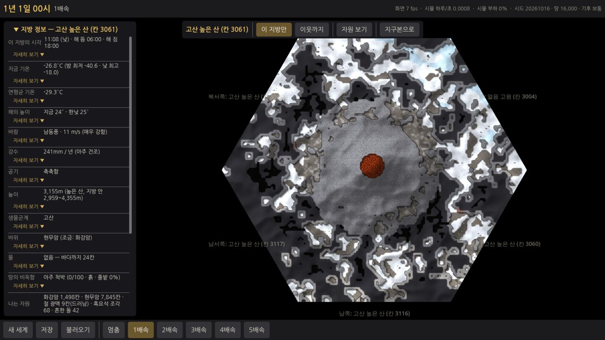
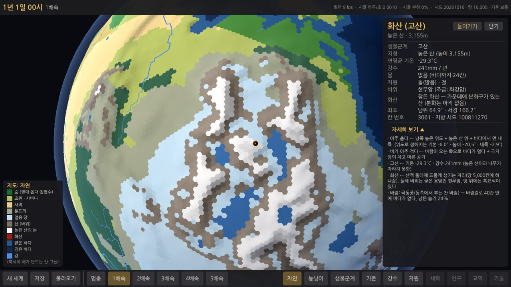
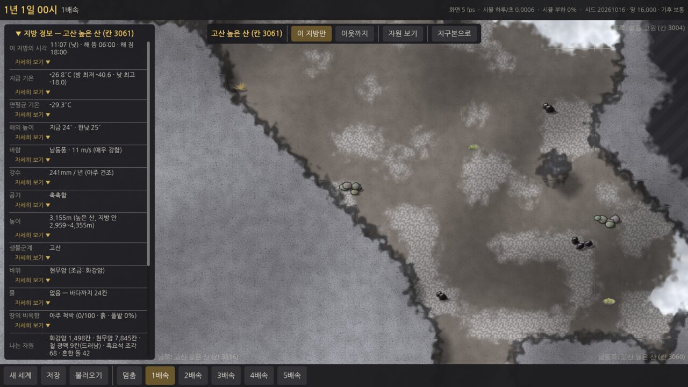
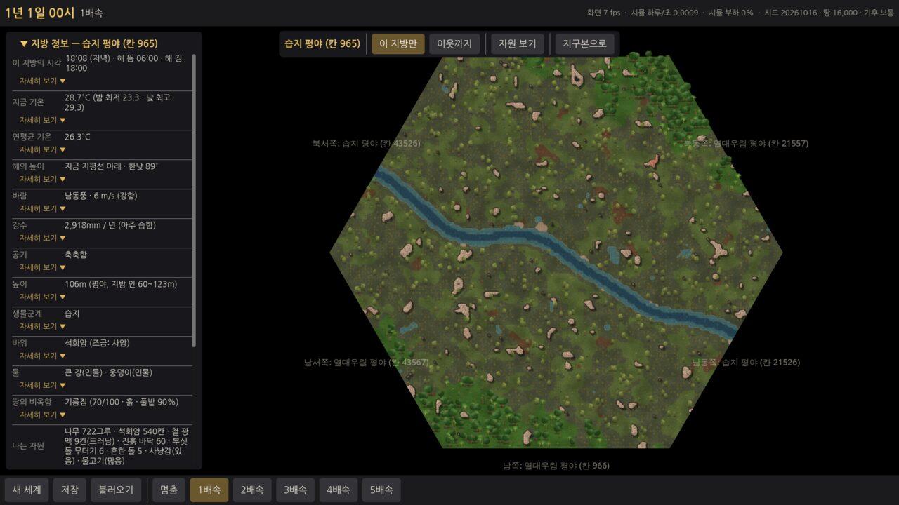
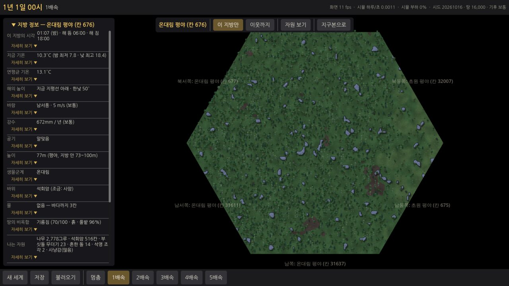
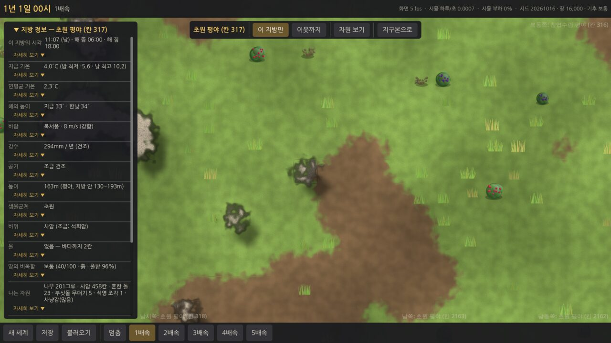
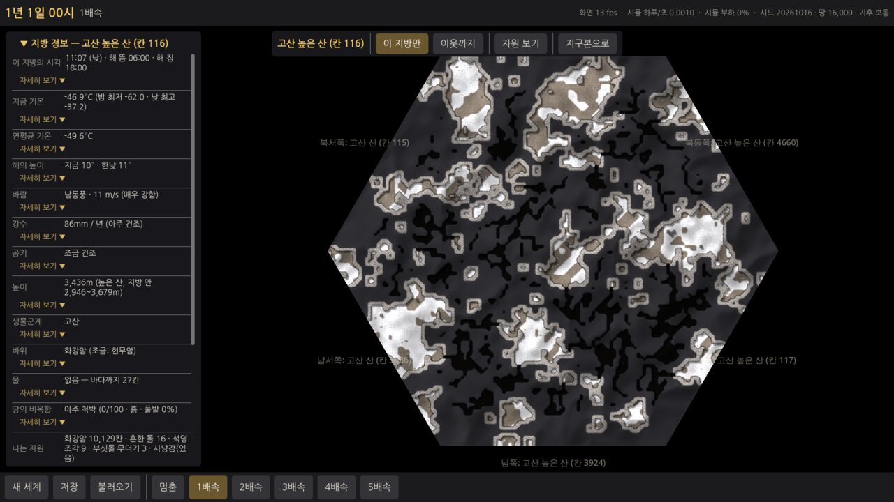
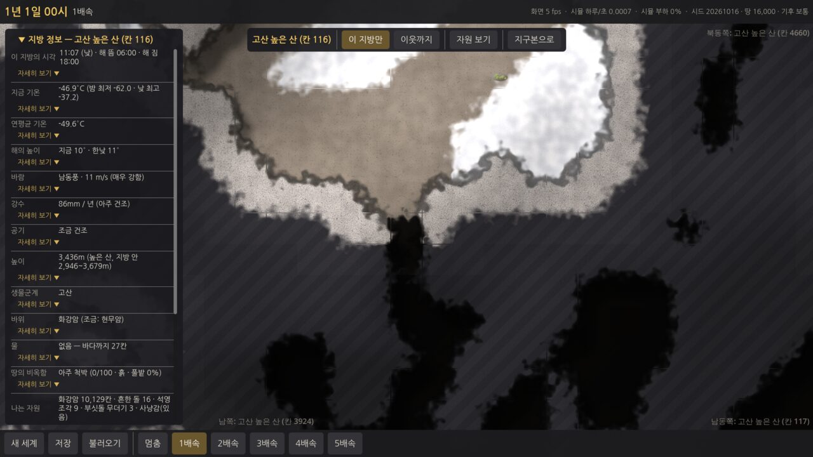
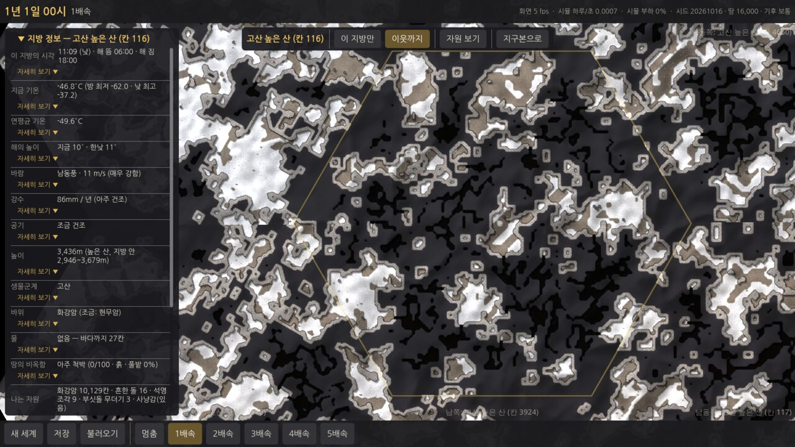

- (1차 검토 뒤 찍음 — 지금은 색이 조금 다름) 평야의 작은 바위 무리 `rocks-plain.jpg` · 광맥이 드러난 바위 덩어리(사암 + 구리 · 철) `ore.jpg` · 광맥 카드 `ore-card.jpg` · 광맥 정보 창 `tile-info.jpg` · **자원 보기** `resource-view.jpg` · 강가 자갈 `river-gravel.jpg` · 산(바위 덩어리 · 어두운 바위 속 · 검은 동굴) `mountain.jpg` · 산 이웃까지(바위 덩어리가 경계를 넘어 이어짐) `neighbors-mountain.jpg` · 지구본 칸 정보의 "바위" 줄 `globe-enter.jpg`
- 숲 `forest.jpg` · 강 `river.jpg` · 해안 `coast.jpg` · 사막 `desert.jpg` · 툰드라 `tundra.jpg` · 이웃까지 `neighbors.jpg` · 나무 카드(가장 가까이) `card.jpg` · 오각형의 막힌 변(절벽) `pentagon-cliff.jpg` · 윈도우 exe(Wine) 이웃까지 `windows-exe-wine.jpg`

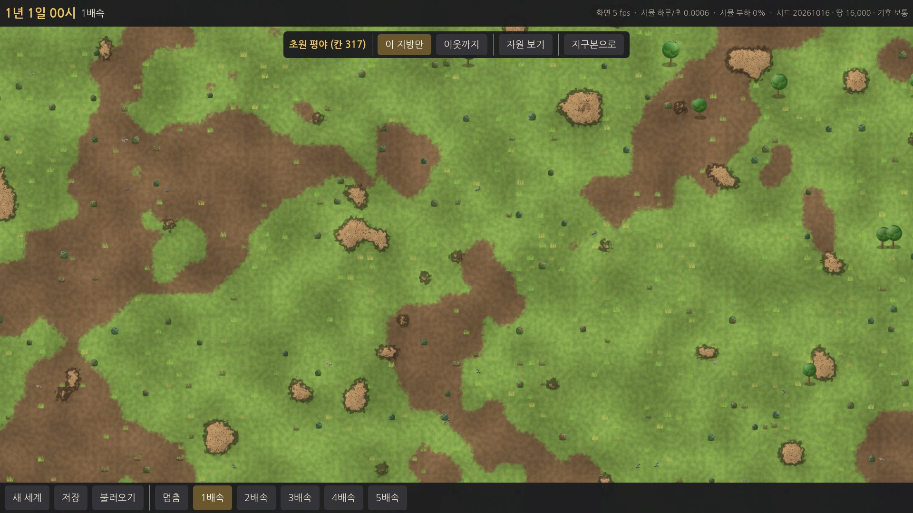
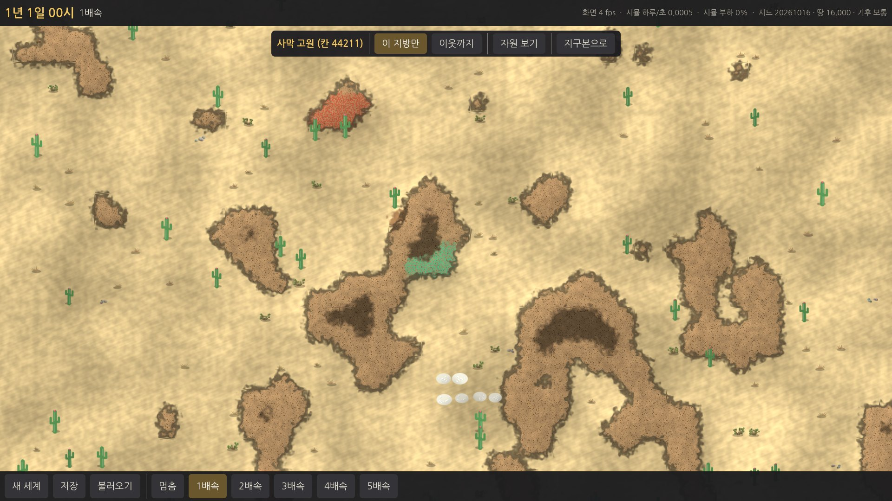
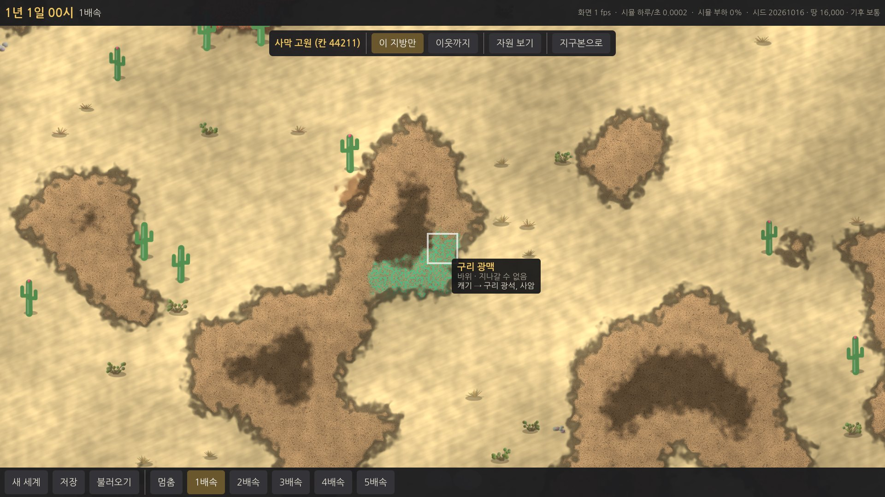
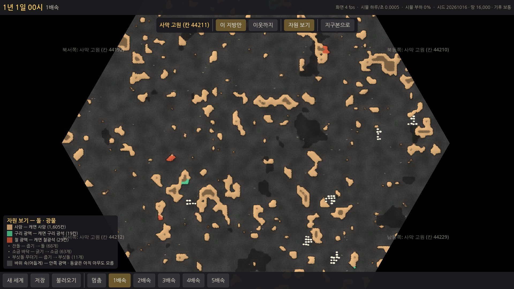
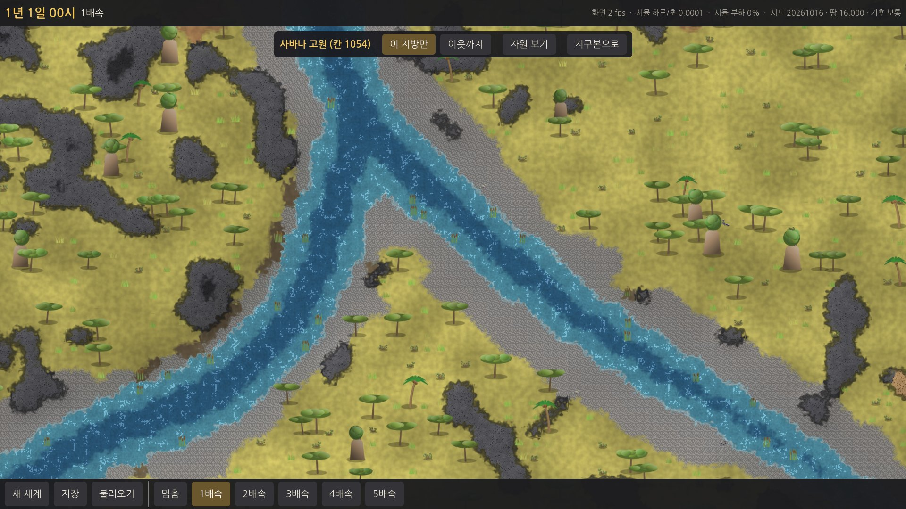

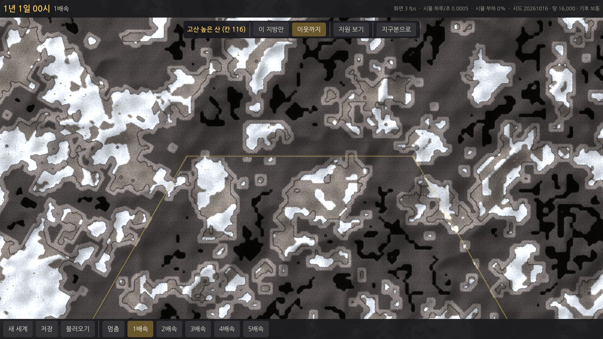

## 검토 뒤 고친 것 (1차, 사용자 요청 6가지)
| # | 요청 | 한 것 |
|---|---|---|
| 1 | 바위를 림월드처럼: 타일 하나 · 못 지나감 · 무리 → 덩어리 → 산 · 큰 덩어리 안 동굴 · 안 가 본 동굴은 검게 | 바위 타일(`Ground.Stone`, 못 지나감) · 거칠기로 정한 양 · 덩어리 안쪽 4 타일 이상에 굴 · 방 모양 동굴(위가 덮임) · 동굴은 검게, 덩어리 안쪽은 어둡게(숨김). 큰 바위 오브젝트는 없앰 |
| 2 | 바위 종류(화강암 · 석회암 · 사암 등), 행성 칸마다, 칸 정보에도 | 5종(`data/rocks.json`) · 칸마다 주된 바위 + 섞인 바위(`Geology`) · 지구본 칸 정보 "바위" 줄 · 지방 타일 · 카드 · 정보 창에 종류 |
| 3 | 광맥은 바위 덩어리 안 · 드러난 것은 색으로(구리 초록, 철 붉은 돌) · 안쪽은 숨김 | 광맥 = 바위 타일 속(`Ore`) · 드러난 것만 얼룩 · 알갱이로 칠함(구리 초록 · 철 붉음 · 주석 은빛) · 안쪽은 숨김(카드도 알려 주지 않음). 광맥 오브젝트 3가지는 없앰 |
| 4 | 바위 양은 평지 · 언덕 · 산에 따라 · 평야에도 작은 바위 무리 · 잔돌 · 부싯돌 · 강가 자갈 | 평야 ~4% · 언덕 ~20% · 산 ~50~65% · 평야 30/30칸에 바위 무리 + 잔돌 + 부싯돌(`resource_floor`) · 강가 자갈 바닥(잔돌 3배) |
| 5 | 바위 덩어리도 이웃 지방과 경계에서 이어지게 | 행성 위의 점에서 뽑는 잡음 · 섞은 거칠기로 정함 → 경계 양쪽 3 타일 띠의 바위 비율 차이 평균 4.7%p(무관한 변끼리 23.5%p). 동굴 · 광맥용 바위 무리는 가장자리에서 멀리 |
| 6 | 2D 지도에 "자원" 보기 | 위쪽 [자원 보기] · 키 Y: 바위(종류 색) · 드러난 광맥 · 자갈 · 잔돌 · 부싯돌 · 진흙 · 소금만 밝게 + 범례(종류 · 칸 수 · 캐면 나오는 것) |

## 검토 뒤 고친 것 (2차, 사용자 요청 10가지)
| # | 요청 | 한 것 |
|---|---|---|
| 1 | 땅 위 돌 종류(흔한 돌 · 부싯돌 · 흑요석 …), 바위 종류 · 지형에 맞게, 돌마다 성질 | 흔한 돌(어디서나) · **부싯돌 무더기(석회암 땅, 다른 바위는 1/10)** · **석영 조각(화강암 땅, 다른 바위는 1/20)** · **흑요석 조각(화산 둘레에만, 현무암 땅에 많이)**. 오브젝트 데이터에 `rocks`(바위 종류별 무게) · `volcano`(화산 둘레만) 칸을 더함. `data/items.json` 의 돌 9가지(흔한 돌 · 부싯돌 · 흑요석 · 석영 · 화강암 · 석회암 · 사암 · 현무암 · 점판암)에 **성질**(단단함 · 질김 · 쪼개짐 · 날이 섬 · 무게 = 낮음/보통/높음/아주 높음, 예: 흑요석 날 = 아주 높음 · 질김 = 낮음) — 숫자는 E4 |
| 2 | 화산 칸(산맥 둘레에 드물게), 지구본 · 칸 정보, 지방 가운데 화산 + 분화구, 둘레 현무암 · 흑요석 | `Volcanoes`: 산 · 높은 산(또는 산과 맞닿은 언덕 · 고원), 둘레가 모두 땅인 칸 중 **땅 5,000칸에 하나꼴(2~6개)**, 서로 약 9칸 이상 떨어지게. 화산 칸의 바위 = 현무암, 2칸 안 = 현무암 섞임. 지구본: 작은 원뿔 + **붉게 빛나는 꼭대기**, 지도 모드 · 범례에 "화산". 칸 정보: 제목 "화산 (…)" · "화산" 줄 · 이유 줄 · 가까운 칸엔 "가까이 있음 (n칸)". 지방: 가운데에 **분화구(못 지나감, 붉게 빛남)** · 지나갈 수 없는 원뿔 산(반지름 24) · 둘레 현무암 바위 · 자갈 · 흑요석 |
| 3 | 2D 지방 정보 칸(가리지 않는 자리), 지역마다 다른 것, 항목마다 자세히 보기 | 왼쪽 **"지방 정보"** 칸(제목을 누르면 접힘, 내용이 길면 스크롤). 지도는 칸이 차지한 만큼 오른쪽으로 비켜 가운데에 놓인다. 항목과 고른 것은 아래 "지방 정보 칸의 항목" |
| 4 | 2D 지도의 밝기가 그 지방 시각을 따라 낮 · 저녁 · 밤, 밤에도 읽을 수 있게 | 해의 높이로 색을 섞음: 낮 = 그대로 · 해 질 녘 = 따뜻한 주황빛 · 밤 = **푸르스름하게 약 55~78% 밝기**(검게 하지 않음). 땅과 오브젝트 그림에 같이 걸림 |
| 5 | "왜?" → "자세히 보기", "펼치기" 없애기 | 지구본 칸 정보 · 지방 정보 모두 **"자세히 보기 ▼ / ▲"** 로 바꿈. 누르면 펼치고 다시 누르면 접힘(동작 그대로) |
| 6 | 글자 · 단추 겹침 없애기 | 이웃 지방 이름을 **화면의 빈 곳(위 · 아래 막대, 지방 정보 칸, 오른쪽 정보 창, 범례, 위쪽 단추 줄을 뺀 곳) 안으로 끌어오고**, 그래도 무엇과 겹치면 감춤. 이름끼리 겹쳐도 뒤의 것을 감춤 |
| 7 | 평야 바위 무리가 흙더미 같다 → 회색 돌 + 그림자, 작은 돌을 멀리서도 보이게 | 바위 색을 회색 쪽으로(5종 모두) · 드러난 바위는 채도를 빼고 밝게 + 돌결 무늬 + **가장자리 어둡게 + 해 반대쪽 그림자**(솟아 보임). 흔한 돌 · 부싯돌 · 석영 · 흑요석 그림을 **진한 테두리가 있는 돌 덩어리**로 다시 그리고 **크기 약 1.7배** · 자갈 바닥은 회색 알갱이 |
| 8 | 산: 걸을 수 있는 땅 · 드러난 바위 · 숨은 바위 속 구분, 현무암과 숨은 바위 헷갈림 | 걸을 수 있는 바위 바닥 = **갈색이 섞인 흙빛** · 드러난 바위 = **밝은 회색**(종류 색) · 숨은 바위 속 = **한 가지 어두운 회색 + 빗금**(종류와 상관없이) · 동굴 = 검정. 현무암은 드러나면 **밝은 청회색**이라 빗금 친 숨은 바위와 다름 |
| 9 | 일부 동굴에 바깥으로 열린 입구, 안쪽은 들어가 보기 전까지 검게 | 10타일 이상인 동굴의 약 절반(55%)에서 **바깥 걸을 수 있는 땅까지 바위를 뚫은 굴**을 냄. 바깥에서 **두 칸(입구)만 보이고** 안쪽은 그대로 검게 가림(E3 에서 사람이 들어가면 걷음) |
| 10 | 빠른 테스트 48초 → 1분 안, 무거운 것은 느린 테스트로 | 지방을 수십 개 만드는 4개(경계 · 자원 단계 · 바위의 양 · 지도 기억)를 **느린 테스트로 옮김** → 빠른 테스트 **약 10초**(86개). 옮긴 것들은 느린 테스트에서 그대로 검사 |
| (덤) | 직접 찾은 것 | 윈도우 실행 파일(Wine)에서 **이웃 지방 이름이 □□ 로** 나오던 것을 고침(그 글자들만 한글 글꼴을 못 찾았음). 바다 쪽 이름이 화면 밖으로 나가던 것도 6번과 함께 고쳐짐 |

### 지방 정보 칸의 항목 (19가지, 요청 12 + 고른 것 7)
| 항목 | 내용 | "자세히 보기" 의 이유 |
|---|---|---|
| 이 지방의 시각 | 그 지방 시각 · 낮/저녁/밤/새벽 · 해 뜸 06:00 · 해 짐 18:00 | 세계 시간(맨 위 시계 = 경도 0°) + 경도 ÷ 15° (15° = 1시간). 계절이 없어 어디서나 낮밤 12시간씩 |
| 지금 기온 | 지금 · 밤 최저 · 낮 최고 | 연평균 + 낮밤 곡선(6시 가장 차갑고 15시 가장 따뜻). 하루 차이 = 6°C + 마른 정도(최대 +14) − 바닷가 3 + 내륙 3 + 높은 곳 3 → **사막은 20°C 넘게** |
| 연평균 기온 | | 지구본 칸 정보와 같은 이유(위도 · 높이 · 바다 · 바람) |
| 해의 높이 | 지금 · 한낮 | 위도: 한낮 = 90° − 위도 |
| 바람 | 방향 · 세기(m/s) | 위도 띠(무역풍 · 편서풍 · 극동풍)와 북/남반구로 방향, 바닷가 +2 · 높은 곳 · 숲 −2 · 탁 트인 땅 +1 · 한낮 + |
| 강수 | mm/년 | 지구본과 같은 이유(바람 길 · 산 그늘) |
| 높이 | 칸 높이 · 지방 안 최저~최고 | 행성 높이 + 거칠기 |
| 생물군계 | | 지구본과 같은 이유 |
| 바위 | 주된 바위 · 섞인 바위 | 지형 · 생물군계 · 지질 지역, 캐면 나오는 것, 화산 가까이면 현무암 |
| 물 | 강 · 호수 · 웅덩이(민물) · 바다(짠물) · 없으면 바다까지 칸 수 | 지방 안 물 타일을 세어 민물/짠물 |
| 땅의 비옥함 | 0~100 · 흙 · 풀밭 비율 | 기온 · 비 · 흙/풀밭 · 강가 · 모래/바위 |
| 나는 자원 | 나무 · 바위(타일 수) · 광맥(드러남) · 돌 종류 · 진흙 · 소금 · 사냥감 · 물고기 | 지방 안에서 센 것 + 행성 자원 단계 |
| (고름) 공기 | 습함 ~ 아주 건조 | 강수와 기온으로 어림(따뜻할수록 빨리 마름) |
| (고름) 서리 · 눈 | 늘 얼어 있음 / 밤마다 서리 / 가끔 서리 / 없음 | 밤 최저 기온(0°C 아래면 서리) |
| (고름) 걷기 어려움 | 걸을 수 있는 땅 비율 | 물 · 바위 · 절벽 · 분화구 타일 수 |
| (고름) 바다까지 | 칸 수 | 행성의 바다 거리 |
| (고름) 화산 | 이 지방이 화산 / 가장 가까운 화산 n칸 / 멀리 없음 | 화산 칸까지 거리, 흑요석은 화산 둘레에서만 |
| (고름) 위치 | 위도 · 경도 · 칸 번호 | |
| (고름) 낮밤 길이 | "이 지방의 시각" 이유에 포함 | 행성이 기울어지지 않아 어디서나 12시간 |

## 기획과 다르게 한 것 / 이유
1. **변의 시작 자리**: 프롬프트는 "E1 의 이웃 순서 그대로". 순서(시계 방향)는 그대로 두고, **가장 북쪽 이웃이 위**에 오도록 시작 자리만 돌렸다. 지구본에서 본 방향과 지방 지도의 위가 대략 같아야 덜 헷갈리고, 가장자리 이름의 "북쪽 · 남동쪽" 도 맞는다.
2. **경계를 맞추는 방법**: 프롬프트는 "두 칸 번호로 정한 공유 시드로 경계 모양". 강이 건너는 자리는 그대로 공유 시드로 정했고, 나머지(높이 · 생물군계 · 물가 · 무늬)는 **타일을 행성 위의 점에 놓고 행성 전체의 잡음 · 칸 무게로 정해** 경계에서 저절로 이어지게 했다. 공유 시드만으로는 변 위의 값만 맞고 변 근처(안쪽 몇 타일)가 따로 놀아서, 이웃까지 붙였을 때 이음매가 보였을 것이다. 어느 쪽을 먼저 만들어도 같다(테스트).
3. **높이**는 "높이 단계" 대신 **정수 m** 로 저장했다(그늘을 매끈하게 그리려면 단계가 너무 거칠다). 물은 따로 **물 깊이** 값.
4. **땅 종류에 얼음 · 절벽 · 바위 · 자갈을 더했다**(13가지). 얼음 생물군계 · 얼어붙은 물, 오각형의 막힌 변, 검토 뒤 바위 타일 · 강가 자갈. 예전 "바위 땅" 은 걸어 다닐 수 있는 **바위 바닥**(동굴 바닥 포함)으로 이름을 바꿨다.
5. **호수 칸**은 지방으로 들어갈 수 없다(물만 있으므로). [이웃까지]에서는 "바다가 아닌 칸" 이라 **온통 물인 지방으로** 보인다(호숫가는 둘레 땅 지방 쪽에 그려진다).
6. **오브젝트 그림 이름 · 크기 · 분류**를 데이터에 넣었고, 나오는 자원은 **`data/items.json`** 따로(아이디 · 이름). 데이터는 시뮬 안에 넣어(embedded) 윈도우 실행 파일에서도 같은 것을 쓴다.
7. **사냥감 · 물고기**는 동물이라 지도 오브젝트를 만들지 않았다(E3 · E15).
8. **Esc** 는 정보 창이 열려 있어도 바로 지구본으로 나간다(정보 창도 닫힘). 지구본에서 칸을 고른 뒤 **Enter** 로도 들어간다.
9. 지방 화면에서는 아래 막대의 **지도 모드 단추 · 범례를 감춘다**(지구본에만 쓰이고, 창끼리 가리지 않게).
10. 지방 **이름이 아직 없어서** 가장자리 · 위쪽에는 "온대림 평야 (칸 676)" 처럼 생물군계 + 지형 + 칸 번호를 쓴다.
11. 지도 기억은 게임 세계가 아니라 **시뮬의 공용 기억(`ProvinceCache`, 최근 40개)** 에 둔다 — 지도는 행성 + 칸만으로 정해지는 읽기 전용이라 나눠 써도 결과가 같다. 세계의 "바뀐 것"(E3~)은 `GameWorld.ProvinceChanges` 자리에.
12. (검토 뒤) **바위 종류 · 광맥은 `data/rocks.json`** 에 따로 두었다(오브젝트가 아니라 타일이므로). 행성 칸의 바위 종류(`Geology`)는 행성 지문에 넣지 않고 행성 + 시드로 그때그때 계산한다(E1 의 행성 지문 고정값을 바꾸지 않으려고 — 결정론은 같음).
13. (검토 뒤) **숨김은 동굴만이 아니라 덩어리 안쪽 바위에도** 걸었다(그 속 광맥을 숨기려면 필요). 화면에서 동굴은 검게, 바위 속은 어둡게(완전히 검으면 산 전체가 구멍처럼 보여서).
14. (검토 뒤) 광맥 바깥 면 판정은 **둘레 8칸에 드러난 땅이 있는가**로 했다(대각선도 드러남으로 침). 언덕처럼 덩어리가 작은 곳은 광맥 대부분이 드러나고, 산의 큰 덩어리 안쪽은 숨는다.

15. (2차 검토 뒤) **화산 칸도 행성 지문에 넣지 않고** 행성 + 시드로 그때그때 정한다(`Volcanoes`, 난수는 "planet.volcano" 스트림) — 바위 종류와 같은 이유. 화산 둘레 바위(현무암)도 같은 방식.
16. (2차 검토 뒤) **계절이 없어서**(기획서 5-2, 행성이 기울지 않음) 해 뜨는 시각 · 지는 시각이 어디서나 그 지방 시각 6시 · 18시이고, 해의 높이는 위도와 시각만으로 정한다. 극지방도 낮밤이 12시간이다.
17. (2차 검토 뒤) **맨 위 시계 = 경도 0° 의 시각**으로 정했다(세계 시간). 지방 시각은 경도 15° 마다 1시간씩 다르다.
18. (2차 검토 뒤) **지금 기온 · 바람 · 공기**는 화면용 설명이다(시뮬 상태가 아님). 하루 기온 차이 · 바람 세기는 실제 지구의 대략적인 값을 본뜬 어림이고, 사람의 생활(E3~)이 쓰기 시작할 때 시뮬로 옮길지 정한다.
19. (2차 검토 뒤) 분화구는 땅 종류 **"분화구"**(못 지나감)를 새로 더했다(땅 종류 15가지).

## 알려진 문제 · 다음 단계에 넘길 것
- **윈도우 PC 에서의 fps 와 부드러움은 아직 확인 못 함**(E0 · E1 에 이어 세 번째). 땅 셰이더가 화소마다 타일 9개 + 높이 16개를 읽는다 — 아주 약한 내장 그래픽에서 느리면, 멀리 볼 때는 섞는 타일 수를 줄이는 가벼운 셰이더로 바꿀 수 있다.
- **오각형 둘레의 이음매 하나**: 오각형 지방의 막힌 변 쪽 꼭짓점에서는, [이웃까지]로 볼 때 이웃 둘 사이 한 곳이 맞지 않는다(오각형 둘레는 평면에 빈틈없이 펼칠 수 없음). 그 자리는 절벽이라 사람이 지나가지 않는다. 행성에 오각형은 12개뿐이고, 땅이 적으면(2,000 이하) 모두 바다.
- 오각형 지방의 막힌 쐐기(지도의 1/6)는 행성 위에서 넓이가 없는 곳이라 무늬를 옆으로 부풀려 만들었다 — 약간 늘어난 무늬가 보일 수 있다.
- 맞댄 변에서 **땅 종류가 다른 타일 11%**(물 · 강 · 높이는 맞음): 같은 행성 위의 점이 아니라 변 양쪽 1 타일씩 떨어진 타일을 비교한 것이라 무늬 잡음의 문턱이 갈린 것. 화면에서는 섞어 그려서 이음매로 보이지 않는다.
- (2차 검토 뒤) 동굴 절반쯤은 입구가 열려 있고 나머지는 아직 **바위 속에 갇혀** 있다. 사람이 들어가거나 바위를 캐면 E3 에서 숨김을 걷는다.
- (2차 검토 뒤) **석회암이 없는 평야 일부에는 부싯돌이 없다**(평야 30칸 중 2칸 — 대신 석영이 있음). 날 서는 돌이 아예 없는 지방이 생기면 이웃 지방에서 가져와야 한다(E3 · E4 에서 확인).
- (2차 검토 뒤) 화산은 **분화하지 않는다**(재난 단계). 화산 지방이 높은 산 · 추운 곳에 있으면 눈과 섞여 보인다.
- (2차 검토 뒤) 밤에는 땅 위 바위 무리가 푸르스름하게, 저녁에는 분홍빛으로 보인다(빛 색을 따라가서). 색 튜닝 때.
- (검토 뒤) 광맥 칸의 수는 행성의 자원 단계를 따르므로, 구리 · 철이 "없음" 인 산에는 광맥이 없다(대부분의 산). 광맥을 찾으려면 지구본의 **자원 지도(Y)** 로 구리 · 철 칸을 먼저 찾으면 된다.
- **E3**: 사람이 걸을 수 있나는 `GroundInfo.IsWalkable`(깊은 물 · 절벽 · 바위 · 바깥은 못 감). 나무 베기 같은 변화는 `GameWorld.ProvinceChanges` 에 "바뀐 타일"로 쌓고 저장 파일 버전 3 의 자리에 쓴다. 지방 사이를 걸어 넘어갈 때는 `ProvinceLayout`(이웃 배치 · 좌표 변환)을 쓴다.
- **E3**: 지구본 칸의 "흐릿함 → 열림"(사람이 들어가 산 칸)은 아직 없다.
- **E4**: `data/items.json` 의 아이템(사과 · 나무 · 돌 · 구리 광석 …)에 재료 성질(기획서 8-1)을 채운다. 아이디는 행성 자원과 같은 이름 체계.
- 툰드라 · 얼음 땅은 오브젝트가 작고 드물어 단조로워 보인다(그림 · 수치 튜닝 때).
- 강이 시작하는 칸의 샘은 지방 안 아무 곳(가운데 근처)이다. 호수에서 흘러나오는 강은 행성 자료에 강 크기가 없어 호수 쪽 변이 아니라 샘에서 시작한다.
- 개발용: `tools/bench --province-dump 그림.ppm --seed N --cell forest|river|…|칸번호` 로 지방 + 이웃을 이어 붙인 그림을, `tools/screenshot.sh … --enter=river|ore|riverbank --neighbors --pzoom=0.5 --focus=river|coast|blocked|stone|ore|cave|mouth|gravel --hover --tileclick --resview --localhour=시 --select=volcano` 로 게임 화면을, `--enterexit=N` 으로 드나들기 메모리를 볼 수 있다.
