# E2 지방 — 보고서

## 쉬운 말 다섯 줄
1. 지구본에서 **땅 칸을 두 번 누르면**(또는 칸 정보의 **[들어가기]**) 그 땅의 **2D 지도**가 펼쳐집니다. 숲에는 나무가 빽빽하고, 강이 흐르고, 바닷가에는 모래밭과 바다가, 산에는 바위와 눈이 있습니다.
2. 나무 · 바위 · 광맥 같은 것에 **마우스를 올리면 작은 카드**로 이름과 "다루는 법 → 나오는 것"(예: 사과나무 — 따기 → 사과 · 베기 → 나무)이 보이고, 누르면 오른쪽 정보 창에 자세히 나옵니다.
3. 위쪽 **[이웃까지]**를 누르면 둘레 지방까지 **육각형으로 빈틈없이 이어 붙어** 보입니다. 강 · 바다 · 높낮이 · 숲이 경계를 넘어 자연스럽게 이어지고, 보이는 곳 밖은 검게 둡니다.
4. 같은 땅 칸은 **언제 들어가도 똑같은 지도**입니다. 지방 하나 만드는 데 약 0.03초(목표 0.5초), 여러 지방을 120번 드나들어도 메모리가 계속 늘지 않았습니다.
5. 아쉬운 점: 클라우드에는 그래픽 카드가 없어 **화면 부드러움(fps)은 윈도우 PC에서 확인**이 필요합니다(클라우드 8~12 fps). 또 오각형 땅(행성에 몇 개뿐) 둘레를 [이웃까지]로 볼 때 이음매 한 곳은 맞출 수 없습니다(수학적으로 평면에 펼칠 수 없음).

## 해 볼 것
1. zip 을 풀고 `WTW` 폴더의 **`WTW.exe`** 를 실행합니다. 윈도우가 "PC 보호" 경고를 띄우면 **"추가 정보 → 실행"** 을 누르세요(서명하지 않은 파일이라 처음 한 번 나옵니다).
2. 새 세계 → [만들기] → 지구본에서 **땅 칸을 두 번 누릅니다**(또는 한 번 눌러 칸 정보 창의 **[들어가기]**, 키보드 Enter).
3. **마우스 왼쪽으로 끌어** 둘러보고(멈춘 채 놓으면 그 자리에 섭니다), **휠로 가까이 · 멀리** 해 봅니다. 땅 사이에 **격자선이 보이지 않는지**, 가장 가까이 가도 **그림이 각지지 않는지** 봐 주세요.
4. 나무 · 바위 · 광맥 · 풀에 **마우스를 올려** 작은 카드(이름 · 땅 종류 · 다루는 법 → 자원)를 보고, **눌러서** 오른쪽 정보 창을 봅니다.
5. 위쪽 **[이웃까지]** 를 누릅니다 → 둘레 지방이 이어 붙는지, 경계(강 · 바닷가 · 숲)가 자연스러운지. **[이 지방만]** 으로 돌아옵니다.
6. **강이 흐르는 칸, 바닷가 칸, 산 칸, 사막 · 툰드라 칸**에 들어가 서로 다른지 봅니다(지구본의 "자연" 지도에서 강은 파란 선, 산은 회색, 사막은 모래색).
7. **Esc**(또는 [지구본으로])로 나왔다가 **같은 칸에 다시 들어가면 같은 지도인지** 봅니다.
8. 위쪽 오른편 **"화면 ○○ fps"** 가 지방 화면에서 60 근처인지 알려 주세요 — 특히 [이웃까지]에서 가장 멀리 / 가장 가까이 볼 때.

---

## 한 일

### 1. 지방 지도 만들기 (`sim/Province/`)
- **틀** (`HexFrame.cs`): 150×150 네모 타일 안의 **정육각형**(위 · 아래 변이 평평, 꼭짓점 반지름 75 타일)만 쓴다 — 14,614 타일, 나머지는 쓰지 않는 땅(검게). 변(자리) 0~5 는 시계 방향.
- **변 = 행성의 이웃** (`ProvinceGenerator.Slots`): E1 의 이웃 순서(시계 방향)를 그대로 쓰되, **가장 북쪽 이웃이 위(자리 0)** 에 오도록 시작 자리만 돌린다(지구본과 같은 방향감). 꼭짓점 H[s] = 행성 꼭짓점(삼각형) 번호 — 맞댄 두 지방의 변 끝이 행성의 같은 점이다(테스트).
- **오각형 칸**: 이웃 다섯은 다섯 변에, 남는 한 변은 **절벽(넘을 수 없음)** 으로 막는다(4~6 타일 띠).
- **이웃과 이어지게 한 방법** (경계 공유 시드보다 한 걸음 더):
  1. 타일 하나하나를 **행성 위의 한 점**에 놓는다. 육각형을 여섯 쐐기(중심, 꼭짓점 두 개)로 나누고 쐐기 안의 무게 좌표로 "칸 중심 · 행성 꼭짓점 두 개" 를 섞는다 → 맞댄 변 위의 점은 양쪽 지방에서 행성 위의 **같은 점**.
  2. 그 점의 **칸 무게**: 가운데 칸 λc + 꼭짓점마다 만나는 세 칸에 λ/3 씩. 변 위에서는 양쪽 칸이 같은 무게. **높이 · 기온 · 강수 · 거칠기 · 자원 단계는 이 무게로 섞고**, 생물군계는 (생물군계별 무게 + 잡음)으로 고른다 → 숲 · 사막의 경계가 지방 경계를 넘어 구불구불 이어진다.
  3. 잡음은 지방마다가 아니라 **행성 전체에 하나**(세계 시드의 `province.noise.*` 스트림) → 어느 쪽 지방에서 봐도 같은 무늬.
  4. **강이 변을 건너는 자리**는 **두 칸 번호로 정한 공유 시드**(세계 시드, 작은 번호, 큰 번호)에서 → 어느 쪽을 먼저 만들어도 같은 자리, 변에 수직으로 건넌다. 강 폭은 위쪽 칸의 `RiverSize`.
  5. **바다 · 호수 쪽 변은 물 띠**. 옆 변도 물이면 이어지고, 옆 변이 땅이면 꼭짓점에서 0 으로 줄어 이웃 지방의 물 띠와 그 점에서 만난다. 물가는 바다 높이로 낮아지고, 바닷가는 모래, 강가 · 호숫가는 진흙.
- **강**: 행성의 `Downstream`(나가는 이웃)과 "이 칸으로 흘러드는 이웃" 의 변으로 들고 나고, 지방 안의 합류점에서 만난다. 시작하는 칸은 지방 안의 샘에서. 구불구불(모서리 깎기), 변 근처는 곧게. 개울 2타일 · 강 3타일 · 큰 강 5타일 폭(큰 강 가운데는 깊은 물). 강을 따라 골짜기를 판다(변 근처는 양쪽이 같은 모양이 되게).
- **높이**: 섞은 높이 + 거칠기에 맞는 잡음(평야 ±수 m, 산 ±수백 m, 산등성이 무늬). 정수 m 로 저장.
- **땅 종류 11가지** (`Ground`): 흙 · 풀밭 · 모래 · 진흙 땅 · 바위 땅 · 눈 · 얼음 · 습지 · 얕은 물 · 깊은 물 · 절벽. 생물군계 · 그 자리 기온(높을수록 춥게) · 기울기 · 물가 거리 · 잡음으로 정한다. 높은 산 = 바위 + 눈(눈은 완만한 곳에, 가파른 곳은 바위), 사막 = 모래 + 바위 · 흙 얼룩, 습지 = 습지 + 웅덩이.
- 타일마다: 땅 종류 · 높이 · 물 깊이 · 생물군계 · **오브젝트 최대 하나** · 변형 값(그림을 조금씩 다르게) · 표시(강 · 바다).
- **결정론**: 사칙연산 · 제곱근 · Floor 만(삼각함수 없음), 결과는 정수. 난수는 지방 시드(`Planet.ProvinceSeed(칸)`)로 만든 타일 해시 · 지방 스트림과 세계 시드의 `province.*` 스트림에서만. **지방 지도 지문 4개를 테스트에 박아 둠**(CI = 다른 컴퓨터에서도 같아야 통과).
- **기억과 저장**: 만든 지도는 `ProvinceCache` 가 최근 40개를 기억(오래된 것은 잊음). `GameWorld.Province(칸)` 으로 얻는다. 저장 파일은 **버전 3** — 지도 전체가 아니라 **"바뀐 지방" 자리만**(지금은 늘 0개, 나무 베기 같은 변화는 E3~). 버전 1 · 2 파일도 읽는다.
- **여러 지방 배치** (`ProvinceLayout.cs`): 가운데 지방은 제자리, 이웃은 맞댄 변이 가운데를 보도록 60° 단위로 돌려 붙인다(행성의 이웃 순서가 모두 시계 방향이라 뒤집지 않고 돌리기만).

### 2. 오브젝트 — "타일 하나에 오브젝트 하나, 다루는 법에 따라 여러 자원"
- **`data/objects.json`**: 다루는 법 8가지(따기 · 베기 · 줍기 · 벗기기 · 깨기 · 캐기 · 파기 · 긁기)와 **오브젝트 28가지**. 오브젝트마다 아이디 · 한국어 이름 · 분류(나무 · 덤불 · 풀 · 돌 · 광맥 · 바닥) · 그림 이름 · 어떤 생물군계/땅에 나나(가중치) · 날 확률 · 묶인 행성 자원 · (광맥은) 뭉쳐 나기 · **다루는 법 → 나오는 자원**.
  - 나무 11: 사과나무(따기 → 사과 / 베기 → 나무) · 참나무(줍기 → 도토리) · 자작나무(벗기기 → 자작나무 껍질) · 소나무(베기 → 나무, 송진) · 가문비나무 · 버드나무 · 케이폭나무 · 야자나무(따기 → 야자 열매) · 바나나 · 아카시아 · 바오밥나무
  - 덤불 5: 난쟁이자작(툰드라) · 덤불(따기 → 열매 / 베기 → 잔가지) · 가시덤불 · 마른 덤불 · 선인장(따기 → 선인장 열매)
  - 풀 4: 풀(베기 → 풀) · 갈대(베기 → 갈대) · 버섯 · 이끼(긁기 → 이끼)
  - 돌 · 광맥 · 바닥 8: 큰 바위(깨기 → 돌) · 잔돌(줍기 → 돌) · 부싯돌 무더기(줍기 → 부싯돌) · 진흙 바닥(파기 → 진흙) · 구리 · 주석 · 철 광맥(캐기 → ○○ 광석, 돌) · 소금 바닥(긁기 → 소금)
- **`data/items.json`**: 나오는 자원 23가지(아이디 · 이름만 — 성질은 E4). **행성 자원과 같은 이름 체계**: 같은 물건은 같은 아이디(`stone · flint · clay · salt · wood`).
- **자원 단계 → 개수**: 묶인 행성 자원의 단계(없음 0 · 있음 1 · 많음 2, 이웃 칸과 무게로 섞은 값)에 비례. 없음이면 나지 않는다. 광맥은 단계 × 몇 뭉치(뭉치 하나 5~7 타일 안팎). 나무는 숲 얼룩 잡음으로 빈터가 생긴다.
- 사냥감 · 물고기(행성 자원)는 동물이라 오브젝트가 없다(E3 · E15).
- 데이터는 **시뮬 안에 넣어**(embedded) 게임 · 측정 도구 · 테스트가 같은 파일을 본다. 검사: 아이디 겹침 · 없는 아이템 · 없는 다루는 법 · 모르는 생물군계/땅 종류/행성 자원 · 필수 칸 · 확률 범위 — 틀리면 "objects.json 의 3번째 항목(apple_tree): …" 처럼 알려 준다.

### 3. 2D 지방 화면 (`game/src/ProvinceView.cs`)
- **들어가기**: 지구본에서 땅 칸을 **두 번 누르기** · 칸 정보의 **[들어가기]** · Enter. 바다 · 호수 칸은 "들어갈 수 없습니다" 알림. **나가기**: [지구본으로] · Esc → **들어갔던 칸을 보는 지구본**(그 칸이 골라진 채).
- **그리기**: 한 지방 = **땅 메시 하나**(육각형) + **오브젝트 MultiMesh 하나** — 타일마다 노드를 만들지 않는다. 지도 만들기는 다른 스레드에서(이웃까지 7 지방은 나눠서 동시에).
  - 땅 셰이더: 타일 자료(땅 종류 · 생물군계 · 물 깊이)를 텍스처로 받아 **화소마다** 둘레 3×3 타일을 매끈한 무게(B-스플라인)로 섞고, **같은 종류끼리 모은 면을 가파르게 잘라** 경계를 만든다 → 땅 종류 경계가 **격자 · 계단 없이 부드러운 곡선**. 무늬(풀결 · 모래 물결 · 바위 금 · 눈 그늘 · 습지 물)는 화면 세상 좌표의 잡음으로 → 확대해도 각지지 않고, 이어 붙인 지방끼리 무늬가 이어진다. 높이는 4×4 B-스플라인 면의 기울기로 언덕 그늘(해는 화면 왼쪽 위). **물은 잔잔하게 일렁이고**(아주 느린 물결 · 반짝임) 물가에 옅은 거품.
  - 오브젝트: 서 있는 그림(나무 · 덤불 · 풀 · 돌)은 지방을 돌려도 **똑바로 서고**, 아래쪽 것이 앞에 그려진다. 나무 · 풀은 **바람에 아주 살짝** 흔들린다. 같은 종류도 4가지 그림 + 크기(±14%) · 좌우 뒤집기 · 밝기 · 위치가 조금씩 다르다.
- **카메라**: 끌기 = 이동(**놓기 직전 0.08초 안에 움직이고 있었을 때만 관성** — E1 지구본과 같은 규칙), 휠 = 확대/축소(**마우스 자리를 중심으로 부드럽게**), 화살표 키 = 이동. 가장 멀리 = 밝은 범위 전체가 한 화면, 가장 가까이 = **타일 하나 약 74px**(손가락만 하게).
- **밝은 범위**: 위쪽 **[이 지방만] / [이웃까지]**. 이웃까지 = 바다가 아닌 이웃(호수 포함)까지 이어 붙이고, 들어간 지방은 옅은 금색 테두리. 밖은 **완전히 검게**, 가장자리에 **"북동쪽: 초원 평야 (칸 32007)" · "북동쪽: 바다" · "막힌 쪽 — 절벽"** 처럼 방향 · 이름만 흐리게(지방 이름이 아직 없어서 생물군계 + 지형 + 칸 번호).
- **카드 · 정보 창**: 타일이나 오브젝트에 마우스를 올리면 **작은 카드**(이름 · 땅 종류 · 생물군계 · 다루는 법 → 자원)가 마우스 옆에 따라다니고, 그 타일에 흰 네모. 누르면 **지구본의 칸 정보 창과 같은 자리**(오른쪽)에 자세히: 오브젝트 · 다루는 법마다 나오는 것 · 땅 종류 · 생물군계 · 높이(물이면 깊이) · 걸어갈 수 있나 · 지방 · 타일 좌표. 지방 화면에서는 지도 모드 단추 · 범례를 감춰 창끼리 겹치지 않게.
- **메모리**: 나가면 노드 · 텍스처를 모두 지우고, 지도는 최근 40개만 기억 → 드나들어도 계속 늘지 않는다(아래 측정).
- 지구본 칸 정보에 "열어 봤음" 표시는 하지 않았다(프롬프트대로 — 사람이 사는 것이 기준, E3 이후).

### 4. 그림 (`game/src/ProvinceArt.cs`, `Sketch.cs`)
- 그림 재료가 없어서 **모두 코드로**: 화소마다 도형까지의 거리로 가장자리를 부드럽게 칠하는 작은 붓(`Sketch`)으로 오브젝트 그림 28가지 × 4 변형을 128×128 칸에 그려 한 장(atlas)에 모은다(처음 지방에 들어갈 때 한 번, 약 0.2초). 나무는 잎뭉치 원을 겹쳐 왼쪽 위가 밝게, 아래에 그림자. 림월드풍 단순 일러스트.
- 땅 색표(땅 종류 × 생물군계) — 사바나 풀은 누렇게, 툰드라 풀은 칙칙하게, 열대 풀은 짙게.
- 무늬 잡음은 이어 붙여도 이음매 없는 **경사(펄린) 잡음** 4겹(값 잡음은 네모 얼룩이 보여서 바꿈).
- 그림 공급은 E0 의 `Art` 한 곳(partial)으로 — 나중에 진짜 그림으로 갈아 끼울 수 있게.

### 5. 테스트 (`sim.tests/ProvinceTests.cs`, `ProvinceSlowTests.cs`)
- 같은 칸 = 같은 지도(지문 · 배열), 다른 칸 · 다른 행성 = 다른 지도 · **지방 지문 고정값 4개**
- 육각형 밖 타일은 쓰지 않음 · 안은 모두 땅 종류가 있음
- 자리 = 행성 이웃 · 가장 북쪽 이웃이 위 · **맞댄 변의 두 끝 = 행성의 같은 꼭짓점**
- 오각형 지방은 한 변(만)이 절벽, 육각형 지방은 절벽 없음
- **경계가 맞음**(5종류 × 이웃 전부): 물 · 강 · 높이가 맞댄 변에서 이어짐, **이웃을 먼저 만들든 가운데를 먼저 만들든 같은 지도**
- **강이 행성의 강 방향과 같은 변으로 들고 남**(강 칸 12개의 모든 변), 강이 없는 칸엔 강물 없음
- 해안 칸: 바다 쪽 변은 물, 땅 쪽 변은 땅, 바다 표시 · 모래
- 산은 높낮이가 크고 바위 · 눈, 평야는 평평
- **자원 단계 → 오브젝트 수**(구리 광맥 · 돌 · 나무 · 진흙): 많음 > 있음 > 없음, 구리 없음이면 광맥 0
- 오브젝트가 허락된 땅 종류 위에만 · 배치(이어 붙이기)의 변 끝이 정확히 맞음
- `data/objects.json` · `items.json` 검사(겹치는 아이디 · 없는 자원 아이디 · 없는 다루는 법 · 모르는 생물군계/땅/행성 자원 · 필수 칸 · 범위 · 문법), 저장소 데이터 = 시뮬 안에 넣은 데이터
- 저장 → 불러오기 → 같은 지방(지도는 다시 만들어 같음), 저장 파일 버전 3, 지도 기억은 40개까지
- 빠른 테스트 **82개 통과**(약 25초, 그중 지방 20개). 느린 테스트에 **시드 20개 × 8종류** 추가(아래).

## 측정 결과 (목표 대비)

| 항목 | 목표 | 결과 |
|---|---|---|
| 지방 하나 만들기 | 0.5초 이내(클라우드) | **중앙값 0.026초, 최대 0.043초** (시드 20 × 8종류 = 160개, Release). 게임 안(개발용 빌드)은 0.1~0.2초 |
| 이웃까지 7 지방 만들기 | 보고 | 차례로 **0.18초**, 나눠서 동시에(게임이 하는 방식) **0.06초** |
| 지방 하나의 메모리 | 보고 | **약 198KB** (타일 배열 계산값 202KB와 같음). 기억 40개 = 약 8MB |
| 드나들어도 메모리가 계속 늘지 않음 | 늘지 않음 | 게임 안에서 지방 120번 드나들기(이 지방만 / 이웃까지 번갈아): 3번째 뒤 90.0MB → 40번 뒤 106.9MB → **120번 뒤 97.4MB**, 엔진 객체 수 약 2,000 그대로 |
| 경계가 맞음 (느린 테스트) | 이어짐 | 시드 20 × 8종류의 이웃 **변 880개**, 표본 191,290: **물이 다른 곳 0.06% · 강 0.05%** · 땅 종류 5.1%(바로 옆 타일이라 무늬 잡음 차이 — 화면에서는 섞여 보임) · 높이 차 중앙값 1.8m(지도 안 이웃 타일끼리 2.9m 보다 작음) |
| 강이 행성의 강 방향과 같은 변 | 모두 | **44/44 변** (느린 테스트) |
| 화면 fps | 60 근처 | **클라우드에서는 못 잼**: 그래픽 카드가 없어 CPU 가 그린다 — 지방 하나 11.5 · 가장 가까이 8.1 · 이웃까지 8.6 fps (같은 컴퓨터의 지구본 14.5). 윈도우 PC 확인 부탁(해 볼 것 8번) |
| 기존 측정(같은 컴퓨터, 기준 파일) | 느려지지 않음 | 행성 만들기 0.42 → 0.425초(비슷함) · 점 500개 하루/초 115.9 → 118.3(비슷함) |
| 게임 안 저장 → 불러오기 | 같은 상태 | 통과 — 리눅스 빌드와 **윈도우 exe(Wine)** 둘 다. 윈도우 exe 로 [이웃까지] 지방 화면도 띄움(`E2/windows-exe-wine.jpg`) |

### 종류별 분포 (느린 테스트 · 측정 도구, 시드 20개 중앙값, 땅 24,000 행성)
| 종류 | 땅 종류 | 오브젝트(지방당) |
|---|---|---|
| 평야 | 풀밭 77% · 흙 21% · 모래 2% | 2,431개: 풀 1,917 · 덤불 302 · 가시덤불 144 · 참나무 59 |
| 숲 | 풀밭 98% · 흙 2% | 4,437개: 참나무 1,651 · 풀 657 · 자작나무 539 · 덤불 489 · 소나무 418 · 사과나무 323 · 버섯 83 |
| 산 | 바위 61% · 눈 37% | 747개: 이끼 633 · 큰 바위 131 · 잔돌 78 · 난쟁이자작 35 |
| 해안 | 풀밭 64% · 모래 11% · 얕은 물 10% · 깊은 물 12% | 2,843개: 풀 835 · 참나무 342 · 케이폭 242 · 야자 164 · 갈대 121 |
| 강 | 풀밭 67% · 습지 10% · 모래 9% · 흙 5% · 물 5% | 3,311개: 풀 977 · 갈대 606 · 가시덤불 260 · 아카시아 219 |
| 사막 | 모래 88% · 흙 4% · 바위 4% · 풀밭 4% | 1,039개: 마른 덤불 468 · 선인장 288 · 가시덤불 121 · 소금 바닥 14 |
| 툰드라 | 풀밭 87% · 눈 8% · 얼음 2% | 2,319개: 풀 628 · 이끼 627 · 난쟁이자작 610 · 덤불 149 · 가문비나무 70 |
| 오각형 | (행성마다 다름) 절벽 2.4% | 1,680개 |

### 스크린샷 (`docs/reports/E2/`)
- 숲 `forest.jpg` · 숲 전체(가장 멀리) `forest-whole.jpg` · 강 `river.jpg` · 해안 `coast.jpg` · 산 `mountain.jpg` · 사막 `desert.jpg` · 툰드라 `tundra.jpg`
- 이웃까지 `neighbors.jpg` · 오브젝트 카드(가장 가까이) `card.jpg` · 타일 정보 창 `tile-info.jpg` · 오각형의 막힌 변(절벽) `pentagon-cliff.jpg` · 지구본 칸 정보의 [들어가기] `globe-enter.jpg` · 윈도우 exe(Wine) 이웃까지 `windows-exe-wine.jpg`

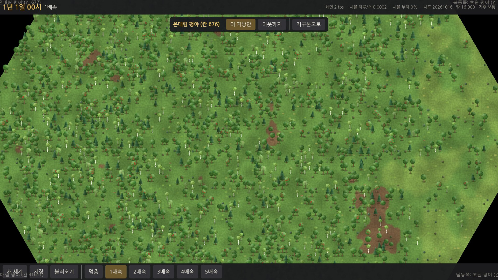
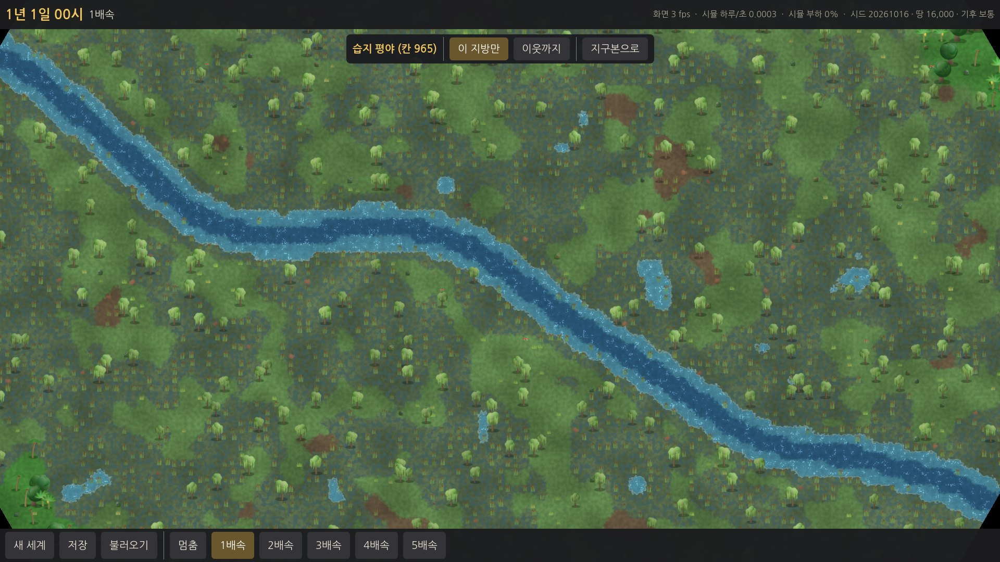
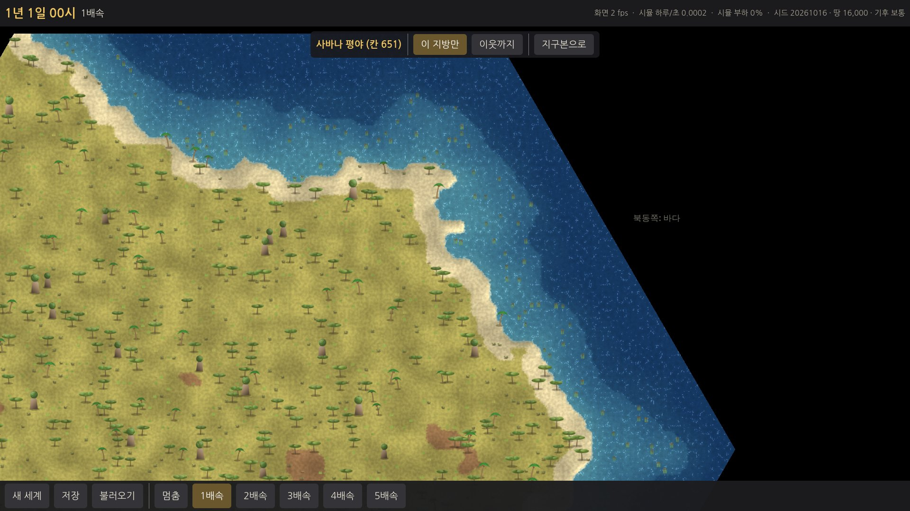
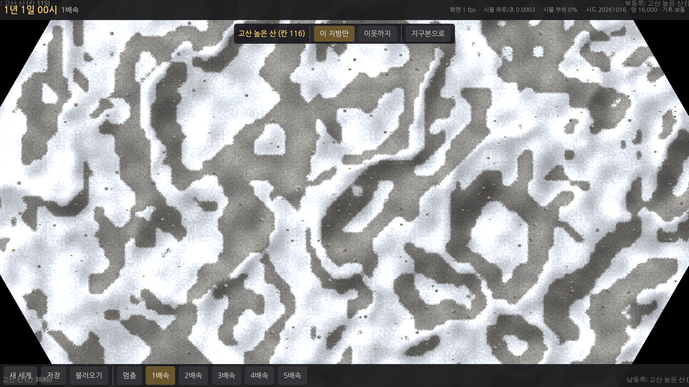
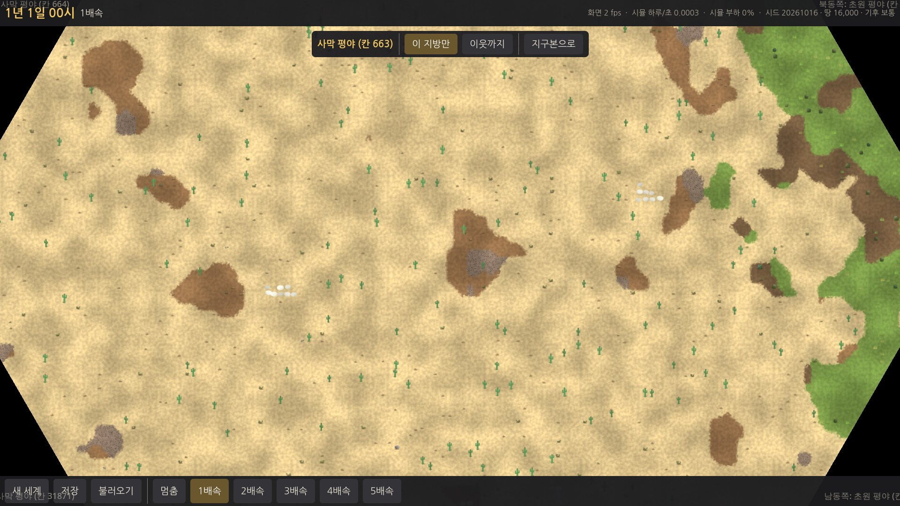
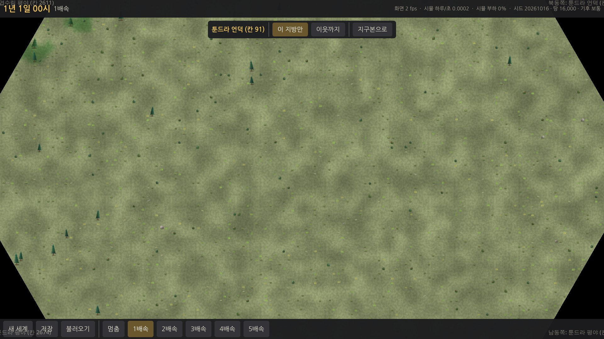
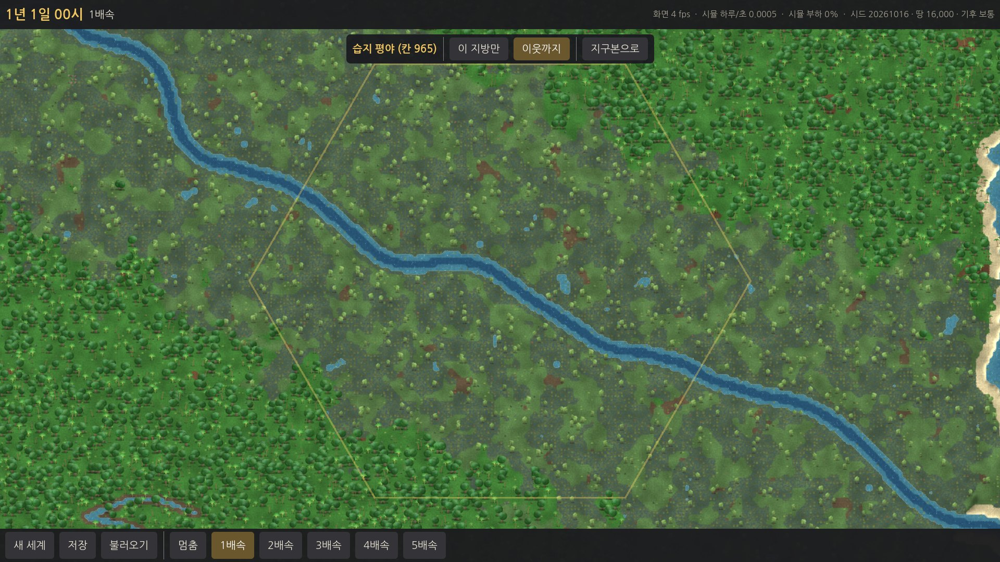
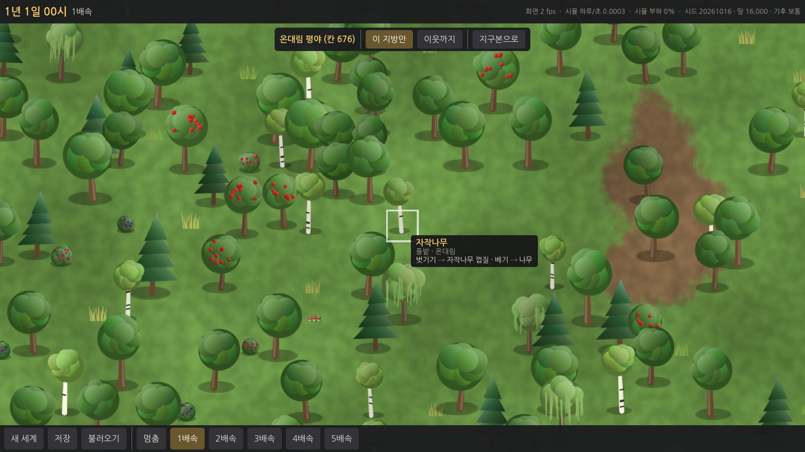
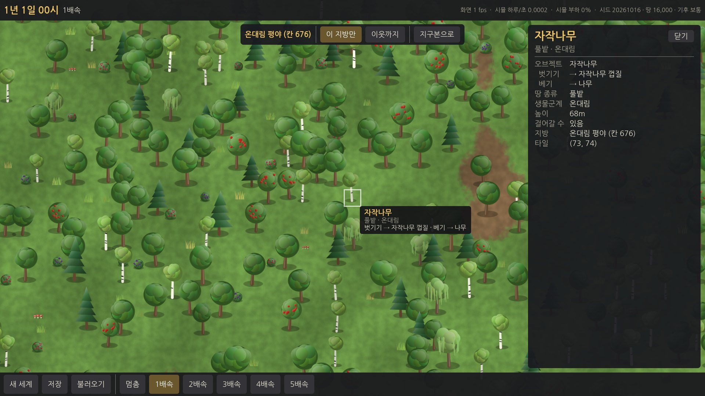
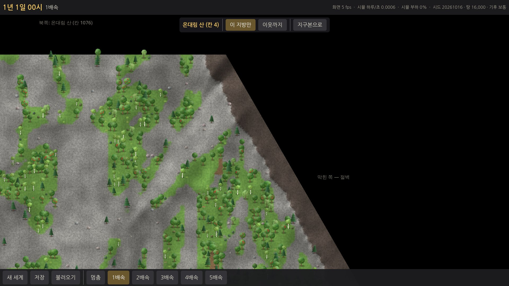
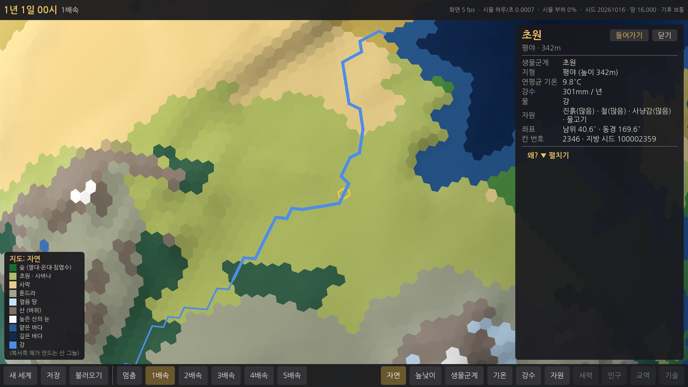

## 기획과 다르게 한 것 / 이유
1. **변의 시작 자리**: 프롬프트는 "E1 의 이웃 순서 그대로". 순서(시계 방향)는 그대로 두고, **가장 북쪽 이웃이 위**에 오도록 시작 자리만 돌렸다. 지구본에서 본 방향과 지방 지도의 위가 대략 같아야 덜 헷갈리고, 가장자리 이름의 "북쪽 · 남동쪽" 도 맞는다.
2. **경계를 맞추는 방법**: 프롬프트는 "두 칸 번호로 정한 공유 시드로 경계 모양". 강이 건너는 자리는 그대로 공유 시드로 정했고, 나머지(높이 · 생물군계 · 물가 · 무늬)는 **타일을 행성 위의 점에 놓고 행성 전체의 잡음 · 칸 무게로 정해** 경계에서 저절로 이어지게 했다. 공유 시드만으로는 변 위의 값만 맞고 변 근처(안쪽 몇 타일)가 따로 놀아서, 이웃까지 붙였을 때 이음매가 보였을 것이다. 어느 쪽을 먼저 만들어도 같다(테스트).
3. **높이**는 "높이 단계" 대신 **정수 m** 로 저장했다(그늘을 매끈하게 그리려면 단계가 너무 거칠다). 물은 따로 **물 깊이** 값.
4. **땅 종류에 얼음 · 절벽을 더했다**(11가지). 얼음 생물군계 · 얼어붙은 물, 오각형의 막힌 변.
5. **호수 칸**은 지방으로 들어갈 수 없다(물만 있으므로). [이웃까지]에서는 "바다가 아닌 칸" 이라 **온통 물인 지방으로** 보인다(호숫가는 둘레 땅 지방 쪽에 그려진다).
6. **오브젝트 그림 이름 · 크기 · 분류**를 데이터에 넣었고, 나오는 자원은 **`data/items.json`** 따로(아이디 · 이름). 데이터는 시뮬 안에 넣어(embedded) 윈도우 실행 파일에서도 같은 것을 쓴다.
7. **사냥감 · 물고기**는 동물이라 지도 오브젝트를 만들지 않았다(E3 · E15).
8. **Esc** 는 정보 창이 열려 있어도 바로 지구본으로 나간다(정보 창도 닫힘). 지구본에서 칸을 고른 뒤 **Enter** 로도 들어간다.
9. 지방 화면에서는 아래 막대의 **지도 모드 단추 · 범례를 감춘다**(지구본에만 쓰이고, 창끼리 가리지 않게).
10. 지방 **이름이 아직 없어서** 가장자리 · 위쪽에는 "온대림 평야 (칸 676)" 처럼 생물군계 + 지형 + 칸 번호를 쓴다.
11. 지도 기억은 게임 세계가 아니라 **시뮬의 공용 기억(`ProvinceCache`, 최근 40개)** 에 둔다 — 지도는 행성 + 칸만으로 정해지는 읽기 전용이라 나눠 써도 결과가 같다. 세계의 "바뀐 것"(E3~)은 `GameWorld.ProvinceChanges` 자리에.

## 알려진 문제 · 다음 단계에 넘길 것
- **윈도우 PC 에서의 fps 와 부드러움은 아직 확인 못 함**(E0 · E1 에 이어 세 번째). 땅 셰이더가 화소마다 타일 9개 + 높이 16개를 읽는다 — 아주 약한 내장 그래픽에서 느리면, 멀리 볼 때는 섞는 타일 수를 줄이는 가벼운 셰이더로 바꿀 수 있다.
- **오각형 둘레의 이음매 하나**: 오각형 지방의 막힌 변 쪽 꼭짓점에서는, [이웃까지]로 볼 때 이웃 둘 사이 한 곳이 맞지 않는다(오각형 둘레는 평면에 빈틈없이 펼칠 수 없음). 그 자리는 절벽이라 사람이 지나가지 않는다. 행성에 오각형은 12개뿐이고, 땅이 적으면(2,000 이하) 모두 바다.
- 오각형 지방의 막힌 쐐기(지도의 1/6)는 행성 위에서 넓이가 없는 곳이라 무늬를 옆으로 부풀려 만들었다 — 약간 늘어난 무늬가 보일 수 있다.
- 맞댄 변에서 **땅 종류가 다른 타일 5%**(물 · 강 · 높이는 맞음): 같은 행성 위의 점이 아니라 변 양쪽 1 타일씩 떨어진 타일을 비교한 것이라 무늬 잡음의 문턱이 갈린 것. 화면에서는 섞어 그려서 이음매로 보이지 않는다.
- **E3**: 사람이 걸을 수 있나는 `GroundInfo.IsWalkable`(깊은 물 · 절벽 · 바깥은 못 감). 나무 베기 같은 변화는 `GameWorld.ProvinceChanges` 에 "바뀐 타일"로 쌓고 저장 파일 버전 3 의 자리에 쓴다. 지방 사이를 걸어 넘어갈 때는 `ProvinceLayout`(이웃 배치 · 좌표 변환)을 쓴다.
- **E3**: 지구본 칸의 "흐릿함 → 열림"(사람이 들어가 산 칸)은 아직 없다.
- **E4**: `data/items.json` 의 아이템(사과 · 나무 · 돌 · 구리 광석 …)에 재료 성질(기획서 8-1)을 채운다. 아이디는 행성 자원과 같은 이름 체계.
- 툰드라 · 얼음 땅은 오브젝트가 작고 드물어 단조로워 보인다(그림 · 수치 튜닝 때).
- 강이 시작하는 칸의 샘은 지방 안 아무 곳(가운데 근처)이다. 호수에서 흘러나오는 강은 행성 자료에 강 크기가 없어 호수 쪽 변이 아니라 샘에서 시작한다.
- 개발용: `tools/bench --province-dump 그림.ppm --seed N --cell forest|river|…|칸번호` 로 지방 + 이웃을 이어 붙인 그림을, `tools/screenshot.sh … --enter=river --neighbors --pzoom=0.5 --focus=river|coast|blocked --hover --tileclick` 로 게임 화면을, `--enterexit=N` 으로 드나들기 메모리를 볼 수 있다.
