# E3 사람 — 보고서

## 쉬운 말 다섯 줄
1. 지방 화면 아래 **[사람 뿌리기] · [가족 뿌리기]** 를 누르고 땅을 누르면 사람이 생깁니다. 사람들은 **스스로** 열매를 따 먹고, 민물을 마시고, 밤이 되면 자고, 서로 이야기하고, 짝을 짓고, 아이를 낳고, 늙어 죽습니다.
2. 사람은 **코드로 그린 몸**(피부 · 머리색 · 머리 모양 · 체형 · 얼굴이 사람마다 다름, 정면 · 옆 · 뒤)으로 보이고, 걸을 때 흔들리고, 잘 때는 눕고, 이야기할 때 말풍선이 뜹니다. 움직임은 매 화면마다 이어 그려 **뚝뚝 끊기지 않습니다.**
3. 사람에 마우스를 올리면 **작은 카드**, 누르면 **큰 카드(개요 · 능력 · 몸 · 마음 · 관계 · 지식 · 이야기)** — 특히 "**지금 하는 일 — 왜**"가 보입니다. [따라가기] · 사람 목록 · 알림(태어남 · 죽음 · 짝 · 무너짐)도 있습니다.
4. 측정(시드 20개 × 10명 × 50년): 사람들이 **한 번도 멸종하지 않고 10명 → 중앙값 37~46명**, 기분 중앙값 **52~54(목표 40~55 안)**, 정신 붕괴 **한 사람당 1년에 0.01번(목표 1번 이하)**. 추운 툰드라에 뿌리면 불 · 옷이 없어 첫날 밤에 얼어 죽습니다(억지로 살리지 않음).
5. 정해야 할 두 가지: **사람 500명 100년은 약 3.5~5분이 걸려 목표(2분)를 넘었습니다 → 상한 최대값을 500 → 300 으로 낮추자고 제안합니다.** **열정(🔥)은 켜고 끈 차이가 뚜렷하지 않아 꺼 두었고 삭제를 권합니다.**

## 해 볼 것
1. zip 을 풀고 `WTW` 폴더의 **`WTW.exe`** 를 실행합니다. 윈도우가 "PC 보호" 경고를 띄우면 **"추가 정보 → 실행"** 을 누르세요(서명하지 않은 파일이라 처음 한 번 나옵니다).
2. 새 세계 → [만들기] → 지구본에서 **따뜻하고 숲이 많은 땅(초록, 강가)** 을 두 번 눌러 들어갑니다.
3. 아래 **[가족 뿌리기]** 를 누르고 땅을 두세 번 누르세요(가족 두세 집). **[사람 뿌리기]** 로 혼자 사는 사람도 몇. 오른쪽 단추나 Esc 로 그만. (바위 · 깊은 물을 누르면 "걸을 수 있는 땅에만" 이라고 나옵니다.)
4. **1배속**으로 지켜보세요 — 걷는 모습이 부드러운지, 열매를 따러 가고 · 강가에서 물을 마시고 · 둘러앉아 이야기하는지.
5. 사람에 **마우스를 올려** 작은 카드, **눌러서** 큰 카드. 슬롯을 하나씩 눌러 보세요 — 특히 **개요의 "지금 하는 일 — 왜"**, 마음(기분 = 생각들의 합), 관계(호감 · 원한), 이야기(전기). 특성 단추에 마우스를 올리면 효과가 나옵니다.
6. 큰 카드의 **[따라가기]** 로 한 사람을 따라가며 하루를 봅니다 — 해가 지면(그 지방 시각 20시 무렵) 자리에 눕고(Z 표시), 아침 6시 무렵 일어나는지. 가족은 서로 붙어서 잡니다.
7. **4~5배속으로 몇 년** 돌려 보세요 — 오른쪽 아래에 **짝 · 아이 · 죽음 · 무너짐 알림**이 쌓이고, 누르면 그 사람으로 갑니다. 오른쪽 위 **사람 목록**에서 이름을 눌러도 됩니다.
8. **추운 땅(툰드라)** 이나 쌀쌀한 언덕에 뿌려 보세요 — 툰드라는 첫날 밤에 얼어 죽고(불 · 옷이 없으니), 쌀쌀한 언덕에서는 밤에 **동굴**로 들어가 잡니다(검은 동굴이 사람이 들어간 만큼 밝아짐).
9. **[지구본으로]** 나와서 사람이 사는 칸에 **사람 모양 + 인원**이 보이는지, 아직 아무도 살지 않은 땅이 살짝 흐릿한지 봅니다.
10. 사람이 많을 때 위쪽 오른편 **"화면 ○○ fps"** 숫자를 알려 주세요(클라우드에는 그래픽 카드가 없어 잴 수 없습니다 — 네 번째 부탁).

---

## 한 일

### 1. 시뮬 (`sim/People/`, Godot 를 모름)
- **사람 뿌리기**(개입 기록 `spawn_person` · `spawn_family` = [칸, x, y]): 한 명은 나이 15~40, 가족은 짝(남 · 여) + 아이 0~2(아기는 엄마가 안음). 이름 · 몸 · 능력 · 특성은 ("people", 지방) 난수에서. 걸을 수 없는 땅이면 아무 일도 없다(기록은 남아 다시 만들어도 똑같음). 이름은 소리 조각(`data/people.json` 의 첫소리 · 가운데 소리 · 끝소리)을 이어 두세 글자.
- **예약 방식**(기획서 6-1): 사람은 "언제까지 무엇을 한다"를 정하고 그 끝에 다음 판단을 예약. 그 사이 **심한 배고픔 · 목마름 · 지침 · 추위가 닥칠 시각을 미리 셈해** 예약을 그때로 당긴다. 누가 말을 걸면 예약을 끊는다. 욕구는 마지막 계산 시각부터 한 시간씩 몰아 셈(정수만).
- **욕구**: 배부름(하루 세 끼쯤) · 물 · 잠 · 쉼 · 어울림 · 추위/더위(지방 시각의 바깥 기온 + 그늘: 동굴은 늘 연평균 + 2°C, 바위 그늘 · 나무 그늘은 밤에 덜 춥고 낮에 덜 더움, 곁에서 함께 자면 +3°C). 굶으면 영양실조(약 8일) · 목마르면 탈수(약 3일) · 6°C 아래로 오래 있으면 저체온 → 죽음.
- **일**: 따 먹기(사과 · 열매 · 야자 · 바나나 · 바오밥 · 선인장 열매 · 버섯 · 이끼) · 줍기(도토리 · 돌 · 부싯돌 · 석영 · 흑요석 — 들고 다니기만) · 물 마시기(**민물만**, 바닷물 곁은 물 마실 자리가 아님) · 자기 · 쉬기 · 이야기 · 둘러보기 · 추위 · 더위 피하기 · (아이) 어른 따라다니기 · (식인) 굶주리면 시신 먹기. 딴 열매는 줄었다가 다시 열린다(몫 · 다시 나는 날은 `data/people.json`).
- **모든 판단에 "왜"**: 판단할 때 까닭(배고파서 · 밤이라서 · 추워서 · 누가 말을 걸어와서 …)과 숫자를 남긴다 → 카드의 "지금 하는 일 — 왜".
- **동굴**: 사람이 동굴 바닥에 닿으면 이어진 동굴 · 맞닿은 바위의 숨김이 걷힌다(바뀐 것으로 저장). 추운 밤에는 동굴을 먼저 찾는다.
- **길 찾기**: 걸을 수 있는 타일만 8방향 A*(모서리 자르기 금지, 얕은 물 · 습지는 비싸게), 꺾임점만 남겨 곧게 걷는다. 이어진 땅 번호가 다르면 찾지 않고 포기. 곧게 보이면 찾지 않는다. 걷기 빠르기 1배속 초당 약 4.6타일(림월드와 비슷), 빠른 발 · 아이 · 늙음 · 병 · 영양실조 · 저체온으로 달라짐. **지방 경계는 넘지 않는다**(지도 안에서만 길을 찾음 — 여러 지방은 E8).
- **능력 · 기술 · 특성**: 타고난 능력 5(1~10) · 기술 10(0~10, 쓰는 것은 채집뿐) · **특성 22개**(기획서 표 그대로, 1~3개, 반대끼리 같이 안 가짐). 특성이 실제로 거는 것: 능력치 ± · 일 속도(근면 · 게으름) · 쉬고 싶은 마음 · 기분 기준(낙천 · 비관) · 붕괴 기준(강철 멘탈 · 예민) · 기술 오름 +10%(예민) · 걷기(빠른 발) · 이야기의 호감(다정 · 까칠 · 무뚝뚝 · 말솜씨) · 말다툼 잦음(까칠) · 원한이 풀리는 빠르기 · 병(튼튼 · 허약) · 멀리 둘러보기 · 동굴 찾기(호기심 · 고지식) · 어둠이 무서움(담력) · 식인. (야심가 · 용감함 · 겁쟁이는 능력치만 — 정치 · 싸움이 생기면 E7 · E9 에서.)
- **생각 30개 · 기분 · 정신 붕괴**: 지금 상태로 정해지는 생각(배고픔 · 굶주림 · 목마름 · 추움 · 피곤함 · 외로움 · 혼자 너무 오래 · 아픔 …)과 사건이 남기는 생각(배불리 먹음 · 잘 잠 · 노숙 · 추위에 떨며 잠 · 이야기 · 말다툼 · 짝과 함께 잠 · 짝이 생김 · 아이가 태어남 · 가족 · 짝 · 친구의 죽음 · 동굴을 찾아냄 · 울고 나니 후련함 …). 기분이 기준(보통 25) 아래면 가끔 **무너진다** — 울며 헤매기 · 화풀이(말다툼) · 혼자 떠나기(하루).
- **관계 · 짝 · 아이 · 죽음**: 호감 · 원한 · 은혜. 이야기하면 호감이 오르내리고(말재주 · 특성), 가끔 말다툼(원한). 혼자 사는 두 어른(16살 이상, 나이 차 15 이하)이 서로 호감 35 이상이면 짝. 짝이 곁에서 자면 아이가 생기고 30일(¾년) 뒤 태어난다. 아기(0~2)는 안겨 다니며 안은 사람이 먹여 준다(안은 사람이 영양실조면 아기는 굶는다), 아이(3~13)는 어른을 따라다닌다. 아이는 부모를 닮는다(피부 · 머리색 · 체형 · 키는 부모 사이 + 조금, 머리 모양 · 얼굴은 둘 중 하나, 능력은 부모 평균 쪽, 특성은 25% 씩 물려받음). 죽음: 굶주림 · 목마름 · 추위 · 더위 · 늙음(45살부터) · 병(아주 간단히 — 걸리면 며칠 건강이 깎임). 시신은 그 자리에 남는다.
- **저장**: 저장 파일 버전 4 — 사람 하나하나의 모든 것(욕구 · 하는 일 · 예약 · 움직임 · 생각 · 관계 · 전기 …) + 사람이 사는 지방의 바뀐 것(딴 몫 · 걷힌 숨김) + 알림. 버전 1~3 파일도 읽는다.
- **카드는 보기만 해도 세계가 바뀌지 않는다**: 카드는 시뮬 스레드가 만들어 건네고, 그 순간의 욕구를 잠깐 셈해 보여 준 뒤 되돌린다(테스트).

### 2. 화면 (`game/src/`)
- `PersonArt.cs`(그림 공급 `Art` 안): 부품별로 그려 겹치는 사람(다리 · 몸 · 가죽 두름 · 팔 · 머리 · 얼굴 · 머리카락 8가지 · 수염), 정면 · 옆 · 뒤, 아기 · 아이 · 어른 · 늙은이(흰머리, 조금 굽음). 생김새마다 한 번 그려 기억. 그림자 · Z · 말풍선 · 먹구름 · 뼈 표시도.
- `ProvinceViewPeople.cs`: 스냅샷의 일정을 화면 시계로 보간. 걷기 흔들림 · 방향 · 앉기(쉼) · 눕기(잠 · 죽음) · 숨쉬기. 안긴 아기는 안은 사람 곁. 마우스 올림 · 누름 · 따라가기 · 고른 사람 고리. 뿌리기 도구일 때 마우스 칸이 초록(뿌릴 수 있음) / 빨강.
- `PeoplePanels.cs`: 작은 카드 · 큰 카드(슬롯 7, 오른쪽 한 칸 — 칸 정보 창과 번갈아) · 사람 목록(오른쪽 위, 접힘) · 알림(오른쪽 아래, 누르면 그 사람 — 지구본에서 누르면 그 지방으로 들어가 카드를 연다).
- 지구본: 사람이 사는 칸에 사람 모양 + 인원, 한 번이라도 산 칸은 밝게, 아무도 산 적 없는 땅은 살짝 흐릿하게(채도 −22% · 명도 −12%).
- **E2 에서 넘어온 일**: 지방 정보 칸 — 줄을 누르면 이유가 펼쳐지고 따로 있던 "자세히 보기" 줄을 없앰(길이 반), 시각 · 지금 기온 · 물 · 나는 자원을 위로. "공기: 축축함 / 강수: 아주 건조" 어긋남 → 이름을 **"땅의 물기"** 로 바꾸고 비가 적은 곳은 "비는 적지만 추워서 덜 마름"으로.

### 3. 테스트 (빠른 테스트 100개, 11초 — 사람 14개 새로)
같은 시드 + 같은 뿌리기 = 같은 사람 · 같은 결과(지문) · 시작 기록으로 다시 만들기 · **저장 → 불러오기 → 계속 = 끊김 없이 계속**(사람 · 관계 · 생각 · 예약 · 딴 몫 포함) · 카드를 봐도 세계가 안 바뀜 · 길이 바위 · 깊은 물을 지나지 않고 갈 수 없는 곳은 포기 · 먹을 것을 없애면 굶어 죽고 있으면 산다 · 물은 민물에서만 · 밤에 90% 넘게 자고 낮에 15% 아래 · 특성이 능력치 · 걷기에 걸리고 반대 특성은 같이 없음 · 아이가 부모를 닮음(몸 · 능력) · 동굴에 들어가면 걷힘 · 걸을 수 없는 땅에는 안 뿌려짐 · 카드마다 "왜"가 있음. 게임 안 자체 시험(저장 → 불러오기 → 사람 위치 차이 0)과 윈도우 실행 파일(Wine) 자체 시험도 통과.

---

## 측정 결과 (클라우드 4코어 Xeon 2.1GHz)

### 시드 20개 × 혼자 사는 사람 10명 × 50년 ("따뜻하고 열매가 많은 땅": 열대우림 16 · 온대림 4) — 표 전체: [E3/measure-seeds.md](E3/measure-seeds.md)
| | 목표 | 결과(중앙값, 열정 끔 = 지금 게임) |
|---|---|---|
| 기분 | 40~55 | **52.0** ✅ |
| 정신 붕괴 | 한 사람당 1년에 1번 이하 | **0.01번** ✅ (너무 적을 수도 — 숫자 튜닝 때 볼 것) |
| 인구 | (목표 없음) | 10 → **46.5** (가장 많을 때 46.5), 멸종 **0/20** |
| 태어남 · 짝 | | 45 · 8.5 |
| 죽음 원인(200명) | 굶주림 10~20%(기획서 20절, 사람 100~150명 기준) | 늙음 85% · **굶주림 14%** · 병 2% · 목마름 0% · 추위 0% |
- 지방 하나의 먹을 것은 하루 50~160명분이라 50년 안에는 대부분 식량 한계에 닿지 않았다. 먹을 것이 적은 온대림(하루 50~70명분)에서만 인구가 50~60명에서 굶주림으로 멈추기 시작했다 — "굶주린 세계(식량으로 인구가 멈춤)"는 E4 의 일.
- 추운 땅: 툰드라(연평균 약 −10°C)에 10명을 뿌리면 **첫날 밤에 모두 얼어 죽는다**(동굴 · 함께 자기로도 모자람). 불 · 옷(E4~)이 없으니 맞는 결과로 두었다.

### 사람 상한(기획서 18절) — [E3/measure-cap.md](E3/measure-cap.md)
| 측정 | 결과 |
|---|---|
| 처음 500명(지방 42곳에 12명씩) × 100년 | **163초** (평균 385명 생존 — 처음 뿌린 사람들이 비슷한 때 늙어 죽어 인구가 한때 250까지 줄었다) · 사람 하루당 **106µs** |
| 처음 300명 × 100년 (상한 500) | 인구가 곧 500 에 닿아 평균 485명 → **304초** · 사람 하루당 **157µs** |
| 500명이 100년 내내 산다면 | **약 3.5~5분** → 목표 **2분 넘음** ❌ |
| 300명이 100년 내내 산다면 | 약 2~3분 → 목표 1분 넘음 ❌ |
| 메모리 | 관리 힙 최대 211MB · 프로세스 316MB |
| 게임 중 부담 | 5배속(하루 0.4초)에서 500명 = 1초에 사람 하루 1,350개 × 약 130µs ≈ 0.18초 → 시뮬 스레드 18% — **게임은 문제없다** |
- **판단(제안)**: 규칙대로라면 "500명 100년 ≤ 2분" 이 아니므로 **상한 최대값을 500 → 300 으로 낮추자고 제안**한다(기본 300 은 그대로). 아직 바꾸지는 않았다(기획 세션이 정할 일). 300 도 측정 목표(1분)를 넘는다는 점을 함께 적는다.
- 느린 까닭: 사람 하루에 판단 약 18번 · 예약 약 32번 · 길 찾기 약 8번(사람답게 짧은 일을 자주 함). 이미 한 것: 곧게 보이면 길 찾기 생략, A* 동점 처리 · 조금 부풀린 거리, 다 따 간 칸 묶음 건너뛰기, 남이 따러 가는 열매 피하기(800µs → 106~157µs).
- 더 빠르게 하는 길(다음 단계에 넘김): ① **지방마다 CPU 하나**(기획서 원칙 7 "최후"; 지방끼리는 하루 경계에서만 주고받으므로 가능 — 4코어면 약 4배 → 500명 100년 약 1분) — E8 "지방별 계산 분리"와 같은 일 ② 계층 길 찾기 ③ 판단 횟수 줄이기(쉬기 · 둘러보기를 더 길게).

### 열정 유지/삭제(기획서 7-1) — 같은 시드로 켬 vs 끔
| | 켬 | 끔 |
|---|---|---|
| 채집 한 번당 경험 | 23.8 | 13.1 |
| 채집 기술 중앙값(살아 있는 어른) | 10.0 | 9.8 |
| 기분 중앙값 | 54.0 | 52.0 |
| 계산 시간 | 149초 | 151초 |
- 열정을 켜면 살아 있는 어른 **모두** 채집 열정을 갖게 되고(먹을 것을 날마다 따니까), 두 세계 모두 채집 기술이 거의 최고(10)에 닿는다 → 기술 · 기분 차이가 **뚜렷하지 않다**(0.2 단계, 기분 2). 계산은 늘지 않는다.
- **판단: 기준대로 열정은 꺼 두었고(카드에도 안 보임) 삭제를 권한다.** 지금 쓰이는 기술이 채집 하나뿐이라 시험이 얇다 — 기술이 여럿이 되는 E4~E6 에서 다시 시험하고 싶으면 스위치(`WorldConfig.Passion`)만 켜면 된다. 코드 삭제는 기획 세션이 정하면 하겠다.

### 화면
- 사람 그리기 준비(시뮬 스냅샷 → 노드): 19명 1.2ms · 80명 2.4ms / 프레임(CPU). 화면 fps 는 클라우드 가상 화면(그래픽 카드 없음)에서 8~14 로 E2 와 같다 — **윈도우 PC 확인 필요**.

### 스크린샷
- 사람들이 있는 지방: 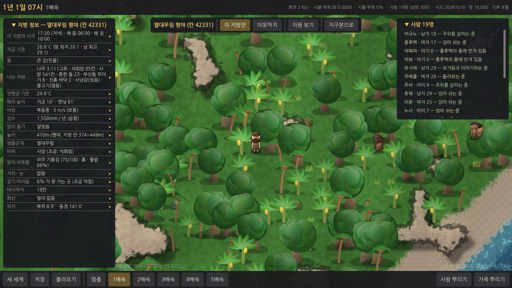
- 작은 카드: 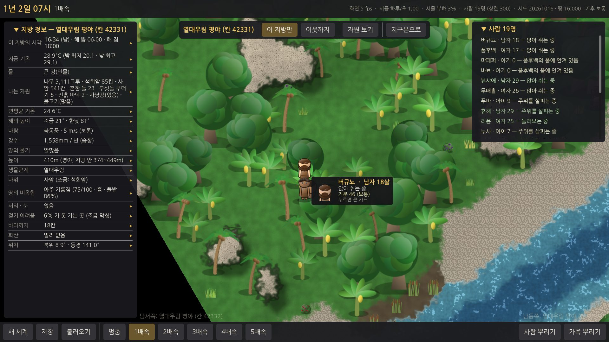
- 큰 카드 — 개요(지금 하는 일 — 왜): 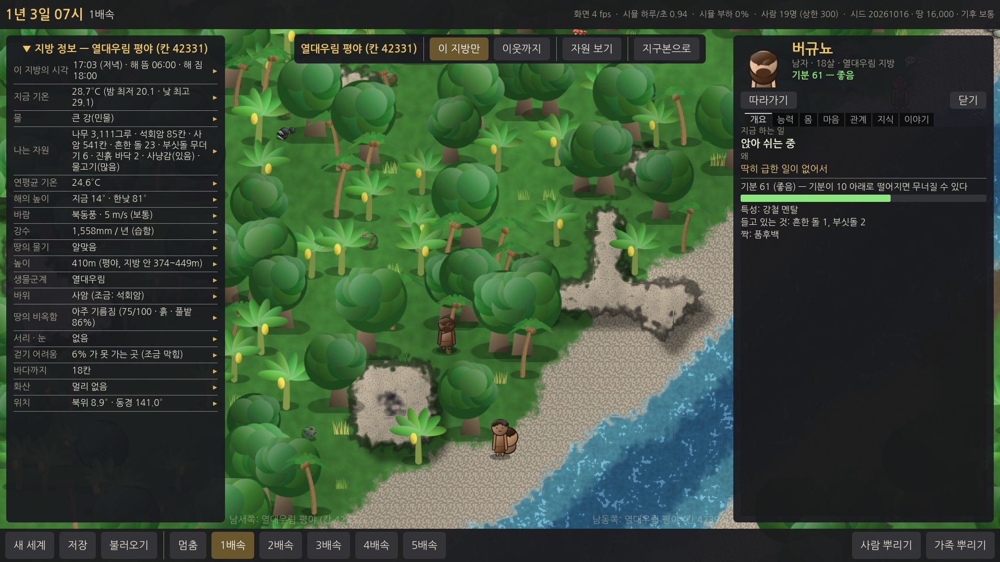
- 큰 카드 — 능력 · 마음 · 관계 · 이야기: 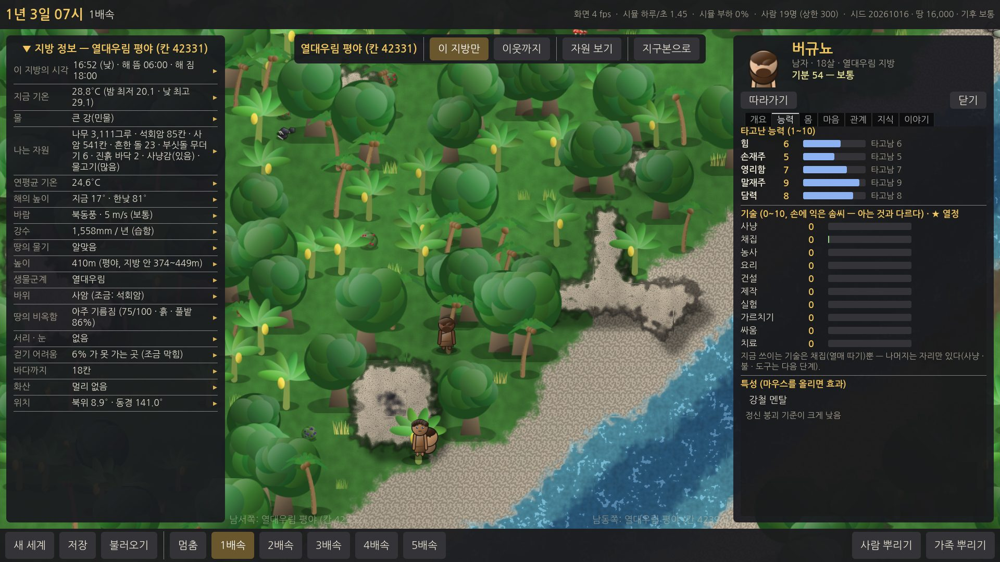 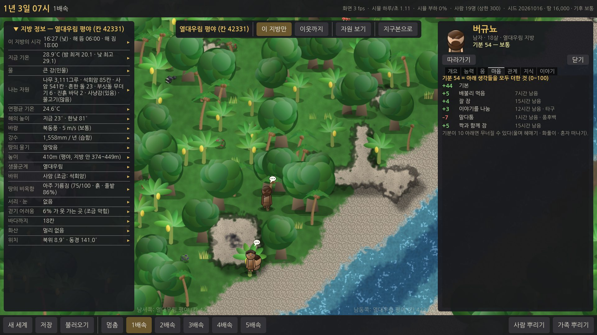 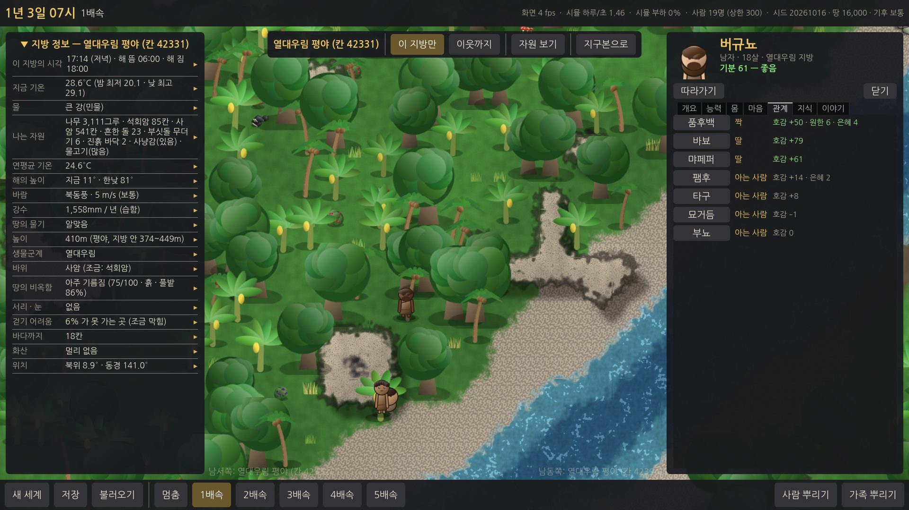 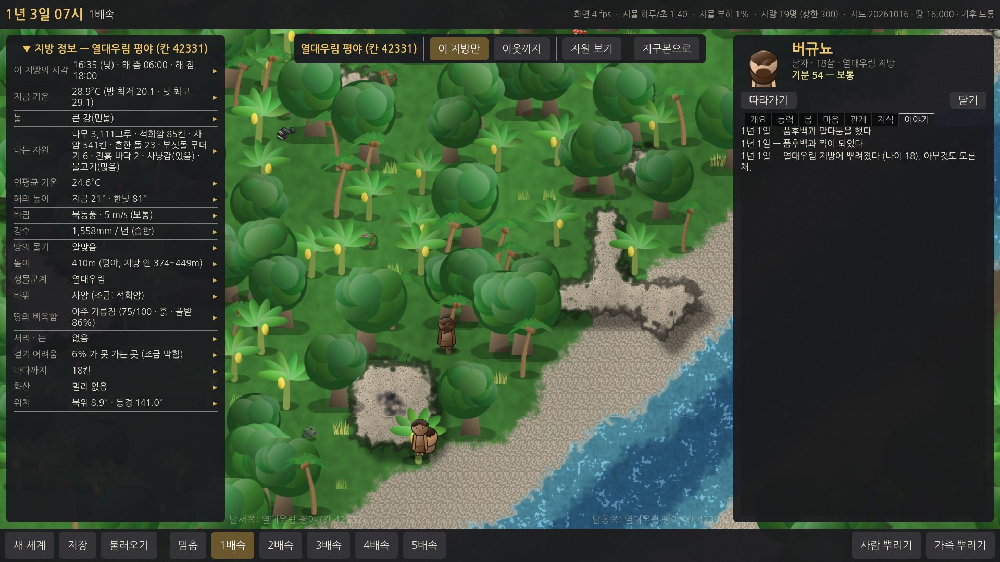
- 밤에 자는 모습(가족이 붙어서): 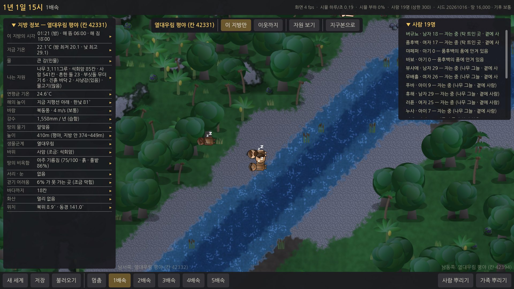
- 동굴에 든 사람(쌀쌀한 언덕, 밤 — 들어간 곳만 어두운 바닥으로 걷힘): 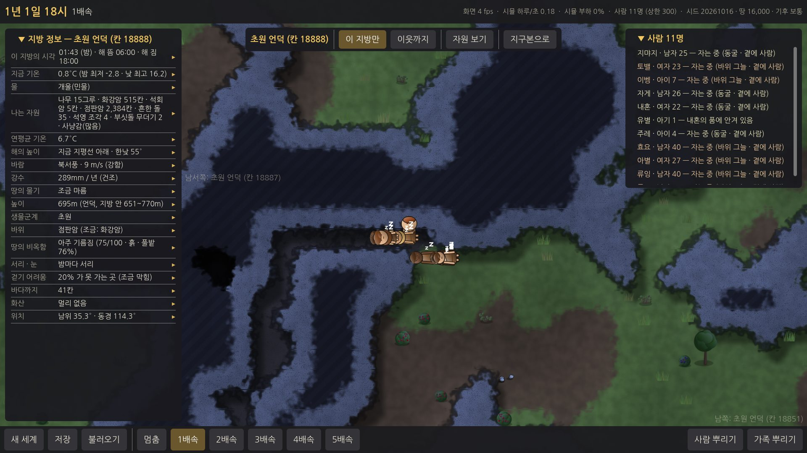
- 지구본의 사람 사는 칸(사람 모양 + 19): 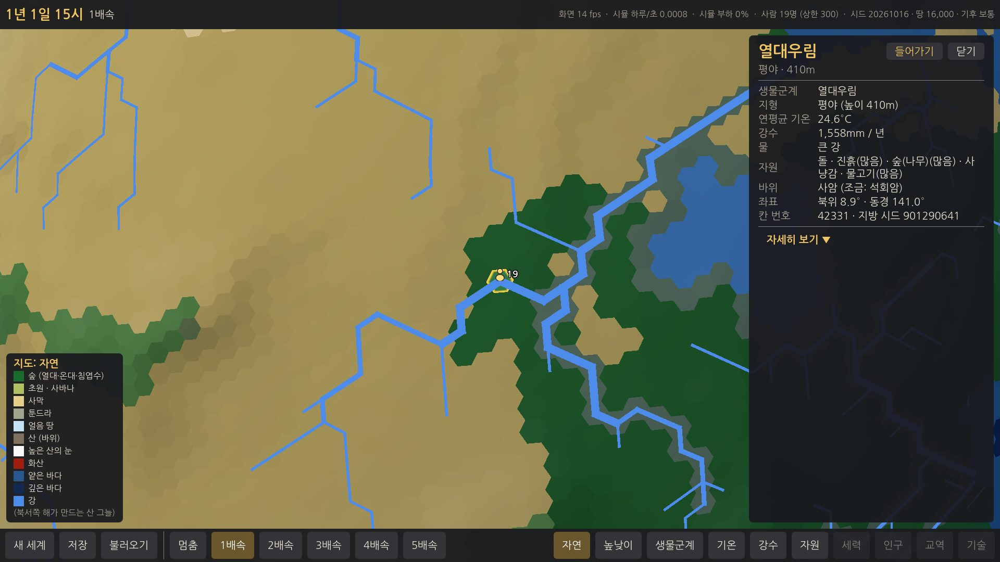
- 사람 80명: 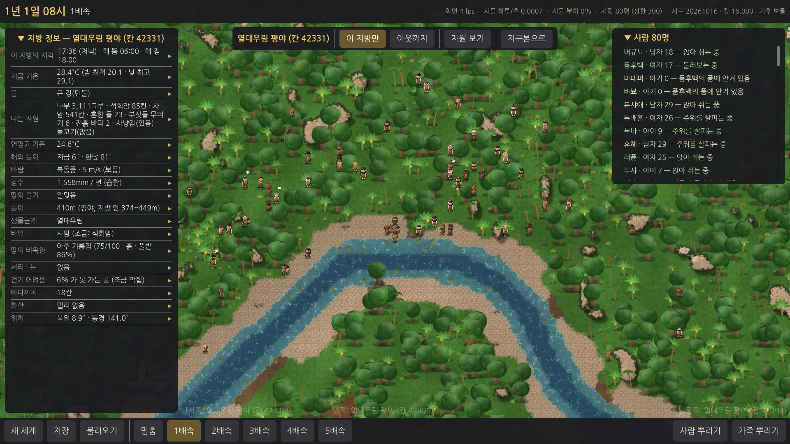

---

## 기획과 다르게 한 것 / 이유
1. **물(목마름)을 욕구로 넣었다.** 프롬프트의 욕구 목록에는 없고 "할 수 있는 일"에 물 마시기 · "짠물은 못 마심" 테스트가 있어서, 마시지 않으면 탈수로 죽게 했다(사막 · 물 없는 지방이 실제로 살기 어려워짐).
2. **열정은 꺼 두었다**(측정 결과 위). 사용자가 미리 허락한 "효과가 안 보이면 없앰"의 첫걸음 — 코드는 스위치로 남김.
3. **사람 상한 최대값은 아직 500**: 낮추자는 제안만 하고 바꾸지 않았다(위).
4. **"대화" 기술은 없다**: 기술 10 목록에 대화가 없어서 이야기는 타고난 능력 "말재주"가 맡는다. 지금 오르는 기술은 채집뿐.
5. **도토리는 먹지 않는다**: 날 도토리는 떫어서(우려내야 함) 줍기만 하는 것으로 두었다.
6. **아기는 안은 사람이 먹여 준다**: 엄마가 죽으면 아빠 → 형제 → 그 부모와 친한 어른이 안는다. 안은 사람이 영양실조면 아기는 굶는다.
7. **동굴은 "입구에서 이어진 바닥"만 걷힌다**: 사람이 동굴 바닥에 닿으면 반지름 10타일 안의 이어진 동굴과 맞닿은 바위까지(바위 너머는 아님).
8. **말다툼은 전기에 다 적지 않는다**: 너무 잦아 이야기가 넘쳐서, 원한이 40 을 넘을 때만 "거듭 다투어 원한이 깊어졌다"로.
9. 지방 시각의 경도 → 틱 어긋남은 처음 한 번만 실수로 셈해 정수로 저장한다(삼각함수 끝자리 차이가 결과에 들어갈 확률은 거의 0 이지만 완전한 정수 셈은 아님). 하루 기온 곡선은 정수 표.

## 알려진 문제 · 다음 단계에 넘길 것
- **사람 500명 100년 ≤ 2분 못 맞춤** → 상한 최대 300 제안 · 지방마다 CPU(E8)로 풀 수 있음.
- **윈도우 PC 의 fps · 부드러움은 여전히 미확인**(E0~E3 네 번째).
- 지방 하나의 먹을 것이 넉넉해 50년 안에 식량으로 인구가 멈추는 곳이 적다 → E4 "굶주린 세계"에서.
- 처음 뿌린 사람들이 비슷한 나이라 수십 년 뒤 한꺼번에 늙어 죽는 물결이 생긴다(측정 500명에서 인구가 500 → 250 → 380). 이상한 것은 아니지만 숫자 튜닝 때 볼 것.
- 정신 붕괴가 아주 드물다(0.01/사람 · 년) — 지금은 굶주림 · 추위 같은 큰 고통이 적어서. E4 이후 다시 잴 것.
- 툰드라는 첫날 밤에 모두 얼어 죽는다 — 불 · 털가죽 옷(E4)이 생기면 바뀐다.
- 사람이 나무 그림 위에 그려진다(나무 뒤로 숨지 않음). 딴 열매가 줄어든 모습은 아직 그림에 없다.
- 이름이 가끔 어색하다(예: "며겡") — 소리 조각 목록은 `data/people.json` 에서 고칠 수 있다.
- 야심가 · 용감함 · 겁쟁이는 지금 능력치만 바꾼다(정치 · 싸움이 생기면).
- 사람 목록 · 카드는 0.35~0.8초마다 다시 받는다 — 아주 빠른 배속에서는 조금 늦게 바뀐다.
