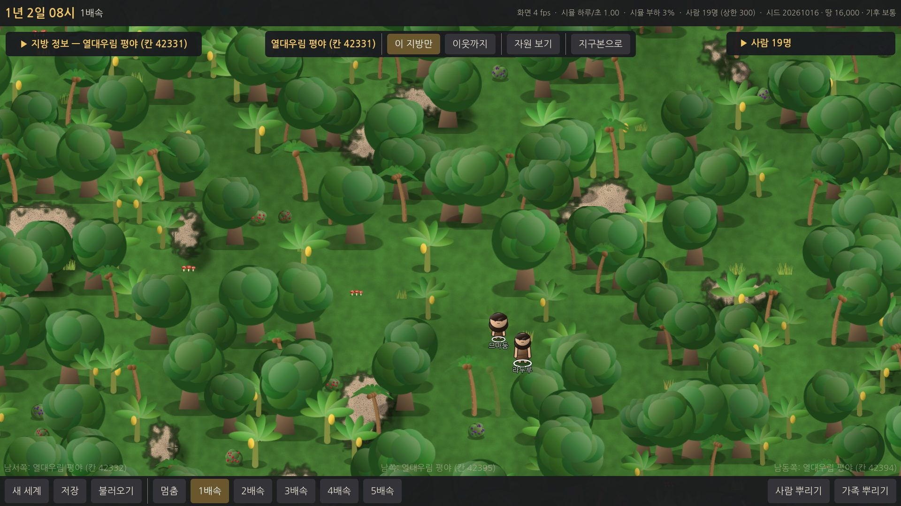
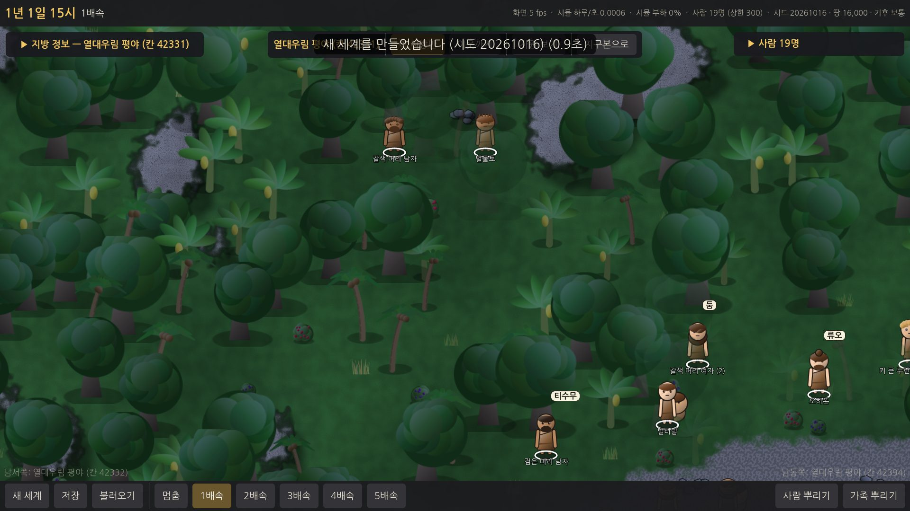
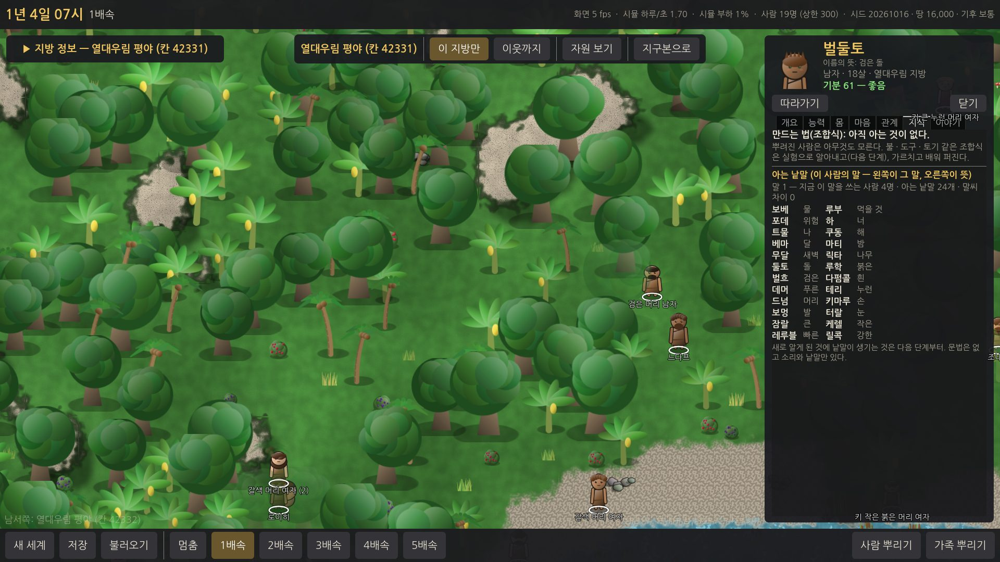

# E3 사람 — 보고서

## 쉬운 말 다섯 줄
1. 지방 화면 아래 **[사람 뿌리기] · [가족 뿌리기]** 로 사람을 뿌리면, 사람들이 **스스로** 열매를 따 먹고 · 물을 찾아 마시고 · 밤에 자고 · 이야기하고 · 짝을 짓고 · 아이를 낳고 · 늙어 죽습니다. 움직임은 끊기지 않게 이어 그립니다.
2. (검토 뒤) **사람들이 말을 합니다.** 뿌린 사람은 저마다 다른 소리를 쓰고 **이름이 없어** "키 큰 붉은 머리 여자"처럼 불립니다. 함께 이야기하다 보면 **한 무리가 같은 말**을 쓰게 되고, 그 말로 서로 **이름을 지어 줍니다**(예: "벌둘토 — 검은 돌"). 아이는 부모가 태어날 때의 일과 바람을 담아 이름을 짓습니다. 말풍선에 그 말의 낱말이 뜨고, 마우스를 올리면 뜻이 나옵니다.
3. (검토 뒤) **숲에서도 사람이 보입니다** — 발밑의 흰 고리, 사람 앞을 가리는 나무는 반쯤 투명, 가까이 보면 이름표. 나무 뒤를 지나는 사람은 가려지고 앞을 지나면 나무를 가립니다. 지방 정보 칸과 사람 목록은 **처음엔 접혀** 지도가 넓습니다.
4. (검토 뒤) 사람은 **본 것만 압니다** — 보이는 물 · 열매, 한 번 본 곳(기억), 남이 마시러 가면 따라가기, 그래도 없으면 **물은 낮은 곳 · 먹을 것은 초록이 짙은 쪽으로 찾아다닙니다.** 카드의 "지금 하는 일 — 왜"가 실제로 하는 일과 같습니다.
5. 측정: 따뜻한 땅에 10명씩 뿌린 세계 20개는 **50년 동안 한 번도 멸종하지 않았고**(10명 → 중앙값 54명), 기분 54(목표 안), 무너짐 0.01번/사람·년. 그런데 **아무 땅에나 뿌리면 고른 땅 100곳 중 90곳에 마실 민물이 없어**, 뿌린 사람의 48%가 "지방 안에 물이 없어서" 목말라 죽었습니다 — 지방 경계를 넘는 다음 단계에서 풀 일입니다.

## 해 볼 것
1. zip 을 풀고 `WTW` 폴더의 **`WTW.exe`** 를 실행합니다. 윈도우가 "PC 보호" 경고를 띄우면 **"추가 정보 → 실행"** 을 누르세요.
2. 새 세계 → [만들기] → 지구본에서 **따뜻하고 숲이 많은 땅(초록, 강가)** 을 두 번 눌러 들어갑니다. (강 · 호수가 없는 땅에는 마실 물이 없습니다.)
3. 아래 **[사람 뿌리기]** 로 혼자 사는 사람을 서너 명, **[가족 뿌리기]** 로 한 가족. 혼자 뿌린 사람의 이름표가 "검은 머리 남자"처럼 **생김새**로 나오는지 봅니다.
4. 1~2배속으로 하루 이틀 지켜보세요 — 혼자 뿌린 사람들이 이야기를 나누다가 **같은 말을 쓰고 이름을 얻는지**(이름표가 바뀜). 큰 카드의 **이야기** 슬롯에 "○○이 자기 말로 '…'라고 부르기 시작했다(뜻: …)"가 남습니다.
5. 사람을 눌러 큰 카드 — 이름 아래 **"이름의 뜻"**, **지식** 슬롯의 **아는 낱말**(왼쪽이 그 말, 오른쪽이 뜻), **관계** 슬롯의 **알아듣기 %**.
6. 휠로 가까이 가서 **말풍선**(이야기하는 두 사람 위)에 마우스를 올려 뜻을 봅니다.
7. **숲 속**에서 사람을 찾아보세요 — 발밑 흰 고리, 사람 앞의 나무가 반쯤 투명해지는지, 나무 뒤를 지나갈 때 가려지는지.
8. 큰 카드의 [따라가기]로 한 사람의 하루를 봅니다 — 목마를 때 "보이는 물가로 / 기억해 둔 물가로 / ○○를 따라 물가로 가는 중"이 실제 움직임과 맞는지.
9. **강이 없는 땅**에 뿌려 보세요 — "물을 찾아 낮은 곳으로 가는 중"으로 찾아다니다, 물이 없으면 며칠 뒤 목말라 죽습니다(다음 단계에서 지방 경계를 넘어 물을 찾게 됨).
10. 4~5배속으로 몇 년 — 아이가 태어나면 알림에 **이름의 뜻**이 나옵니다. 지구본으로 나와 사람 사는 칸 표시도 확인.

---

## 고친 것 (E3 결과 검토 뒤)
| # | 요청 | 한 일 |
|---|---|---|
| 1 | 사람 상한 기본 300 · 최대 500 그대로, 측정은 300명 기준 | 설정은 그대로(기본 300, 100~500). 측정을 **300명 기준**으로 다시 했고(아래), 2분 목표는 측정 편의용 · 게임 중 부담은 괜찮음(윈도우 PC 에서 fps 60 확인 — 사용자) · 속도는 E8(지방마다 CPU)에서 — 로 보고서를 고쳤다. |
| 2 | 열정은 지우지 말고 꺼 둔 채로 | 그대로 꺼 둠(`WorldConfig.Passion = false`, 카드에도 안 보임). 코드는 남겨 E6 에서 다시 시험. |
| 3 | 이름은 언어에서, 언어는 말을 주고받으며 | **말(언어) 뼈대** — 아래 "말과 이름". 문법 없음 · 소리와 낱말만 · 별명/지명/성 · 사투리/갈라짐 · 빌려 오기 · 언어 지도는 하지 않음. |
| 4 | 숲에서 사람이 안 보임 | 발밑 흰 고리(맨 위 층) · 사람 앞을 가리는 나무 · 덤불은 32% 로 투명 · 가까이 보면(확대 0.9 이상) 이름표 · **앞뒤 정렬**(키 큰 오브젝트를 한 타일 줄마다 나눠 사람과 함께 정렬 — 나무 뒤를 지나면 가려짐). |
| 5 | 지도가 좁음 | 지방 정보 칸: 처음엔 **접힘**(제목만), 너비 420 → 340. 사람 목록: 처음엔 **접힘**, 420 → 360. 큰 카드 500 → 440. |
| 6 | 물 · 먹을 것 찾기를 똑똑하게, "왜"가 행동과 맞게 | 보이는 것(14타일) → 기억(물가 6곳 · 열매 자리 10곳) → 남을 따라감 → 찾아다님(물은 낮은 곳 · 먹을 것은 초록이 짙은 쪽, 가던 쪽을 조금 더). 카드의 "지금 하는 일"과 "왜"가 이 넷 중 실제로 한 것을 말한다. 이전에 "물을 찾아다닌다"면서 아무 데나 걷던 것을 없앰. |
| 7 | 경계 넘기는 하지 말고 "지방 안에 없어서 죽은 사람"을 측정 | 측정 추가(아래). 경계는 넘지 않는다. |

### 말과 이름 (3번)
- **말 = 무리의 말 + 사람마다 조금 다른 말씨.** 말 하나에 저장하는 것은 시드 · 즐겨 쓰는 소리의 무게(첫소리 13 · 가운데 소리 12 · 끝소리 6) · 아는 뜻 목록뿐. **낱말은 소리 규칙 + 시드로 그때그때 만든다**(사람이 낱말을 들고 있지 않음, 결정론). 사람은 말 번호 + 말씨(소리 무게에 더하는 −6~+6 의 작은 값 31개)만 가진다.
- "이 지방은 ○○어"처럼 정하지 않는다: **뿌린 사람(가족)마다 말이 하나씩** 생긴다. 같은 말끼리 이야기하면 말씨가 한 걸음씩 닮아 가고, 다른 말끼리 4번 넘게 이야기하면 **쓰는 사람이 적은 쪽이 많은 쪽 말을 배운다**(옛 말의 소리 버릇은 말씨로 조금 남음). 측정: 혼자 뿌린 10명이 8년 뒤 모두 한 말(알아듣기 94~98%).
- **알아듣기(0~100%)** = 두 사람의 낱말(기본 뜻 24개)이 자모로 얼마나 같은가 → 나중에 떨어져 사는 무리끼리 사투리 → 다른 말로 갈라지는 것을 이 위에 얹을 수 있다(말에 `Parent` 자리도 있음).
- **처음 낱말은 24개**(물 · 먹을 것 · 위험 · 너 · 나 · 해 · 달 · 밤 · 새벽 · 나무 · 돌 · 색 5 · 몸 4 · 큰 · 작은 · 빠른 · 강한) — `data/language.json`. 뜻 목록은 늘어날 수 있다(E4 부터 새로 알게 된 것에 낱말).
- **이름**: 뿌린 사람은 이름이 없고 화면엔 생김새("키 큰 붉은 머리 여자", 같으면 "(2)"). **같은 말을 쓰는 사람과 지내기 시작하면** 그 사람이 자기 말로 생김새의 뜻(붉은 머리 · 큰 발 · 검은 눈 · 강한 손 …)을 담아 이름을 지어 부르고 전기에 남는다. 함께 뿌린 가족은 처음부터 서로 부르던 이름이 있다. **아기는 부모가** 태어날 때의 일(밤 · 달 · 새벽 · 해 · 물가 · 나무 · 돌 · 손 · 발 …)과 바람(강한 · 빠른 · 큰 · 색 …)을 담아 짓고, 15% 는 죽은 가족이나 존경받던 사람(살아 있는 어른들의 호감 평균 40 이상)의 이름을 물려받는다. 카드 · 작은 카드에 **이름의 뜻**을 작게 보인다. 같은 지방에 같은 이름이 살아 있으면 다른 뜻으로 다시 짓는다.
- **걸러내기**: 우리말의 흔한 낱말 · 욕 · 놀림말 목록(약 230개, "바보" 등)과 욕에 쓰이는 글자(놈 · 년 …)가 들어가면 다시 만든다. 어색한 발음을 줄였다: 이중 모음(ㅑ ㅕ ㅛ ㅠ)은 드물게 · 첫 글자에만 · 소리 없는 첫소리(ㅇ) 뒤에만(야 · 요는 되고 댜 · 며는 안 됨), 이중 모음 · ㅐ · ㅔ 뒤 받침은 ㄴ · ㄹ만, 소리 없는 첫소리(ㅇ) 연달아 금지, 같은 글자 연달아 금지.
- **조사**: 지어낸 이름 · 생김새 이름 · 번호 뒤 이/가 · 을/를 · 은/는 · 과/와 · 이라고/라고 를 받침에 맞게(번호는 읽는 소리로: "(2)가", "(3)이") — 알림 · 카드 · 전기 모든 문장(테스트).
- **말풍선**: 이야기를 시작할 때 고른 뜻(배고프면 "먹을 것", 목마르면 "물", 아니면 너 · 나 · 해 · 달 …)의 낱말을 그 사람의 말로 띄우고, 마우스를 올리면 뜻. 말다툼은 "위험 · 너". 게임의 설명 글은 모두 쉬운 한국어이고 지어낸 말은 이름 · 말풍선 · 낱말 목록에만 나오며 늘 뜻이 같이 보인다.

---

## 한 일

### 1. 시뮬 (`sim/People/`, Godot 를 모름)
- **사람 뿌리기**(개입 기록 `spawn_person` · `spawn_family` = [칸, x, y]): 한 명은 나이 15~40, 가족은 짝(남 · 여) + 아이 0~2(아기는 엄마가 안음). 몸 · 능력 · 특성은 ("people", 지방) 난수에서. 걸을 수 없는 땅이면 아무 일도 없다(기록은 남아 다시 만들어도 똑같음). 이름은 위 "말과 이름"(처음엔 이름 없음).
- **예약 방식**(기획서 6-1): 사람은 "언제까지 무엇을 한다"를 정하고 그 끝에 다음 판단을 예약. 그 사이 **심한 배고픔 · 목마름 · 지침 · 추위가 닥칠 시각을 미리 셈해** 예약을 그때로 당긴다. 누가 말을 걸면 예약을 끊는다. 욕구는 마지막 계산 시각부터 한 시간씩 몰아 셈(정수만).
- **욕구**: 배부름(하루 세 끼쯤) · 물 · 잠 · 쉼 · 어울림 · 추위/더위(지방 시각의 바깥 기온 + 그늘: 동굴은 늘 연평균 + 2°C, 바위 그늘 · 나무 그늘은 밤에 덜 춥고 낮에 덜 더움, 곁에서 함께 자면 +3°C). 굶으면 영양실조(약 8일) · 목마르면 탈수(약 3일) · 6°C 아래로 오래 있으면 저체온 → 죽음.
- **일**: 따 먹기(사과 · 열매 · 야자 · 바나나 · 바오밥 · 선인장 열매 · 버섯 · 이끼) · 줍기(도토리 · 돌 · 부싯돌 · 석영 · 흑요석 — 들고 다니기만) · 물 마시기(**민물만**, 바닷물 곁은 물 마실 자리가 아님) · 자기 · 쉬기 · 이야기 · 둘러보기 · 추위 · 더위 피하기 · (아이) 어른 따라다니기 · (식인) 굶주리면 시신 먹기. 딴 열매는 줄었다가 다시 열린다(몫 · 다시 나는 날은 `data/people.json`).
- **모든 판단에 "왜"**: 판단할 때 까닭(배고파서 · 밤이라서 · 추워서 · 누가 말을 걸어와서 …)과 숫자를 남긴다 → 카드의 "지금 하는 일 — 왜".
- **동굴**: 사람이 동굴 바닥에 닿으면 이어진 동굴 · 맞닿은 바위의 숨김이 걷힌다(바뀐 것으로 저장). 추운 밤에는 동굴을 먼저 찾는다.
- **길 찾기**: 걸을 수 있는 타일만 8방향 A*(모서리 자르기 금지, 얕은 물 · 습지는 비싸게), 꺾임점만 남겨 곧게 걷는다. 이어진 땅 번호가 다르면 찾지 않고 포기. 곧게 보이면 찾지 않는다. 걷기 빠르기 1배속 초당 약 4.6타일(림월드와 비슷), 빠른 발 · 아이 · 늙음 · 병 · 영양실조 · 저체온으로 달라짐. **지방 경계는 넘지 않는다**(지도 안에서만 길을 찾음 — 여러 지방은 E8).
- **능력 · 기술 · 특성**: 타고난 능력 5(1~10) · 기술 10(0~10, 쓰는 것은 채집뿐) · **특성 22개**(기획서 표 그대로, 1~3개, 반대끼리 같이 안 가짐). 특성이 실제로 거는 것: 능력치 ± · 일 속도(근면 · 게으름) · 쉬고 싶은 마음 · 기분 기준(낙천 · 비관) · 붕괴 기준(강철 멘탈 · 예민) · 기술 오름 +10%(예민) · 걷기(빠른 발) · 이야기의 호감(다정 · 까칠 · 무뚝뚝 · 말솜씨) · 말다툼 잦음(까칠) · 원한이 풀리는 빠르기 · 병(튼튼 · 허약) · 멀리 둘러보기 · 동굴 찾기(호기심 · 고지식) · 어둠이 무서움(담력) · 식인. (야심가 · 용감함 · 겁쟁이는 능력치만 — 정치 · 싸움이 생기면 E7 · E9 에서.)
- **생각 30개 · 기분 · 정신 붕괴**: 지금 상태로 정해지는 생각(배고픔 · 굶주림 · 목마름 · 추움 · 피곤함 · 외로움 · 혼자 너무 오래 · 아픔 …)과 사건이 남기는 생각(배불리 먹음 · 잘 잠 · 노숙 · 추위에 떨며 잠 · 이야기 · 말다툼 · 짝과 함께 잠 · 짝이 생김 · 아이가 태어남 · 가족 · 짝 · 친구의 죽음 · 동굴을 찾아냄 · 울고 나니 후련함 …). 기분이 기준(보통 25) 아래면 가끔 **무너진다** — 울며 헤매기 · 화풀이(말다툼) · 혼자 떠나기(하루).
- **관계 · 짝 · 아이 · 죽음**: 호감 · 원한 · 은혜. 이야기하면 호감이 오르내리고(말재주 · 특성), 가끔 말다툼(원한). 혼자 사는 두 어른(16살 이상, 나이 차 15 이하)이 서로 호감 35 이상이면 짝. 짝이 곁에서 자면 아이가 생기고 30일(¾년) 뒤 태어난다. 아기(0~2)는 안겨 다니며 안은 사람이 먹여 준다(안은 사람이 영양실조면 아기는 굶는다), 아이(3~13)는 어른을 따라다닌다. 아이는 부모를 닮는다(피부 · 머리색 · 체형 · 키는 부모 사이 + 조금, 머리 모양 · 얼굴은 둘 중 하나, 능력은 부모 평균 쪽, 특성은 25% 씩 물려받음). 죽음: 굶주림 · 목마름 · 추위 · 더위 · 늙음(45살부터) · 병(아주 간단히 — 걸리면 며칠 건강이 깎임). 시신은 그 자리에 남는다.
- **물 · 먹을 것 찾기**: 위 "고친 것 6" — 보임 · 기억 · 따라감 · 찾아다님.
- **저장**: 저장 파일 버전 5 — 사람 하나하나의 모든 것(욕구 · 하는 일 · 예약 · 움직임 · 생각 · 관계 · 전기 · 말 · 말씨 · 이름의 뜻 · 기억한 물가 …) + 말(시드 · 소리 무게 · 아는 뜻) + 사람이 사는 지방의 바뀐 것(딴 몫 · 걷힌 숨김) + 알림. 버전 1~4 파일도 읽는다(버전 4 는 지방마다 말 하나를 새로 만들어).
- **카드는 보기만 해도 세계가 바뀌지 않는다**: 카드는 시뮬 스레드가 만들어 건네고, 그 순간의 욕구를 잠깐 셈해 보여 준 뒤 되돌린다(테스트).

### 2. 화면 (`game/src/`)
- `PersonArt.cs`(그림 공급 `Art` 안): 부품별로 그려 겹치는 사람(다리 · 몸 · 가죽 두름 · 팔 · 머리 · 얼굴 · 머리카락 8가지 · 수염), 정면 · 옆 · 뒤, 아기 · 아이 · 어른 · 늙은이(흰머리, 조금 굽음). 생김새마다 한 번 그려 기억. 그림자 · Z · 말풍선 · 먹구름 · 뼈 표시도.
- `ProvinceViewPeople.cs`: 스냅샷의 일정을 화면 시계로 보간. 발밑 고리 · 앞 나무 반투명 · 이름표 · 말풍선(그 말의 낱말, 마우스를 올리면 뜻). 걷기 흔들림 · 방향 · 앉기(쉼) · 눕기(잠 · 죽음) · 숨쉬기. 안긴 아기는 안은 사람 곁. 마우스 올림 · 누름 · 따라가기 · 고른 사람 고리. 뿌리기 도구일 때 마우스 칸이 초록(뿌릴 수 있음) / 빨강.
- `PeoplePanels.cs`: 작은 카드 · 큰 카드(슬롯 7, 오른쪽 한 칸 — 칸 정보 창과 번갈아) · 사람 목록(오른쪽 위, 접힘) · 알림(오른쪽 아래, 누르면 그 사람 — 지구본에서 누르면 그 지방으로 들어가 카드를 연다).
- 지구본: 사람이 사는 칸에 사람 모양 + 인원, 한 번이라도 산 칸은 밝게, 아무도 산 적 없는 땅은 살짝 흐릿하게(채도 −22% · 명도 −12%).
- **E2 에서 넘어온 일**: 지방 정보 칸 — 줄을 누르면 이유가 펼쳐지고 따로 있던 "자세히 보기" 줄을 없앰(길이 반), 시각 · 지금 기온 · 물 · 나는 자원을 위로. "공기: 축축함 / 강수: 아주 건조" 어긋남 → 이름을 **"땅의 물기"** 로 바꾸고 비가 적은 곳은 "비는 적지만 추워서 덜 마름"으로.

### 3. 테스트 (빠른 테스트 106개, 약 12초 — 사람 14개 + 말 · 이름 · 물 찾기 6개 새로)
같은 시드 + 같은 뿌리기 = 같은 사람 · 같은 결과(지문) · 시작 기록으로 다시 만들기 · **저장 → 불러오기 → 계속 = 끊김 없이 계속**(사람 · 관계 · 생각 · 예약 · 딴 몫 포함) · 카드를 봐도 세계가 안 바뀜 · 길이 바위 · 깊은 물을 지나지 않고 갈 수 없는 곳은 포기 · 먹을 것을 없애면 굶어 죽고 있으면 산다 · 물은 민물에서만 · 밤에 90% 넘게 자고 낮에 15% 아래 · 특성이 능력치 · 걷기에 걸리고 반대 특성은 같이 없음 · 아이가 부모를 닮음(몸 · 능력) · 동굴에 들어가면 걷힘 · 걸을 수 없는 땅에는 안 뿌려짐 · 카드마다 "왜"가 있음 · (고친 뒤) 낱말은 결정론이고 걸러낼 낱말이 안 나옴 · 조사가 받침에 맞음 · 뿌린 사람은 이름이 없고 생김새 이름이 서로 다름 · 이야기하면 한 말이 되고 이름을 얻음(알아듣기 40% 아래 → 85% 위) · 가족은 한 말 · 카드에 이름의 뜻과 낱말 · 아는 물가가 없으면 찾아다니다 보면 기억함. 게임 안 자체 시험(저장 → 불러오기 → 사람 위치 차이 0)과 윈도우 실행 파일(Wine) 자체 시험도 통과.

---

## 측정 결과 (클라우드 4코어 Xeon 2.1GHz)

### 시드 20개 × 혼자 사는 사람 10명 × 50년 ("따뜻하고 열매가 많은 땅": 열대우림 16 · 온대림 4) — 표 전체: [E3/measure-seeds.md](E3/measure-seeds.md)
| | 목표 | 결과(중앙값, 열정 끔 = 지금 게임) |
|---|---|---|
| 기분 | 40~55 | **53.5** ✅ |
| 정신 붕괴 | 한 사람당 1년에 1번 이하 | **0.01번** ✅ (너무 적을 수도 — 숫자 튜닝 때 볼 것) |
| 인구 | (목표 없음) | 10 → **54** (가장 많을 때 54.5), 멸종 **0/20** |
| 태어남 · 짝 | | 53 · 9 |
| 죽음 원인(192명) | 굶주림 10~20%(기획서 20절, 사람 100~150명 기준) | 늙음 93% · 굶주림 6% · 병 1% · 목마름 0% · 추위 0% |
| 지방 안에 물 · 먹을 것이 없어서 죽은 사람 | | **0명**(이 땅들은 모두 강가) |
- 물 · 먹을 것을 찾아간 방법(한 세계, 2년): 보임 92% · 기억 8% · 따라감 · 찾아다님 0 — 강가 숲에서는 대부분 보이는 곳에서 해결된다.
- 지방 하나의 먹을 것은 하루 50~160명분이라 50년 안에는 대부분 식량 한계에 닿지 않았다 — "굶주린 세계(식량으로 인구가 멈춤)"는 E4 의 일.
- 추운 땅: 툰드라(연평균 약 −10°C)에 10명을 뿌리면 **첫날 밤에 모두 얼어 죽는다**. 불 · 옷(E4~)이 없으니 맞는 결과로 두었다.

### 아무 땅에나 뿌리면 — "물 · 먹을 것이 지방 안에 없어서 죽은 사람"(7번) — [E3/measure-nosource.md](E3/measure-nosource.md)
시드 20개 × 땅 칸 5곳(무작위 — 사막 · 얼음 · 산도 포함) × 5명 × 3년:
| | 결과 |
|---|---|
| 뿌린 사람 | 500명 → 3년 뒤 56명 생존 |
| 고른 땅 100곳 중 **닿을 수 있는 곳에 민물이 없는 땅** | **90곳** (먹을 것이 없는 땅은 1곳) |
| 죽음 444명 | 목마름 239 · 추위 200 · 굶주림 5 |
| **지방 안에 물이 없어서 죽은 사람** | **239명 (뿌린 사람의 48%)** |
| **지방 안에 먹을 것이 없어서 죽은 사람** | **0명** |
| 찾아간 방법 | 보임 14% · 기억 3% · 따라감 0% · 찾아다님 82% |
- 민물은 강 · 호수(와 드문 웅덩이)에만 있어서 **땅 칸 대부분에 마실 물이 없다**. 그런 땅에 뿌린 사람은 낮은 곳 · 초록 쪽으로 찾아다니다 3일쯤 뒤 목말라 죽는다. 다음 단계(지방 경계 넘기)에서 이웃 지방의 강을 찾아가게 되면 크게 줄 것이다. 샘 · 빗물 웅덩이 같은 물을 더할지도 그때 같이 정하면 좋겠다.

### 사람 수(기획서 18절) — 300명 기준 — [E3/measure-cap.md](E3/measure-cap.md)
| 측정 | 결과 |
|---|---|
| 처음 300명(지방 25곳에 12명씩, 상한 300) × 100년 | **188초** · 평균 266명 생존(처음 사람들이 비슷한 때 늙어 죽어 한때 182명) · 사람 하루당 **177µs** |
| 300명이 100년 내내 산다면 | 약 **212초**(3.5분) |
| 메모리 | 관리 힙 최대 192MB · 프로세스 254MB |
| 게임 중 부담 | 5배속(하루 0.4초)에서 300명 = 1초에 사람 하루 750개 × 약 180µs ≈ 0.13초 → 시뮬 스레드 13% — 게임은 괜찮다(사용자: 윈도우 PC 에서 fps 60 확인) |
- **결정(사용자)**: 상한은 **기본 300 · 최대 500 그대로**. 처음의 "500명 100년 ≤ 2분" 은 측정 편의용 목표였고 게임 중 부담은 괜찮으므로, 측정은 300명 기준으로 하고 **속도는 E8(지방마다 CPU — 지방끼리는 하루 경계에서만 주고받으므로 4코어면 약 4배)** 에서 푼다.
- 첫 보고 때보다 사람 하루당 비용이 조금 늘었다(약 140 → 165~177µs): 물 · 먹을 것 찾기(기억 · 찾아다님)와 말(이야기할 때 말씨 맞추기) 때문.

### 열정(기획서 7-1) — 같은 시드로 켬 vs 끔
| | 켬 | 끔 |
|---|---|---|
| 채집 한 번당 경험 | 23.8 | 12.4 |
| 채집 기술 중앙값(살아 있는 어른) | 10.0 | 9.0 |
| 기분 중앙값 | 55.5 | 53.5 |
- 켜면 살아 있는 어른 **모두** 채집 열정을 갖게 되고 두 세계 모두 채집 기술이 최고 근처에 닿는다 → 차이가 뚜렷하지 않다(기술 1단계 · 기분 2).
- **결정(사용자)**: 지우지 않고 **꺼 둔 채로** 둔다. 기술이 여러 개가 되는 **E6** 에서 다시 시험한다(`WorldConfig.Passion` 만 켜면 됨).

### 화면
- 사람 그리기 준비(시뮬 스냅샷 → 노드): 19명 1.2ms · 80명 2.4ms / 프레임(CPU). 화면 fps 는 클라우드 가상 화면(그래픽 카드 없음)에서 8~14 로 E2 와 같다 — **윈도우 PC 확인 필요**.

### 스크린샷
- (고친 뒤) 숲 — 발밑 고리 · 앞 나무 반투명 · 이름표(이름 없는 사람은 생김새로), 지방 정보 칸 · 사람 목록은 접힘: 
- (고친 뒤) 이야기하는 사람 위 말풍선(그 말의 낱말 — 마우스를 올리면 뜻): 
- (고친 뒤) 큰 카드 — 이름의 뜻 · 말:   지식 슬롯의 아는 낱말:   이야기(이름을 얻음): 
- 사람들이 있는 지방(처음 보고): 
- 작은 카드: 
- 큰 카드 — 능력 · 마음 · 관계(처음 보고):   
- 밤에 자는 모습(가족이 붙어서): 
- 동굴에 든 사람(쌀쌀한 언덕, 밤 — 들어간 곳만 어두운 바닥으로 걷힘): 
- 지구본의 사람 사는 칸(사람 모양 + 19): 
- 사람 80명: 

---

## 기획과 다르게 한 것 / 이유
1. **물(목마름)을 욕구로 넣었다.** 프롬프트의 욕구 목록에는 없고 "할 수 있는 일"에 물 마시기 · "짠물은 못 마심" 테스트가 있어서, 마시지 않으면 탈수로 죽게 했다(사막 · 물 없는 지방이 실제로 살기 어려워짐).
2. **열정은 꺼 둔 채로**(사용자 결정 — E6 에서 다시 시험).
3. **사람 상한 기본 300 · 최대 500 그대로**(사용자 결정 — 속도는 E8).
4. **"대화" 기술은 없다**: 기술 10 목록에 대화가 없어서 이야기는 타고난 능력 "말재주"가 맡는다. 지금 오르는 기술은 채집뿐.
5. **도토리는 먹지 않는다**: 날 도토리는 떫어서(우려내야 함) 줍기만 하는 것으로 두었다.
6. **아기는 안은 사람이 먹여 준다**: 엄마가 죽으면 아빠 → 형제 → 그 부모와 친한 어른이 안는다. 안은 사람이 영양실조면 아기는 굶는다.
7. **동굴은 "입구에서 이어진 바닥"만 걷힌다**: 사람이 동굴 바닥에 닿으면 반지름 10타일 안의 이어진 동굴과 맞닿은 바위까지(바위 너머는 아님).
8. **말다툼은 전기에 다 적지 않는다**: 너무 잦아 이야기가 넘쳐서, 원한이 40 을 넘을 때만 "거듭 다투어 원한이 깊어졌다"로.
9. 지방 시각의 경도 → 틱 어긋남은 처음 한 번만 실수로 셈해 정수로 저장한다(삼각함수 끝자리 차이가 결과에 들어갈 확률은 거의 0 이지만 완전한 정수 셈은 아님). 하루 기온 곡선은 정수 표.
10. **(고친 뒤) 낱말 목록에 크기 · 빠름 · 강함을 넣었다**: 사용자가 든 "물 · 먹을 것 · 위험 · 너 · 나 · 자연 · 색 · 몸 정도"에 이름 짓기에 쓸 "큰 · 작은 · 빠른 · 강한"을 더해 24개.
11. **(고친 뒤) 말이 바뀌는 것은 "적은 쪽이 많은 쪽 말을 배움"으로 했다**: 서로 조금씩 섞이는 대신(그건 낱말 빌려 오기 · 사투리 단계의 일), 한 사람의 말이 무리의 말로 바뀌고 옛 소리 버릇만 말씨로 남는다. 그래서 무리 안에서 같은 말이 된다.
12. **(고친 뒤) 사람은 본 것만 안다**: 보이는 거리 14타일. 그 밖의 물 · 열매는 기억 · 따라가기 · 찾아다니기로만 안다(전에는 지방 전체를 다 아는 것처럼 가장 가까운 곳으로 갔다).

## 알려진 문제 · 다음 단계에 넘길 것
- **땅 칸의 90% 에 마실 민물이 없다**(강 · 호수만) → 아무 땅에 뿌리면 절반이 목말라 죽는다. 다음 단계(지방 경계 넘기)에서 이웃 지방의 물을 찾아가게 할 때 함께 볼 것(샘 · 빗물 웅덩이를 더할지).
- 사람 하루당 비용 165~177µs — 300명 100년 약 3.5분. 속도는 E8(지방마다 CPU).
- **윈도우 PC 의 fps · 부드러움**: 사용자가 60 fps 를 확인해 주었다(E3 첫 판). 고친 판(나무를 줄마다 나눠 앞뒤 정렬)은 그리기 호출이 늘었다 — 이웃까지 볼 때 느려지면 알려 주세요.
- 지방 하나의 먹을 것이 넉넉해 50년 안에 식량으로 인구가 멈추는 곳이 적다 → E4 "굶주린 세계"에서.
- 처음 뿌린 사람들이 비슷한 나이라 수십 년 뒤 한꺼번에 늙어 죽는 물결이 생긴다. 숫자 튜닝 때 볼 것.
- 정신 붕괴가 아주 드물다(0.01/사람 · 년). E4 이후 다시 잴 것.
- 툰드라는 첫날 밤에 모두 얼어 죽는다 — 불 · 털가죽 옷(E4)이 생기면 바뀐다.
- 사람 앞의 나무는 반투명이 되므로, 나무에 "가려지는" 모습은 주로 나무 줄기 · 덤불이 사람 뒤에 있을 때 보인다. 딴 열매가 줄어든 모습은 아직 그림에 없다.
- 걸러내는 낱말 목록(약 230개 + 욕 글자 13개)에 없는 우리말과 우연히 같아질 수는 있다 → `data/language.json` 의 banned 에 더하면 된다.
- 지어낸 말의 이름이 비슷한 소리끼리 겹치기도 한다(한 무리가 같은 소리를 즐겨 쓰므로 — 그게 한 말이라는 뜻이기도 하다).
- 말은 문법 · 별명 · 지명 · 성 · 사투리 · 갈라짐 · 빌려 오기 · 언어 지도 없이 뼈대만(요청대로).
- 야심가 · 용감함 · 겁쟁이는 지금 능력치만 바꾼다(정치 · 싸움이 생기면).
- 사람 목록 · 카드는 0.35~0.8초마다 다시 받는다 — 아주 빠른 배속에서는 조금 늦게 바뀐다.
