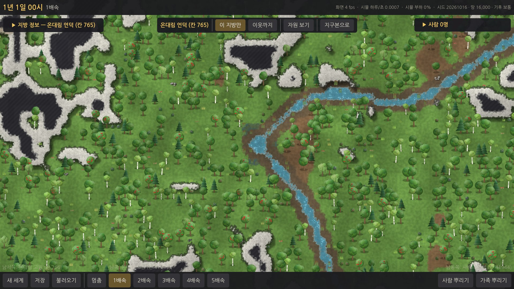
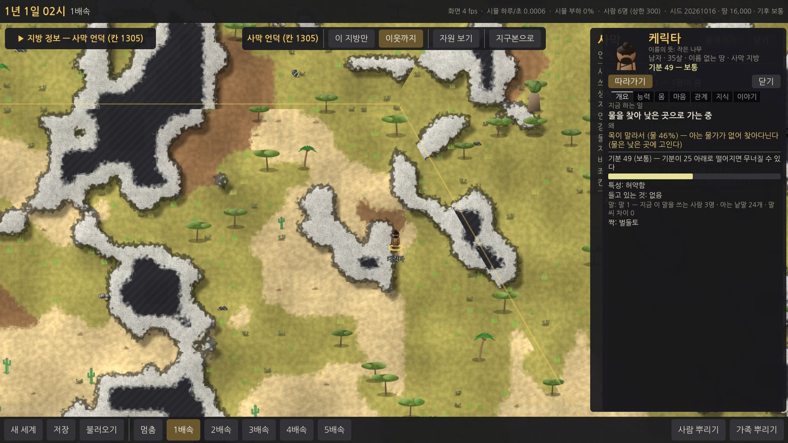
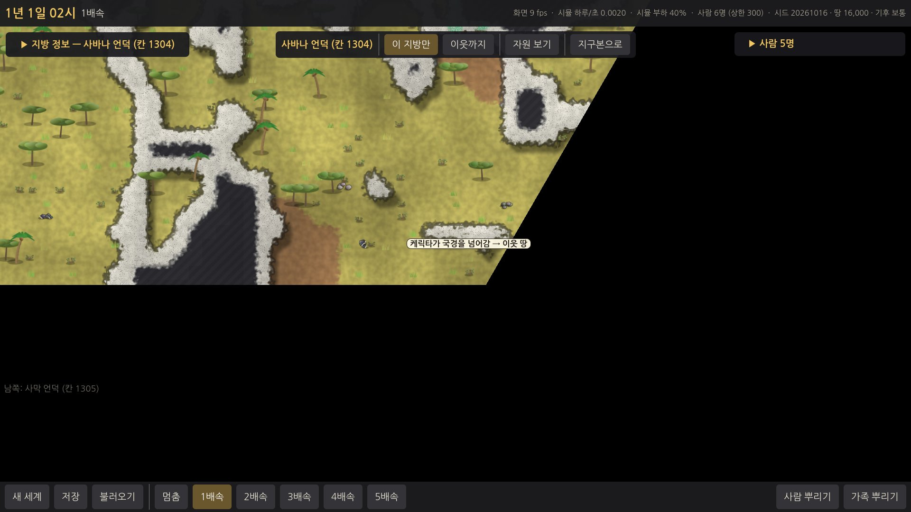
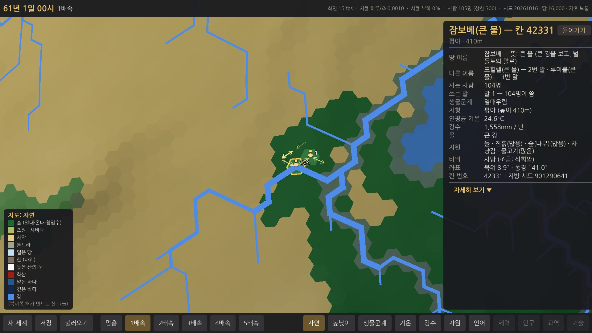
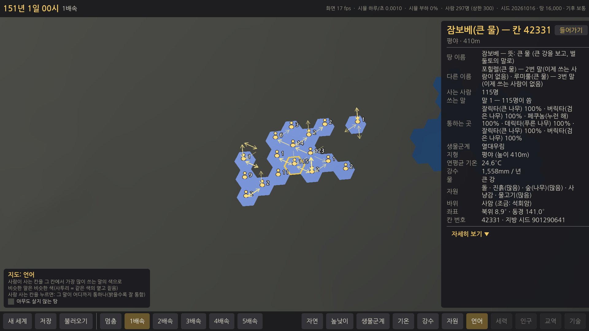
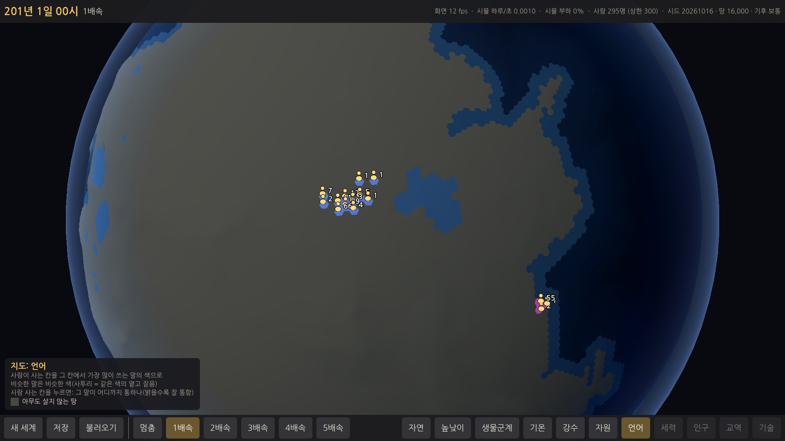
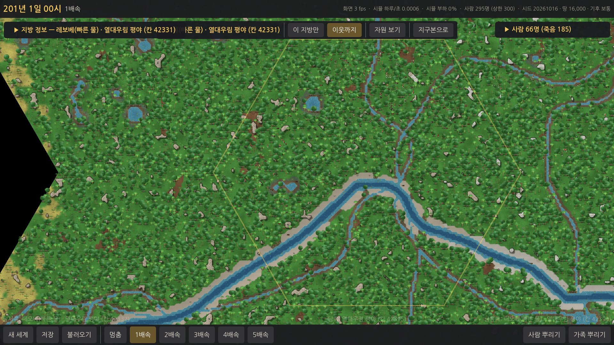
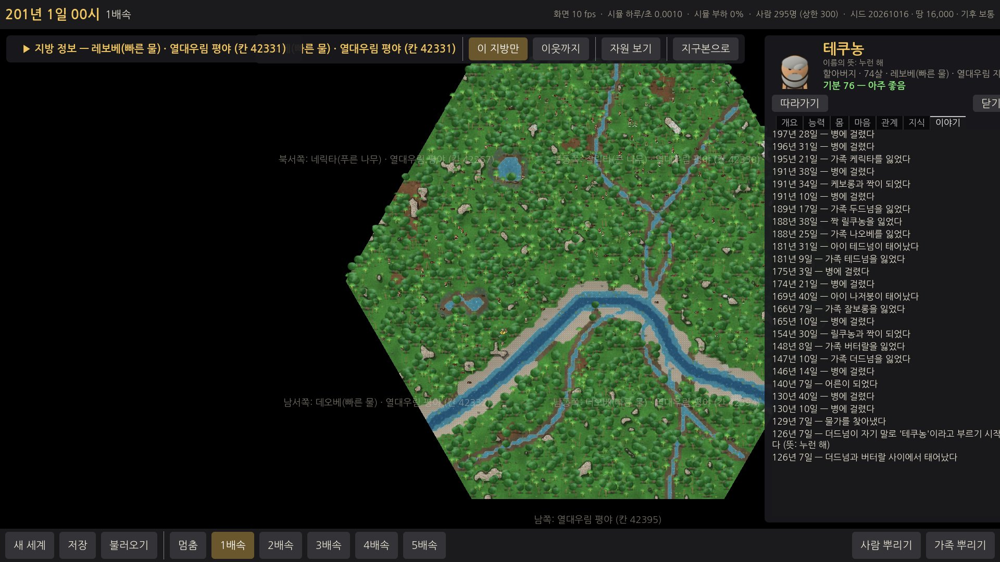

# E3b 지방 넘기 — 보고서

## 쉬운 말 다섯 줄
1. **땅마다 작은 물이 생겼습니다** — 비가 오는 땅에는 개울 · 샘 · 웅덩이 · 늪이 있고, 개울은 옆 지방과 경계에서 이어집니다. 마실 물이 있는 지방이 3% → 69% 로 늘었고, 숲 · 습한 땅은 98~100% 입니다.
2. **사람이 지방 경계를 걸어서 넘습니다.** 물 · 먹을 것이 없거나 모자라면, 짝을 찾거나 궁금하면, 혼자 남아 쓸쓸하면 옆 지방으로 갑니다. 가족은 함께 갑니다. 카드의 "지금 하는 일 — 왜"에 그대로 나옵니다("물을 찾아 낮은 쪽, 이웃 땅으로 가는 중").
3. **사람들이 행성 위로 퍼집니다** — 따뜻한 땅에 10명을 뿌리고 100년 돌리면 사람 사는 지방이 중앙값 7곳(많게는 15곳), 지구본에 옮겨 가는 방향이 노란 화살표로 보입니다. 아무 땅에나 뿌렸을 때 "물이 없어 죽은 사람"은 48% → 10% 로 줄었습니다.
4. **사람들이 땅에 이름을 붙입니다**(예: "레보베 — 빠른 물", 큰 강을 보고). 말이 다른 무리는 같은 땅을 다르게 부릅니다. 지방 제목 · 칸 정보 · 카드 · 이야기에 이름과 뜻이 나옵니다.
5. **떨어져 살면 말이 달라집니다** — 서로 만나지 않는 두 무리는 200년 뒤 알아듣기 67%, 500년 뒤 43%(목표는 60~85% · 40% 아래 — 500년 쪽은 조금 못 미침). 지구본 **[언어] 지도**에서 말마다 색이 다르고, 칸을 누르면 그 말이 어디까지 통하는지 보입니다. 다만 서로 오가는 이웃 무리는 100~200년 동안 대개 한 말을 지킵니다(아래).

## 해 볼 것
1. zip 을 풀고 `WTW` 폴더의 **`WTW.exe`** 를 실행합니다. 윈도우가 "PC 보호" 경고를 띄우면 **"추가 정보 → 실행"** 을 누르세요. (이번 판은 저장 파일 형식이 바뀌어 E3 저장 파일도 읽지만, 새 세계로 시작하는 것을 권합니다.)
2. 새 세계 → 지구본에서 **강이 없는 숲 · 초원**에 들어가 보세요 — 개울 · 샘(작은 웅덩이에서 개울이 흘러나감) · 웅덩이 · 늪이 있는지. 타일을 누르면 "얕은 물 (개울)" · "(샘)" · "(웅덩이)".
3. 한 지방에 **가족 두셋**을 뿌리고, 한 사람을 눌러 **[따라가기]** — 4~5배속으로 돌리다 그 사람이 경계를 넘으면 **카메라가 따라 이웃 지방으로** 들어가는지(위쪽 지방 이름이 바뀜).
4. 위쪽 **[이웃까지]** 를 누르면 옆 지방의 사람도 보입니다. **[이 지방만]** 일 때 사람이 경계를 넘어가면 가장자리에 **"○○가 국경을 넘어감 → …"**, 들어오면 파란 테두리로 **"○○가 들어옴"** 이 잠깐 뜹니다.
5. **물이 없는 땅(사막 · 마른 초원)** 에 사람을 뿌려 보세요 — "물을 찾아 낮은 쪽, 이웃 땅으로 가는 중"으로 경계를 넘어가는지(경계 너머 물가가 보이면 "경계 너머 보이는 물가로").
6. 5배속으로 수십 년 → 지구본으로 나와 **사람 사는 칸이 늘어나는지**, 칸 사이의 **노란 화살표**(최근 3년 동안 옮겨 간 방향).
7. 사람 사는 칸을 누르면 **땅 이름(뜻)** · 다른 무리가 부르는 이름 · 사는 사람 · 쓰는 말. 지방에 들어가면 왼쪽 위 제목과 가장자리 이웃 이름에도 이름이 나옵니다.
8. 지구본 아래 **[언어]**(U) — 사람 사는 칸이 말의 색으로 칠해집니다. 칸을 누르면 그 말이 어디까지 통하는지(밝을수록 잘 통함), 칸 정보의 **"통하는 곳"**.
9. 큰 카드의 **이야기** 슬롯 — "물을 찾아 이웃 땅 '…'로 옮겨 갔다", "머물던 땅을 '…'라고 부르기 시작했다".

---

## 한 일

### 1. 지방 안의 작은 물 (`sim/Province/ProvinceGenerator.cs` — `SmallWater`)
- **땅의 축축함** = 연 강수 × "덜 마르는 정도"(추울수록 덜 증발): 툰드라 · 침엽수림은 비가 적어도 축축하고, 더운 사바나 · 사막은 마른다. 거친 땅(산)은 물이 고이기 어렵다.
- **개울**: 땅 칸끼리 맞댄 변마다 "개울이 건너는가 · 어디서 · 어느 쪽으로"를 **두 칸의 값(번호 · 강수 · 기온 · 높이)만으로** 정한다 → 어느 쪽 지방을 먼저 만들어도 같은 자리에서 이어진다. 높은 칸에서 낮은 칸으로 흐르고, 지방 안에서는 들어온 개울을 모아 나가는 변으로 보낸다(나갈 땅 변이 없으면 바다 · 호수 쪽으로, 그것도 없으면 고여 웅덩이). 강처럼 변을 수직으로 건너고, 개울가는 조금 낮은 골짜기.
- **샘 · 웅덩이**(지방 안쪽, 변에서 14타일 이상 — 이음매에 닿지 않음): 축축할수록 많다. 웅덩이는 낮은 곳으로 흘러가 고이고, 샘은 비탈에서 솟아 낮은 쪽으로 개울을 내보낸다. 비가 많은 곳의 웅덩이 둘레는 습지, 사막의 드문 오아시스(12%) 둘레는 풀밭. 얼음 땅의 녹은 물 웅덩이는 기온이 −14°C 아래면 얼어 있다(그대로).
- 지방 지도 지문 고정값 테스트를 **일부러 고쳤다**(숲 · 강 · 해안 칸 — 오각형 칸은 그대로).
- 타일 정보에 "(개울) · (샘) · (웅덩이)", 지방 정보의 "물"에 개울 · 샘이 나온다.

### 2. 경계 넘기 (`sim/People/PeopleSim.Cross.cs`)
- **변(Border)**: 지방의 변마다 — 이웃이 땅일 때만 — "넘어가는 자리"(이 지방 가장자리의 걸을 수 있는 타일)와 "넘어가면 서는 이웃 지방의 타일"을 E2 의 `ProvinceLayout`(이웃 지방을 돌려 이어 붙이는 배치)으로 짝짓는다. 이웃 쪽이 걸을 수 없으면(바위 · 절벽 · 깊은 물) 그 자리는 없다. **바다 · 호수 쪽 변, 오각형의 막힌 변(절벽)은 넘을 수 없다.** 이웃 지도는 처음 필요할 때 만든다(지도로만 정해지는 것이라 저장하지 않음).
- **길 찾기는 나눠서**: 경계까지는 이 지방 안의 길(E3 그대로), 넘어간 뒤에는 그 지방 안의 길. 지방을 가로지르는 큰 길 찾기는 하지 않는다(값싸다).
- **넘겨주기**: 사람은 경계 타일까지 걸어가고, **6분(게임 시간)마다 정해진 "넘겨주기 시각"** 에 — 그 시각의 다른 예약을 모두 처리한 뒤 — **사람 번호 순으로 한꺼번에** 이웃 지방으로 옮겨진다(안고 있는 아기도 함께). 걸음은 넘겨주기 시각에 딱 닿도록 조금 늘린다 → 경계에서 서서 기다리지 않는다. 지방끼리 주고받는 일이 정해진 시각에만 생기므로 **E8 에서 지방마다 CPU 를 따로 돌려도 같은 결과**를 낼 수 있는 구조다(간격과 이유는 아래 "기획과 다르게").
- **멈춤과 따라잡기**: 살아 있는 사람이 없어진 지 10일이 지난 지방은 **잠든다**(무거운 것 — 걷기 지도 · 길 찾기 · 열매 목록 — 을 버리고 바뀐 것만 남김). 다시 사람이 들어오면 깨어나고, 딴 열매는 **딴 시각부터 흐른 시간만큼 한 번에 다시 열려 있다**(몫 계산이 원래 그 방식이라 따로 돌릴 것이 없다). 잠들었는지는 결과에 영향이 없다(테스트 — 깨어 있든 잠들었든 저장 내용이 같다).
- **경계 너머도 본다**: 가장자리 가까이에서는 이웃 지방의 물가도 보이는 거리(14타일)만큼 보이고 기억한다. 기억은 이제 "칸 × 타일 수 + 타일"이라 **이웃 지방의 물가 · 열매 자리도 기억**하고, 그쪽에 있으면 경계를 넘어간다.
- **저장 버전 6**: 깨어 있는 지방과 잠든 지방을 같은 모양으로(칸 번호 순), 넘겨주기 대기, 땅 이름, 말의 낱말 바뀜 수, 사람의 옮겨 가기 상태. 경계로 걸어가는 도중에 저장해도 끊김 없이 이어진다(테스트). 버전 1~5 파일도 읽는다.

### 3. 왜 옮겨 가나 — "왜"가 행동과 맞게 (`PeopleSim.Find.cs` · `PeopleSim.Move.cs`)
| 까닭 | 언제 | 카드에 |
|---|---|---|
| 물 · 먹을 것(보임) | 이 땅엔 보이는 물가가 없고 경계 너머에 보인다 | "경계 너머 보이는 물가로 — 이웃 땅으로 가는 중" |
| 물 · 먹을 것(기억) | 이 땅엔 아는 곳이 없고, 전에 본 이웃 땅의 물가 · 열매 자리가 있다 — **돌아오기** | "기억해 둔 물가가 있는 '…'로 가는 중" |
| 물 · 먹을 것(따라감) | 경계를 넘어 물 · 먹을 것을 찾아가는 사람을 따라간다 | "○○를 따라 이웃 땅으로 가는 중" |
| 물 · 먹을 것(찾아다님) | 가장자리 가까이거나 여러 번 찾아도 못 찾았으면 이웃 땅도 후보 — 물은 **더 낮은 땅**, 먹을 것은 **더 축축한 땅** 쪽. 못 찾을수록 떠나고 싶어진다. 막 떠나온 땅으로 곧바로 되돌아가는 것은 덜 좋아한다 | "물을 찾아 낮은 쪽, 이웃 땅으로 가는 중 — 이 땅에서 N번 찾아다녀도 물이 없어" |
| 먹을 것이 모자람 | 며칠째 둘레에도 기억에도 딸 것이 없다(사람이 늘어 딴 몫이 빨리 줄면 쌓인다) → **짝 · 아이와 함께** 새 땅으로(무리 안에서 모자란 집부터 떠나 일부가 떨어져 나간다) | "먹을 것이 모자라 새 땅으로 옮겨 가는 중" |
| 짝을 찾아 | 짝이 될 만한 사람이 이 땅에 없다(20일 넘게 머문 뒤 가끔) | "짝을 찾아 이웃 땅으로" |
| 호기심 | 호기심 많은 어른(어린아이가 없음)이 드물게 | "이웃 땅을 둘러보러" |
| 돌아가기 | 혼자 남아 쓸쓸하면 사람이 있던 땅으로 | "살던 땅으로 돌아가는 중" |
| 가족 따라 | 짝 · 부모가 이웃 땅에 있으면 그리로(아이는 늘) | "가족을 따라 옮겨 가는 중" |
| 정신 붕괴 | "혼자 떠나기" 중 30% 는 아예 이웃 땅으로 | "혼자 떠나 이웃 땅으로" |
- 스스로 떠나는 일(돌아가기 · 짝 찾기 · 호기심)은 한 번 떠난 뒤 15일 동안 쉰다(이리저리 오가기만 하지 않게).
- 억지로 살리지 않는다: 떠난 땅에도 물이 없으면 그대로 목말라 죽는다.

### 4. 화면 (`game/src/`)
- **따라가기 카메라가 경계를 넘는다**: 따라가던 사람이 다른 지방으로 넘어가면 밝은 범위의 가운데를 그 지방으로 옮기고 카메라는 그 사람에게 바로 붙는다(새 가운데 지방은 돌아가 있지 않은 모습이라 화면이 60° 단위로 돌 수 있다).
- **[이웃까지]**: 옆 지방의 사람도 그린다(E3 에도 있던 것 — 이제 실제로 오간다).
- **"○○가 국경을 넘어감 → 이웃 땅 '…'"** (밝은 범위 밖으로 나갈 때, 그 자리에 5초) · **"○○가 들어옴"**(파란 테두리, 밖에서 들어올 때). 조사는 받침에 맞게.
- **지구본**: 사람 사는 칸(E3) + **옮겨 가는 방향** — 최근 3년(120일) 동안 칸 → 이웃 칸으로 넘은 횟수만큼 굵고 진한 노란 화살표.
- **[언어] 지도 모드**(U): 사람 사는 칸을 그 칸에서 가장 많이 쓰는 말의 색으로 — 뿌리(가장 먼 조상 말)마다 다른 빛깔, 갈라져 나온 말(사투리)은 같은 빛깔의 옅고 짙음. 사람 사는 칸을 누르면 **그 말이 어디까지 통하나**(밝을수록 잘 통함) + 칸 정보의 "통하는 곳"(알아듣기 % 높은 순).
- **지명**: 지방 제목 · 지방 정보(맨 위 "이름" 줄과 그 이유) · 지구본 칸 정보(땅 이름 · 다른 이름 · 사는 사람 · 쓰는 말) · 가장자리 이웃 이름 · 큰 카드("레보베(빠른 물) · 열대우림 지방") · 알림 · 이야기.

### 5. 말 — 사투리의 시작과 지명 (`PeopleSim.Drift.cs` · `PeopleSim.Places.cs`)
- **갈라짐**(한 해에 한 번): 무리(같은 말을 쓰고 한 지방에 사는 사람들)마다 가끔(해마다 6%) 소리 버릇 하나가 한 칸 바뀐다 — 무리 모두가 같이(유행처럼). 같은 무리 안에서는 이야기하며 다시 닮아 가므로 무리마다 따로 흘러간다. 말을 쓰는 무리가 하나뿐이면 무리의 어긋남을 말에 굳히고(말 전체가 바뀜), **여러 무리로 떨어져 살면 어긋남이 큰 무리(3명 이상)가 새 말(사투리, `Parent` = 옛 말)로 갈라진다.** 말마다 가끔(해마다 1.9%) 낱말 하나가 새것으로 바뀐다(말마다 정해진 순서 — 갈라진 말은 다른 순서).
- **다시 닮아 감**: 다른 말을 쓰는 사람끼리 한 지방에서 여러 번 이야기하면 적은 쪽이 많은 쪽 말을 쓰게 된다(E3 규칙) → 사투리 무리가 다시 만나 함께 살면 한 말로 돌아온다(테스트).
- **지명**: 사람들이 한 지방에 5일 넘게 머물거나, 그 땅의 눈에 띄는 것(큰 강 · 화산 · 바다 · 호수 · 동굴 · 높은 산)을 보면 하루 뒤, **그 무리의 말로** 이름을 붙인다. 처음 낱말 24개로만 짓는다(새 낱말은 E4): 큰 강 = "빠른 물 / 큰 물", 바다 = "큰 물", 호수 = "푸른 물 / 흰 물", 화산 = "붉은 돌 / 검은 돌", 동굴 = "밤 돌 / 검은 돌", 높은 산 = "큰 돌 / 흰 돌". 눈에 띄는 것이 없으면 그 땅의 모습(숲 = "푸른 나무", 사막 = "누런 해" …)과 그곳에서 있었던 일(사람이 죽은 땅 = "위험 …", 아이가 태어난 땅 = "새벽 …"). 말이 다른 무리는 같은 땅을 다르게 부른다 — 화면에는 처음 이름을 붙인 무리의 이름, 다른 이름은 칸 정보에 같이(그 말을 이제 아무도 안 쓰면 "이제 쓰는 사람이 없음"). 이름 짓기는 하루 경계에서 지방 번호 순 · 말 번호 순(결정론).
- 하지 않은 것(요청대로): 새 낱말 · 빌려 오기 · 별명 · 성 · 나라 안 사투리 · 통역 · 글 · 가계도.

### 6. 테스트 (빠른 테스트 113개, 약 21초 — 새로 7개)
같은 시드 + 같은 뿌리기 → 경계를 여러 번 넘어도 같은 결과(지문) · 경계로 걸어가는 도중 저장 → 불러오기 → 계속 = 끊김 없음 · 바다 · 절벽 · 막힌 변은 못 넘음(넘어가는 자리는 양쪽 다 걸을 수 있는 땅) · 빈 지방은 잠들고, 다시 들어가면 흐른 시간만큼 열매가 열려 있음(깨어 있든 잠들었든 저장 내용 같음) · 개울이 경계에서 이어짐 · 습한 땅 85% 이상에 민물 · 400년 떨어진 무리는 말이 갈라지고(알아듣기 75% 아래), 다시 함께 이야기하면 한 말이 됨 · 지명이 그 무리의 말로 붙고 조사("…이라고 / 라고")가 맞음. E3 의 "먹을 것이 없으면 굶어 죽는다" 테스트는 "굶어 죽거나 이웃 땅으로 떠난다"로 고쳤다.

---

## 측정 결과 (클라우드 4코어 Xeon 2.1GHz)

### 작은 물 — 생물군계별 "마실 민물이 있는 지방" — [E3b/measure-water.md](E3b/measure-water.md)
시드 20개 × 무작위 땅 칸 30곳 = 600곳. "있다" = 지방에서 가장 큰 이어진 땅에 민물을 마실 자리가 하나라도.
| 생물군계 | 목표 | 결과(E3 → E3b) |
|---|---|---|
| 열대우림 · 온대림 · 침엽수림 · 습지 | 90% 이상 | 25% · 8% · 0% · – → **100% · 98% · 98% · 100%** ✅ |
| 초원 · 사바나 · 툰드라 | 절반 이상 | 10% · 0% · 0% → **74% · 84% · 99%** ✅ |
| 사막 · 고산 | 낮게 | 0% · 0% → **28% · 43%** (사막은 드문 오아시스 + 이웃에서 흘러드는 개울) |
| 얼음 땅 | — | 0% → 37% (녹은 물 웅덩이, 아주 추운 곳은 얼어 있음) |
| 모두 | | **3% → 69%** |
(E3 쪽 숫자는 같은 도구로 시드 8개 × 30곳을 잰 것.)

### 아무 땅에나 뿌림 — E3 와 같은 조건(시드 20 × 5곳 × 5명 × 3년) — [E3b/measure-nosource.md](E3b/measure-nosource.md)
| | E3 | E3b |
|---|---|---|
| 고른 땅 100곳 중 닿을 수 있는 곳에 민물이 없는 땅 | 90곳 | **43곳** |
| 죽음(뿌린 500명 중) | 444명 — 목마름 239 · 추위 200 · 굶주림 5 | **284명** — 목마름 71 · 추위 212 · 굶주림 1 |
| **지방 안에 물이 없어서 죽은 사람** | 239명(48%) | **48명(9.6%)** |
| **옮겨 가서 산 사람**(처음 뿌린 사람 중 끝에 다른 지방에서 살아 있음) | 0 | **69명** |
| 물 없는 땅에 뿌린 사람 중 살아 남은 사람 | – | 215명 중 36명 |
| 찾아간 방법 | 보임 14% · 기억 3% · 찾아다님 82% | 보임 61% · 기억 12% · 따라감 0% · 찾아다님 25% |
- 남은 죽음의 대부분은 **추위**(툰드라 · 얼음 · 고산 — 불 · 옷이 없음, E4)이다.
- 경계를 넘은 횟수가 많다(시드마다 3년에 약 2,000번): 물 없는 땅의 경계 가까이 사는 사람이 **이쪽 열매와 저쪽 물을 오가며** 산다(기억한 물가 · 열매 자리로). 알맞은 행동이지만 횟수는 많다 — 아래 속도에 포함.

### 퍼져 나가기 — 시드 20 × 따뜻한 땅에 10명 × 100년 — [E3b/measure-spread.md](E3b/measure-spread.md)
| | 결과(중앙값) |
|---|---|
| 사람 사는 지방(100년 뒤) | **7곳**(1~15곳) |
| 한 번이라도 사람이 산 지방 | 23곳 |
| 가장 멀리 간 거리 | **5칸**(처음 땅에서) |
| 인구 | 10 → **180.5명**, 멸종 1/20(온대림 시드 하나 — 목마름 16명) |
| 경계를 넘은 횟수 | 1,605번 |
| 죽음 원인(890명) | 늙음 92% · 목마름 7% · 굶주림 0% (지방에 물이 없어 죽은 사람 38명) |
| 떠나기로 한 까닭(20 시드 합, 물 · 먹을 것 찾아 넘은 것은 빼고) | 가족 따라 4,613 · 돌아감 4,051 · 짝을 찾아 2,267 · 정신 붕괴 1,062 · 호기심 693 · **먹을 것이 모자라 527** |
| 쓰는 말 · 이름 붙은 땅 | 말 **1개**(1~3개) · 땅 이름 22곳 |
- 퍼지는 것은 주로 **혼자 사는 어른이 짝을 찾아 · 궁금해서 떠났다가 쓸쓸해 돌아오는** 오감과, 먹을 것이 모자란 집이 떠나는 것. 한 지방이 먹여 살릴 수 있는 사람이 많아(하루 50~160명분) 100년 안에는 "먹을 것이 모자라 떠남"이 적다.
- 말: 퍼진 무리는 서로 자주 오가서(경계 넘기 중앙값 1,605번) **100년 동안 거의 한 말**을 지킨다(가장 낮은 지방 사이 알아듣기 80~100%). 사투리가 생긴 시드도 몇 있다(말 2~3개).

### 떨어져 산 두 무리의 말 — 시드 20 × 무리마다 가족 3집 × 500년 — [E3b/measure-dialect.md](E3b/measure-dialect.md)
서로 절대 만나지 않게 **같은 시드의 세계 두 벌**에 한 무리씩(같은 행성, 12칸 넘게 떨어진 따뜻한 땅 두 곳), 처음에 같은 말로 맞춘 것만 실험 준비이고 나머지는 그대로 돌렸다(무리마다 상한 60).
| | 목표 | 결과(두 무리 사이 알아듣기, 중앙값) |
|---|---|---|
| 50년 · 100년 · 150년 | | 91% · 82% · 76% |
| **200년** | 60~85%(사투리) | **67%** ✅ |
| 300년 · 400년 | | 58% · 49% |
| **500년** | 40% 아래(다른 언어) | **43%** ❌(조금 못 미침 — 19 시드 중 7개는 40% 이하) |
| 무리 안(같은 말을 쓰는 사람끼리) | | 96~99% |
- 숫자(소리 버릇 해마다 6% · 낱말 바뀜 해마다 1.9% · 갈라짐 어긋남 5)는 먼저 모형(`people driftmodel`)과 시드 4개로 골랐다(그때 200년 68% · 500년 38%). 20 시드로는 500년이 43% 로 목표에 조금 못 미쳤고, **억지로 맞추지 않고 그대로 둔다.** 낱말 바뀜을 조금 빠르게(해마다 2.3% 쯤) 하면 맞출 수 있을 것으로 보이지만 200년 쪽도 같이 내려간다 — 숫자 튜닝(T 단계)에서 정할 것.
- 시드 4 는 한 무리가 처음 몇 해 안에 사라져 비교하지 못했다.

### 속도 · 메모리 — 사람 300명이 지방 20곳에 흩어져 100년 (기획서 18절)
[E3b/measure-cap.md](E3b/measure-cap.md)
| 측정 | E3(한 지방씩 25곳, 경계 넘기 없음) | E3b |
|---|---|---|
| 한 시드 시간 | 188초 | **265초** |
| 사람 하루당 비용 | 177µs | **245µs** |
| 300명이 100년 내내 산다면 | 212초 | 294초 |
| 메모리(관리 힙 최대 · 프로세스) | 192MB · 254MB | **249MB · 490MB** |
| 끝에 깨어 있는 지방 · 잠든 지방 | – | 52곳 · 232곳(사람 사는 지방 44곳) |
| **지방끼리 주고받는 양**(E8 을 위해) | – | 경계를 넘은 사람 10,878번 = **하루 2.7번**, 넘겨주기가 실제로 일어난 시각 하루 2.6번(6분 간격 240번 중) · 잠든 지방이 깨어남 2,619번 |
- 비용이 늘어난 까닭: 경계 너머 보기 · 이웃 지방 지도 만들기(처음 한 번) · 잠든 지방 깨우기 · 하루 경계의 지명 · 말 셈. 지방이 많이 열려도 **잠든 지방은 바뀐 것만 남기므로** 메모리가 끝없이 늘지는 않는다 — 깨어 있는 지방(사람 사는 곳 + 비고 10일 안 된 곳)만큼 늘고, 지도는 최근 64장만 기억한다. 다만 프로세스 메모리가 254 → 490MB 로 늘었다(깨어 있는 지방 52곳 × 지방마다 약 2MB + 지도 기억).
- 게임 중 부담: 5배속(하루 0.4초)에 300명이면 1초에 사람 하루 750개 × 245µs ≈ 0.18초 → 시뮬 스레드 18%. 속도는 E8(지방마다 CPU)에서.

---

## 스크린샷 (`docs/reports/E3b/`)
- 개울 · 샘이 있는 지방(강이 없는 온대림 언덕): 
- 경계를 넘는 사람 — [따라가기]로 이웃 지방까지 카메라가 따라감, 카드의 "물을 찾아 …": 
- [이 지방만]에서 경계를 넘어갈 때 "○○가 국경을 넘어감 → 이웃 땅": 
- 60년 뒤 지구본 — 칸 정보의 땅 이름(뜻) · 다른 무리의 이름 · 사람 수 · 쓰는 말, 옮겨 가는 화살표: 
- 150년 뒤 퍼진 사람 칸 17곳([언어] 지도, 고른 칸의 "통하는 곳"): 
- [언어] 지도 — 멀리 떨어져 산 두 무리(200년)의 말이 다른 색: 
- [이웃까지] — 가장자리 이웃 이름에 땅 이름: 
- 큰 카드의 이야기("…이 자기 말로 '테쿠농'이라고 …"): 

## 기획과 다르게 한 것 / 이유
1. **넘겨주기 간격은 6분(게임 시간)** — 기획서 5-5 는 "하루 경계에서만 주고받기", 프롬프트는 "예: 1시간"을 허용. 1시간이면 걸음을 그만큼 늘려야 해서 경계 앞에서 눈에 띄게 느려지거나 서 있게 된다. 6분이면 사람이 한 번에 20타일쯤 걷는 시간이라 걸음을 늘린 티가 거의 나지 않는다. E8 에서 지방마다 CPU 를 쓸 때는 6분마다 한 번 맞춰야 한다(하루 240번) — 맞추는 비용이 크면 간격을 늘리고 걸음 늘리기를 크게 하는 쪽으로 바꿀 수 있다.
2. **지방끼리 주고받는 것이 넘겨주기 말고도 남아 있다**(E8 에서 정리할 것): 가족 · 짝을 번호로 찾아보기(같은 지방인지 확인하고 쓰지만 읽기는 함), 말 표(갈라짐 · 배우기 — 한 해 한 번 · 이야기할 때), 땅 이름 표(하루 경계), "그 말을 쓰는 사람 수" 세기. 모두 결정론적인 순서로만 돌지만, CPU 를 나누려면 이것들도 정해진 시각에 묶어야 한다.
3. **말의 갈라짐에 "낱말이 새것으로 바뀜"을 더했다**: 소리 버릇만 흘러가게 하면(모형 측정) 500년 뒤에도 알아듣기가 60% 근처에 머물러 "500년이면 다른 언어(40% 아래)"를 맞출 수 없었다. 실제 말도 소리가 바뀌는 것과 함께 낱말이 통째로 바뀐다. 말마다 해마다 1.9% 확률로 기본 낱말 하나가 바뀐다. ("새 낱말 · 빌려 오기"(E4)와는 다르다 — 뜻은 그대로, 낱말만 새것.)
4. **지명은 처음 낱말 24개로만** 짓는다(강 · 바다 · 산 같은 낱말이 아직 없어서 "빠른 물" · "큰 물" · "큰 돌"로). 카드 · 칸 정보에는 "큰 강을 보고"처럼 이유를 쉬운 말로 같이 적는다.
5. **사람은 이웃 지방 하나 너머까지는 모른다**: 기억 · 돌아가기는 바로 붙은 지방까지만. 두 지방 넘게 떨어진 곳은 E8 의 "먼 여정"에서.
6. **잠드는 데 10일을 기다린다**: 사람이 곧 되돌아오는 일이 많아(물을 마시러 갔다 오기 등) 바로 재우면 다시 깨우는 비용(지도 만들기)이 컸다. 결과에는 영향이 없다.
7. 지방 지도 지문 고정값 테스트를 고쳤다(작은 물 때문 — 프롬프트대로).

## 알려진 문제 · 다음 단계에 넘길 것
- **500년 떨어져 산 무리의 알아듣기 43%** — 목표(40% 아래)에 조금 못 미친다(위). 숫자 튜닝에서.
- **메모리가 늘었다**(300명 · 100년: 프로세스 254 → 490MB) — 깨어 있는 지방이 많을 때. 비고 10일 기다리기를 줄이거나 깨어 있는 지방의 길 찾기 버퍼를 나눠 쓰면 줄일 수 있다.
- **이웃끼리 오가는 무리는 100~200년 동안 대개 한 말**이다(퍼져 나가기 측정). 떨어져 사는 무리의 갈라짐 속도는 목표에 맞췄지만, "같은 무리가 넓게 퍼져 가장자리부터 사투리가 생기는" 모습은 드물다. 오가는 사람이 많을수록 말이 하나로 섞이는 지금 규칙의 결과다 — 숫자 튜닝(T 단계)이나 E7(나라 안 사투리)에서 볼 것.
- **경계 넘기 횟수가 많다**: 혼자 사는 어른이 짝을 찾아 떠났다 쓸쓸해 돌아오기를 되풀이하고, 물 없는 땅 가장자리 사람은 물과 열매 사이를 오간다. 행동은 맞지만 비용(지방 깨우기 · 지도 만들기)이 든다. 사람 하루당 비용이 E3 의 165µs 에서 약 210µs 로 늘었다.
- **[언어] 지도의 굵은 경계선**(기획서 14-1 "크게 갈리는 곳에 굵은 경계")은 아직 없다 — 색 차이로만.
- 따라가기로 경계를 넘으면 새 가운데 지방 모습으로 바뀌며 화면이 60° 단위로 돌 수 있다.
- 지구본의 옮겨 가는 화살표는 최근 400번의 넘기만 기억한다(사람이 많으면 3년이 안 될 수 있음).
- 같은 낱말 이름이 다른 말의 다른 땅에 겹칠 수 있다(같은 말 안에서는 겹치지 않게 다시 짓는다).
- 사막 · 고산의 민물 비율(28% · 43%)은 "낮게"이지만 0 에 가깝지는 않다 — 이웃에서 흘러드는 개울 때문.
- 먹을 것이 모자라 떠나는 일은 100년 안에는 적다(지방 하나가 먹여 살리는 사람이 많음) → E4 "굶주린 세계"에서 다시 볼 것.
